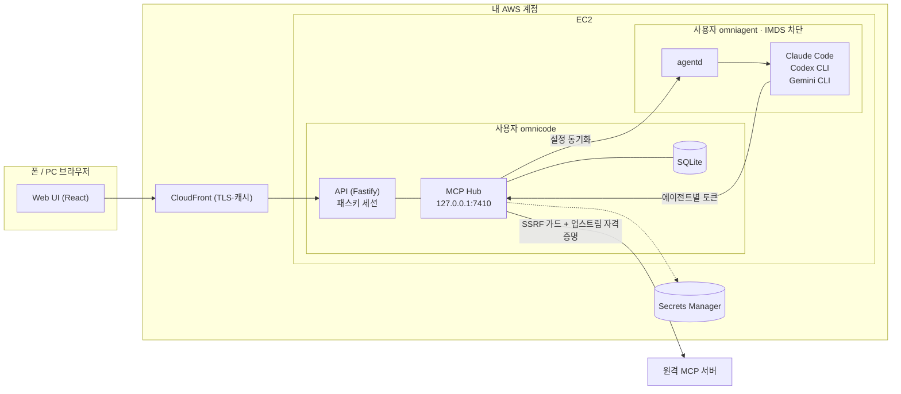

# OmniCode

**MCP 서버를 한 번 등록하면 Claude Code · Codex CLI · Gemini CLI가 함께 쓰는, 셀프 호스팅 MCP Hub.**
폰 브라우저에서 서버를 추가하고 OAuth 로그인까지 끝낸다. 업스트림 자격증명은 에이전트에게 절대 닿지 않는다.

> **In short (EN).** OmniCode is a self-hosted workspace that runs the official coding-agent CLIs on your own AWS account. Its first feature is an **MCP Hub**: register an MCP server once from your phone, finish its OAuth login in the browser, and Claude Code, Codex CLI and Gemini CLI all get it through a local endpoint. The hub is the only MCP client that talks to upstream servers, so tokens and API keys never reach the agents, which are treated as untrusted. It bridges two MCP protocol generations (2025-11-25 sessions and the stateless 2026-07-28 revision), implements OAuth 2.1 for MCP (CIMD/DCR, PKCE, RFC 9207 `iss`), and uses passkey-only login. TypeScript, ~17k lines of source, 674 tests.

<p>
<a href="https://github.com/minBuild/omnicode/actions/workflows/ci.yml"></a>


</p>

---

## 왜 만들었나

코딩 에이전트에 MCP 서버를 붙이는 일은 생각보다 번거롭고 위험하다.

| 문제 | 실제로 겪는 일 |
|---|---|
| 설정 형식이 CLI마다 다르다 | Claude Code는 `~/.claude.json`, Codex는 TOML, Gemini는 필드 이름이 다른 JSON. 같은 서버를 세 번 등록한다 |
| 헤드리스 서버에서 OAuth가 안 된다 | CLI의 OAuth는 `localhost` 콜백을 기다린다. EC2에는 브라우저가 없고, 폰 브라우저는 EC2의 `localhost`에 닿지 않는다 |
| 비밀값이 흩어진다 | API 키가 여러 설정 파일에 평문으로 남는다 |
| 에이전트 자체가 공격 표면이다 | 에이전트는 업스트림이 돌려준 텍스트를 읽고 셸 명령을 실행한다. 자격증명이 에이전트 손에 닿으면 악성 서버 하나가 나머지 토큰을 모두 빼낼 수 있다 |

## 무엇을 하나

- **화면에서 MCP 서버 추가** — URL, 프리셋, README의 `mcpServers` JSON 붙여넣기, MCP Registry 검색.
- **폰에서 OAuth 로그인 완료** — 리다이렉트를 OmniCode 도메인으로 받으므로 서버에 브라우저가 필요 없다.
- **한 번 등록, 세 CLI에 반영** — Hub가 각 CLI 설정 파일에 로컬 주소(`http://127.0.0.1:7410/mcp/<id>`)만 써 넣는다. 사용자가 직접 넣은 다른 항목은 바이트 단위로 보존한다.
- **도구 승인과 변경 감지** — 노출 전에 도구 목록을 승인받고, 업스트림이 도구 설명을 몰래 바꾸면(rug pull) 그 도구만 재승인 전까지 막는다.
- **호출 기록** — 어떤 에이전트가 어떤 도구를 언제 호출했는지 남긴다. 인자 원문과 토큰은 남기지 않는다.
- **패스키 로그인** — 비밀번호 없이 WebAuthn만 쓴다. 토큰 재발급 같은 고위험 작업은 5분 안의 패스키 재인증을 요구한다.

## 구조



- **Hub가 유일한 MCP 클라이언트다.** OAuth, API 키 주입, 도구 필터, 감사 로그를 한곳에서 처리한다.
- **에이전트는 신뢰하지 않는다.** Hub·API와 에이전트를 다른 Unix 사용자로 나누고, 에이전트 쪽에서는 EC2 인스턴스 메타데이터(IMDS)에 접근하지 못하게 막는다. 에이전트가 할 수 있는 최대치는 "자기에게 허용된 서버의 승인된 도구를 Hub를 통해 호출"하는 것이다.
- **에이전트마다 토큰이 다르다.** Hub는 호출자를 식별해 서버별 노출 설정(바인딩)을 실제로 강제한다.

## 기술적으로 다룬 문제

| 주제 | 내용 | 코드 |
|---|---|---|
| **MCP 프로토콜 세대 브리징** | 세션 기반 2025-11-25와 무상태 2026-07-28을 양쪽에서 함께 다룬다. 공식 SDK가 아직 2026-07-28을 지원하지 않아 무상태 클라이언트(필수 헤더, `_meta`, SSE 응답, `subscriptions/listen`, Multi Round-Trip Requests)를 직접 구현했다 | [`hub/src/upstream`](packages/hub/src/upstream) |
| **MCP용 OAuth 2.1** | Protected Resource Metadata 탐색, 클라이언트 등록 우선순위(사전 등록 → CIMD → DCR → 직접 입력), PKCE, RFC 8707 `resource`, RFC 9207 `iss` 검증(mix-up 방어), refresh 단일 비행, scope step-up | [`hub/src/oauth`](packages/hub/src/oauth) |
| **SSRF 방어** | 업스트림이 준 모든 URL을 한 함수로만 내보낸다. DNS 결과를 고정해 rebinding을 막고, 리다이렉트를 단계마다 다시 검사하고, IPv4-mapped·NAT64 우회 표기까지 차단한다 | [`hub/src/net`](packages/hub/src/net) |
| **요청 단위 로그 귀속** | SDK는 업스트림 로그가 어느 요청의 것인지 알려주지 않는다. 요청을 `AsyncLocalStorage` 문맥 안에서 보내 응답 스트림의 로그를 정확히 그 호출에만 전달하고, 넘기기 전에 비밀값을 마스킹한다 | [`legacy.ts`](packages/hub/src/upstream/legacy.ts) |
| **도구 정의 변조 방어** | 승인 시점의 도구 정의를 RFC 8785(JCS)로 정규화해 해시하고, 달라진 도구만 막는다 | [`shared/src/canonical.ts`](packages/shared/src/canonical.ts) |
| **설정 파일 안전 편집** | 세 CLI의 설정 파일에서 Hub 항목만 바꾸고 주석·형식·다른 항목을 보존한다. 임시 파일 후 `rename`, 적용 뒤 다시 읽어 확인한다 | [`agentd/src/adapters`](packages/agentd/src/adapters) |
| **패스키 인증** | 단일 사용자용 WebAuthn 로그인, 서버는 세션 토큰의 해시만 저장, 고위험 작업은 재인증, 요청 위조 방어(Origin·Sec-Fetch-Site) | [`api/src/auth`](packages/api/src/auth) |

## 테스트

674개 테스트가 실제 프로토콜 동작을 검증한다. 목(mock)으로 끝내지 않고 가짜 서버를 실제로 띄운다.

- **가짜 MCP 서버 2세대** — SDK 기반 레거시 서버(Streamable HTTP, HTTP+SSE)와 직접 작성한 2026-07-28 서버로 세대 감지, 타임아웃, 취소, 재연결, 구독을 검증한다.
- **가짜 OAuth 인가 서버** — PKCE, `iss`, CIMD·DCR, refresh 회전, 동시 refresh가 정확히 한 번만 나가는지를 확인한다.
- **소프트웨어 패스키 인증기** — ES256 키로 실제 WebAuthn 등록·서명 응답을 만들어 서버 검증을 통과시킨다.
- **SSRF 우회 말뭉치** — 57개 차단 URL과 DNS rebinding 시나리오.
- **화면 DOM 테스트** — jsdom과 Testing Library로 승인, 삭제 확인, 재인증 창, JSON 붙여넣기, 레지스트리 검색을 확인한다.

```bash
npm install
npx tsc -b          # 타입 검사·빌드
npx vitest run      # 55개 파일, 674개 테스트
```

## 빠르게 실행해 보기 (AWS 없이)

요구 사항: Node.js 22.13 이상 (`node:sqlite` 내장).

```bash
npm install && npm run build && npm run build --workspace @omnicode/web

export OMNICODE_SECRETS_BACKEND=memory OMNICODE_DATA_DIR=/tmp/omnicode-dev \
       OMNICODE_AGENTD_SOCKET=/tmp/omnicode-agentd.sock OMNICODE_MCP_ALLOW_HTTP_LOOPBACK=1 \
       OMNICODE_AUTH_MODE=session OMNICODE_PUBLIC_URL=http://localhost:8080
mkdir -p /tmp/omnicode-home
HOME=/tmp/omnicode-home node packages/agentd/dist/main.js &   # agentd 는 이 HOME 의 CLI 설정을 편집한다 (실제 HOME 보호)
node packages/api/dist/main.js &
cat /tmp/omnicode-dev/setup-token   # 첫 패스키 등록용 1회 토큰 → http://localhost:8080/setup
```

패스키 없이 둘러보려면 `OMNICODE_AUTH_MODE=dev`와 `OMNICODE_DEV_TOKEN=<16자 이상>`으로 띄우고 로그인 화면에 그 토큰을 넣는다. 환경변수 전체 목록은 [`.env.example`](.env.example).

## 내 AWS 계정에 배포

1. [`infra/local/`](infra/local/README.md)에 실제 값이 든 설정을 둔다 (`omnicode.env`, IAM 정책, CloudFront 설정 등). 이 폴더는 git에 올라가지 않는다.
2. EC2에서 [`infra/install/mcp-feature.sh`](infra/install/mcp-feature.sh)로 사용자·systemd·iptables·IMDSv2를 설정한다.
3. [`infra/bin/omnicode-deploy`](infra/bin/omnicode-deploy)로 빌드하고 서비스를 재시작한다.
4. CloudFront는 [`infra/cloudfront/README.md`](infra/cloudfront/README.md)대로 둔다. 엣지에서 인증하지 않는다.
5. `sudo cat /var/lib/omnicode/setup-token`으로 토큰을 읽어 `<공개 URL>/setup`에서 첫 패스키를 등록한다.

## 저장소 구조

```
packages/
  shared/   공용 타입·zod 스키마·오류 코드·JCS 해시·마스킹
  hub/      MCP Hub — 업스트림 커넥터, OAuth, SSRF 가드, SQLite 레지스트리, 에이전트용 MCP 서버
  agentd/   omniagent 데몬 — CLI 설정 파일·토큰 파일 편집 (systemd 소켓 활성화)
  api/      Fastify API, 패스키 인증, OAuth 콜백, CIMD 문서
  web/      Vite + React 모바일 우선 화면
  tools/    Claude Code headersHelper
presets/    기여 가능한 MCP 서버 프리셋 (스키마 검증)
infra/      systemd·iptables·백업·설치·배포 스크립트, IAM 정책, CloudFront 문서
docs/       설계문서와 남은 작업
```

## 문서

| 문서 | 내용 |
|---|---|
| [설계 0001 — MCP 화면 관리](docs/design/0001-mcp-management.md) | 위협 모델, 프로토콜 동작, 데이터 모델, API, 보안, 운영, 결정 기록 27개 |
| [설계 0002 — 로그인과 재인증](docs/design/0002-auth.md) | 패스키 전용 인증, 세션 규칙, 복구 |
| [설계 0003 — AWS 작업 공간](docs/design/0003-aws-workspace.md) | 본체 배포(Terraform, CloudFront VPC 오리진), 영상 편집 PC(DCV), iOS 빌드(Xcode Cloud) |
| [남은 작업](docs/handoff/0001-mcp-remaining-work.md) | 항목별 진행 현황, 실제 환경 검증 목록 |

## 현재 상태

- **완료:** 설계문서의 Phase 1과 Phase 2 일부(JSON 붙여넣기, 리소스 구독), Phase 3 일부(레지스트리 검색). 로컬·통합 테스트와 빌드한 서버의 패스키 로그인 흐름까지 확인했다.
- **진행 전:** 실제 EC2와 세 CLI, 폰을 이용한 검증(설계 19.1 Phase 0)과 배포. stdio MCP 서버를 컨테이너에서 격리 실행하는 기능은 설계 제안까지만 있다.

## 라이선스

[MIT](LICENSE)
