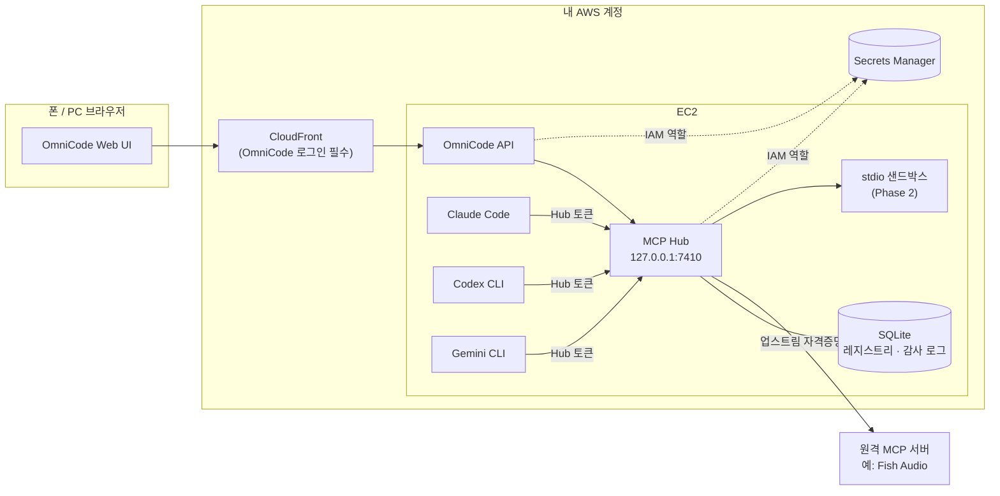
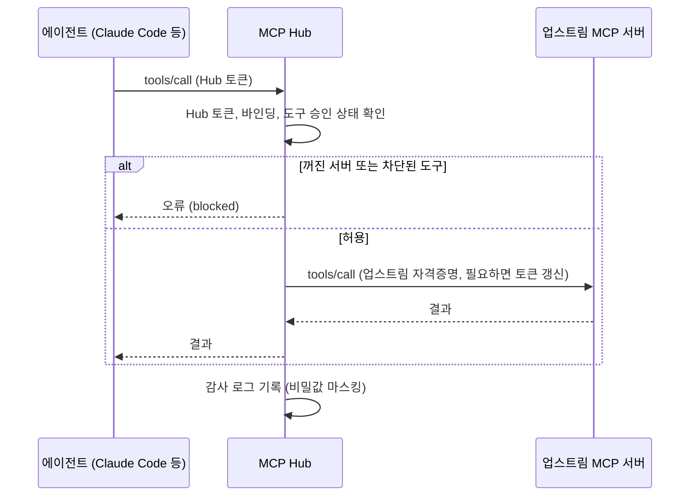
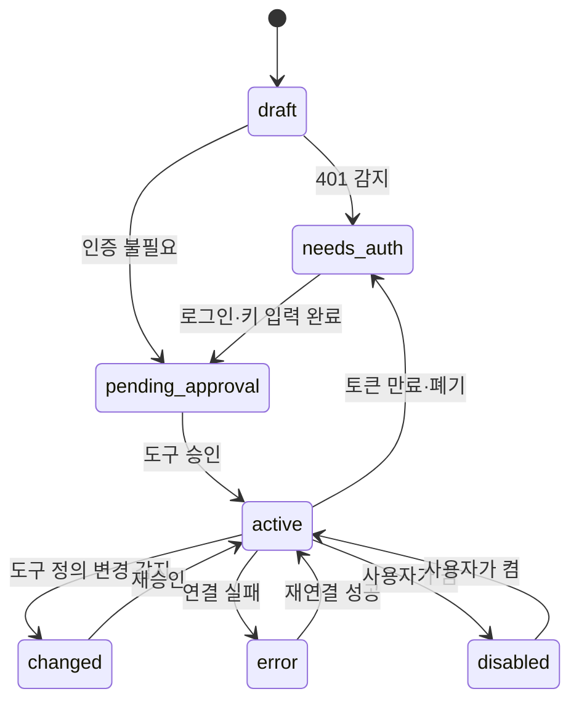
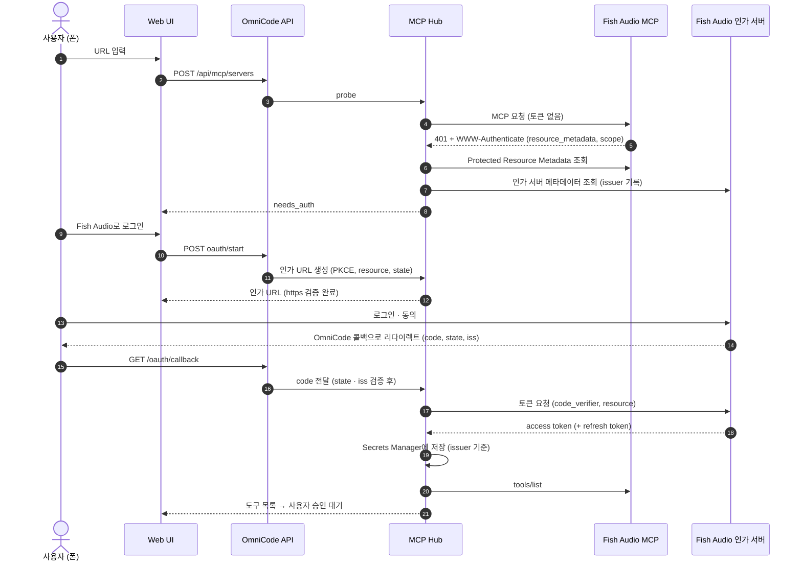

# 0001. 화면에서 MCP 서버 추가·관리하기

| 항목 | 내용 |
|---|---|
| 상태 | 초안 (Draft) — 리뷰 대기 |
| 작성일 | 2026-10-07 |
| 작성 | @minBuild (초안 작성: Claude) |
| 대상 MCP 스펙 | 2026-07-28 (이전 버전 서버·클라이언트와 호환 유지) |
| 전제 | OmniCode 배포 1개 = 사용자 1명 (각자 자기 AWS 계정에 설치) |

---

## 1. 요약

OmniCode 웹 화면에서 MCP 서버를 URL·프리셋·JSON으로 추가하면, **한 번 등록하고 한 번 로그인하는 것으로 Claude Code·Codex CLI·Gemini CLI가 모두 그 서버를 쓸 수 있게** 한다.

핵심 결정은 EC2 안에 **MCP Hub**(로컬 MCP 게이트웨이)를 두는 것이다.

- Hub가 업스트림 MCP 서버에 연결하는 **유일한 MCP 클라이언트**가 되어 OAuth 로그인, API 키 주입, stdio 실행을 한곳에서 처리한다.
- 각 CLI에는 `http://127.0.0.1:7410/mcp/<id>` 형태의 **로컬 주소만** 등록한다. 업스트림 자격증명은 CLI 설정 파일에 들어가지 않는다.
- OAuth 리다이렉트를 OmniCode 도메인으로 받기 때문에, 서버에 브라우저가 없어도 **폰에서 로그인까지 끝난다.**

---

## 2. 배경

OmniCode는 각자 자기 AWS 계정(CloudFront + EC2 + Secrets Manager)에 설치해서 쓰는 오픈소스 개인 작업 환경이다. EC2에서 공식 CLI(Claude Code, Codex CLI, Gemini CLI)를 실행하고, 폰이나 PC 브라우저에서 작업을 이어간다.

MCP 서버를 CLI마다 따로 붙이면 세 가지 문제가 생긴다.

1. **설정 형식이 제각각이다.** Claude Code는 `~/.claude.json`(JSON), Codex CLI는 `~/.codex/config.toml`(TOML), Gemini CLI는 `~/.gemini/settings.json`(JSON, 필드 이름이 다름)을 쓴다.
2. **헤드리스 서버에서 OAuth가 불편하다.** CLI의 OAuth는 대부분 `localhost` 콜백을 기다리는데, EC2에는 브라우저가 없고 폰 브라우저는 EC2의 `localhost`에 닿지 않는다. Gemini CLI 문서는 헤드리스 환경의 OAuth를 지원하지 않는다고 적고 있고, Claude Code는 `claude mcp login <name> --no-browser`로 URL을 출력한 뒤 콜백 URL을 붙여넣는 방식을 제공하지만 폰에서 하기엔 번거롭다.
3. **비밀값이 흩어진다.** API 키가 여러 CLI 설정 파일에 평문으로 남는다.

---

## 3. 목표 / 비목표

### 목표

- **G1.** 폰·PC 화면에서 MCP 서버를 추가·수정·삭제·일시중지할 수 있다.
- **G2.** 한 번 등록하면 선택한 에이전트(Claude Code / Codex CLI / Gemini CLI) 모두에 반영된다.
- **G3.** OAuth 로그인이 필요한 원격 서버도 화면 안에서 로그인까지 끝난다.
- **G4.** 비밀값(API 키, OAuth 토큰)은 Secrets Manager에만 있고, 레포·CLI 설정·로그에 남지 않는다.
- **G5.** 추가 전에 도구 목록을 보여주고 승인받으며, 도구 단위로 끄고 켤 수 있다.
- **G6.** 어떤 에이전트가 어떤 도구를 언제 호출했는지 기록을 볼 수 있다.

### 비목표

- 여러 사용자가 한 배포를 공유하는 멀티테넌트 운영
- 에이전트 자체의 로그인(Claude·ChatGPT 계정 등) 관리 — 각 공식 CLI의 로그인 흐름을 그대로 쓴다
- MCP 서버를 다른 사람에게 호스팅·재판매
- 공개 마켓플레이스 운영

---

## 4. 용어

| 용어 | 뜻 |
|---|---|
| 업스트림 서버 | 사용자가 추가한 실제 MCP 서버 (예: Fish Audio) |
| MCP Hub | EC2 안에서 업스트림 서버에 대신 연결하고, CLI에는 로컬 MCP 서버로 보이는 OmniCode 구성 요소 |
| 에이전트 | OmniCode가 실행하는 공식 CLI: Claude Code, Codex CLI, Gemini CLI |
| 바인딩 | 서버를 어떤 에이전트에 노출할지에 대한 설정 |
| Hub 토큰 | 에이전트가 Hub에 접속할 때 쓰는 로컬 전용 bearer 토큰 |
| 동기화 어댑터 | 각 CLI 설정 파일에 Hub 주소를 등록·삭제하는 모듈 |

---

## 5. 사용자 시나리오

**S1. Fish Audio 추가 (원격 서버 + OAuth)**

1. 출근길에 폰으로 OmniCode → MCP → **[+ 추가]** → `https://api.fish.audio/mcp` 붙여넣기
2. Hub가 서버를 확인하고 "로그인 필요"를 표시 → **[Fish Audio로 로그인]**
3. Fish Audio 로그인·동의 후 OmniCode로 돌아오면 도구 목록(음성 생성, 보이스 검색, 음성 인식 등)이 보인다 → **[승인]**
4. Claude Code·Codex 토글을 켜고 저장
5. 다음 Claude 작업에서 "이 대본으로 내레이션 만들어줘"가 동작하고, 생성된 오디오는 URL로 돌아온다

**S2. API 키 방식 서버 추가** — URL과 헤더 이름·키를 입력하면 키는 Secrets Manager에 저장되고, 화면에는 다시 표시되지 않는다.

**S3. README의 JSON 붙여넣기 (stdio, Phase 2)** — `mcpServers` 블록을 붙여넣으면 실행될 명령 전체가 경고와 함께 표시되고, 재인증 후 승인하면 샌드박스 안에서 실행된다.

**S4. 도구 변경 감지** — 업스트림 서버가 업데이트로 도구 설명을 바꾸면 해당 서버는 "변경 감지" 상태가 되고, 재승인 전까지 바뀐 도구는 에이전트에 노출되지 않는다.

---

## 6. 설계 개요

### 6.1 대안 비교

| | A. CLI 설정 직접 동기화 | **B. MCP Hub (채택)** |
|---|---|---|
| 구조 | 화면에서 받은 설정을 CLI 3개의 설정 파일에 각각 씀 | Hub가 업스트림에 연결하고, CLI에는 Hub 로컬 주소만 등록 |
| OAuth | CLI마다 따로 로그인, 헤드리스에서 불편 | Hub가 한 번 로그인, 콜백은 OmniCode 도메인 |
| 비밀값 | CLI 설정 파일 여러 곳에 저장 | Secrets Manager 한곳 |
| 도구 승인·차단 | CLI마다 방식이 다름 | Hub에서 일괄 처리 |
| 호출 기록 | CLI 로그에 흩어짐 | Hub에서 일괄 기록 |
| 구현 비용 | 낮음 | 중간 (Hub 구현 필요) |

A는 빨리 만들 수 있지만 G3·G4·G5·G6을 만족시키기 어렵다. 따라서 **B를 채택**하고, CLI 설정 동기화는 "Hub 주소를 등록하는 일"로만 줄인다.

### 6.2 전체 구조



### 6.3 Hub 엔드포인트 방식

업스트림 서버마다 별도 엔드포인트를 연다: `http://127.0.0.1:7410/mcp/<serverId>` (포트는 예시).

- 각 CLI가 서버 이름으로 도구를 구분하므로 서버 간 도구 이름 충돌이 없다.
- 서버 단위 on/off가 각 CLI의 기본 화면(예: Claude Code의 `/mcp`)에도 그대로 보인다.
- 단점: 서버를 추가·삭제할 때마다 CLI 설정 동기화가 필요하다 → 10장의 동기화 어댑터가 처리한다.

하나의 통합 엔드포인트로 모든 서버를 묶는 대안은 18장 미결 사항에서 다룬다.

### 6.4 도구 호출 흐름



업스트림 자격증명은 Hub 밖으로 나가지 않는다. 에이전트는 Hub 토큰만 알고, Hub는 그 토큰을 업스트림에 넘기지 않는다.

---

## 7. 구성 요소

| 구성 요소 | 역할 | 실행 위치 |
|---|---|---|
| Web UI | 서버 목록, 추가 마법사, 상세, 호출 기록 화면 | 브라우저 (CloudFront로 제공) |
| OmniCode API | 화면 요청 처리, 재인증, OAuth 콜백 수신, 동기화 지시 | EC2 (systemd) |
| MCP Hub | 업스트림 연결, OAuth·토큰 갱신, 도구 필터, 감사 로그, 에이전트용 로컬 MCP 엔드포인트 | EC2 (systemd, `127.0.0.1`에만 바인딩) |
| 동기화 어댑터 | CLI별 설정에 `omni-*` 항목을 생성·삭제 | Hub 내부 모듈 |
| 레지스트리 DB | 서버·도구·바인딩·감사 로그 (SQLite) | EC2 EBS, S3로 백업 |
| Secrets Manager | API 키, OAuth 토큰, Hub 토큰 | AWS |
| stdio 샌드박스 | stdio 서버를 컨테이너로 격리 실행 | EC2 Docker (Phase 2) |

구현 언어는 TypeScript(Node.js)로 하고, MCP 공식 TypeScript SDK로 클라이언트·서버 양쪽의 전송 처리와 버전 협상을 맡긴다.

---

## 8. 서버 추가 플로우

### 8.1 추가 경로

| 경로 | 입력 | 단계 |
|---|---|---|
| URL | `https://…/mcp` | MVP |
| 프리셋 | 레포의 `presets/*.json` 중 선택 (예: Fish Audio) | MVP |
| JSON 붙여넣기 | README에 흔한 `mcpServers` 블록 | Phase 2 |
| 레지스트리 검색 | MCP Registry 호환 API 검색 | Phase 3 |

프리셋은 오픈소스 기여 지점이다. 누구나 PR로 `presets/<name>.json`을 추가할 수 있게 한다.

```json
{
  "id": "fish-audio",
  "displayName": "Fish Audio",
  "description": "음성 생성, 보이스 검색, 음성 인식",
  "transport": "streamable_http",
  "url": "https://api.fish.audio/mcp",
  "auth": { "type": "oauth" },
  "docs": "https://docs.fish.audio/overview/mcp",
  "defaultAgents": ["claude", "codex", "gemini"]
}
```

### 8.2 서버 상태



### 8.3 공통 단계

1. **입력 정규화** — 이름을 `[a-z0-9-]`로 정리한다. JSON에 `url`만 있고 `type`이 없으면 Streamable HTTP로 간주한다 (Claude Code가 JSON 블록 변환 시 요구하는 보정과 같다).
2. **URL 검증 (SSRF 방어)** — 14.2 참고. 통과하지 못하면 즉시 거부한다.
3. **탐지 (probe)** — Streamable HTTP로 먼저 연결하고, 실패하면 레거시 HTTP+SSE를 시도한다 (사용 중단 예정 전송이므로 화면에 표시). 401이 오면 OAuth가 필요하다고 판단한다.
4. **인증** — 9장.
5. **도구 미리보기·승인** — `tools/list` 결과(이름, 설명, 입력 스키마, annotations)를 보여주고 승인받는다. 승인한 도구 정의의 해시를 저장한다.
6. **바인딩 선택** — 노출할 에이전트를 고른다 (기본: 프리셋의 `defaultAgents`, 없으면 전체).
7. **동기화** — 10장. 성공·실패 결과를 화면에 표시한다.

---

## 9. 인증 처리

### 9.1 인증 유형

| 유형 | 예 | 저장 위치 | Hub 동작 |
|---|---|---|---|
| `none` | 공개 서버 | — | 그대로 연결 |
| `header` | `Authorization: Bearer <키>`, `X-API-Key` | Secrets Manager | 업스트림 요청에 헤더 주입 |
| `oauth` | Fish Audio | Secrets Manager (토큰) | 9.2 흐름, 만료 전 자동 갱신 |
| `stdio_env` | `FISH_API_KEY=…` 같은 환경변수 | Secrets Manager | 프로세스 실행 시 env로만 주입 |

MCP 스펙에서 OAuth 인가는 HTTP 전송에 적용되고, stdio 서버는 환경변수로 자격증명을 받는다.

### 9.2 OAuth 흐름 (Hub = MCP 클라이언트)



2026-07-28 스펙 기준으로 지킬 항목:

- **클라이언트 등록 우선순위** (스펙 권장 순서)
  1. 이 서버용으로 사전 등록한 client 정보가 있으면 사용
  2. 인가 서버 메타데이터에 `client_id_metadata_document_supported: true`가 있으면 Client ID Metadata Document(CIMD) 사용
  3. `registration_endpoint`가 있으면 Dynamic Client Registration(DCR) 사용 — DCR은 이번 스펙에서 사용 중단(Deprecated) 상태가 되었고 하위 호환용으로만 남아 있다. OmniCode는 원격 브라우저 앱이므로 `application_type: "web"`으로 등록한다.
  4. 셋 다 안 되면 화면에서 사용자에게 client_id/secret 입력을 요청
- **CIMD 문서 공개** — 아래 문서를 `https://<내 도메인>/.well-known/omnicode/client.json`에 정적으로 둔다. 인가 서버가 직접 가져가야 하므로 **이 경로만 CloudFront 인증 없이 공개**한다 (비밀값 없음). Tailscale 전용 배포처럼 공개 경로가 없으면 DCR 또는 사용자 입력으로 넘어간다.

  ```json
  {
    "client_id": "https://<내 도메인>/.well-known/omnicode/client.json",
    "client_name": "OmniCode (<내 도메인>)",
    "redirect_uris": ["https://<내 도메인>/oauth/callback"],
    "grant_types": ["authorization_code", "refresh_token"],
    "response_types": ["code"],
    "token_endpoint_auth_method": "none"
  }
  ```
- **PKCE** 필수. **`resource` 파라미터**(서버의 canonical URI)를 인가 요청과 토큰 요청 모두에 넣는다.
- **`iss` 검증** — 리다이렉트 전에 인가 서버 issuer를 기록해 두고, 응답에 `iss`가 있으면 기록한 값과 정확히 비교한다. 다르면 코드를 사용하지 않는다. 인가 서버 메타데이터에 `authorization_response_iss_parameter_supported: true`가 있는데 응답에 `iss`가 없어도 거부한다.
- **자격증명은 issuer 기준으로 저장**한다. 사전 등록·DCR로 얻은 client 자격증명은 다른 인가 서버에 재사용하지 않고, 인가 서버가 바뀌면 다시 등록한다 (CIMD client_id는 인가 서버가 바뀌어도 그대로 쓸 수 있다).
- **scope** — `WWW-Authenticate`의 `scope`를 우선 사용한다. 실행 중 권한 부족(403 `insufficient_scope`)이 오면 기존 scope와 합집합으로 재인가(step-up)한다.
- **state** — 암호학적 난수로 만들고, 현재 OmniCode 로그인 세션에 묶으며, 1회용·10분 만료로 둔다.
- **리다이렉트 URI** — `https://<내 도메인>/oauth/callback` 하나로 고정하고 정확히 일치하는지만 본다.

### 9.3 Hub 토큰 (에이전트 → Hub)

- 설치 시 생성해서 Secrets Manager `omnicode/hub-token`에 저장하고, EC2의 `~/.omnicode/hub-token`(권한 `0600`)에 캐시한다.
- Hub는 토큰이 없거나 틀리면 401을 반환한다. 이 토큰은 **업스트림으로 절대 전달하지 않는다** (스펙의 token passthrough 금지 규칙).
- Hub는 다운스트림(에이전트)에 OAuth나 DCR을 제공하지 않고 고정된 로컬 토큰만 받는다. 그래서 MCP 프록시에서 문제가 되는 confused deputy 공격(정적 client_id + DCR + 동의 쿠키의 조합)의 전제 조건이 성립하지 않는다.
- 교체: 화면에서 **[Hub 토큰 재발급]** → 동기화 재실행.

---

## 10. 에이전트(CLI) 연동

동기화 어댑터는 **`omni-` 접두사가 붙은 항목만** 만들고 지운다. 사용자가 CLI에 직접 추가한 다른 서버는 건드리지 않는다. DB의 원하는 상태와 실제 설정을 비교해 차이만 반영한다 (멱등).

> 아래 명령과 필드는 2026-10 시점 각 CLI 문서 기준이다. Phase 0에서 실제 설치된 버전으로 다시 확인한다.

### 10.1 Claude Code

user scope(`~/.claude.json`)에 등록하고, 헤더는 `headersHelper`로 주입한다.

```bash
claude mcp add-json omni-fish-audio \
  '{"type":"http","url":"http://127.0.0.1:7410/mcp/fish-audio","headersHelper":"omnicode hub-headers"}' \
  --scope user
```

- `omnicode hub-headers`는 `~/.omnicode/hub-token`을 읽어 `{"Authorization":"Bearer …"}`를 출력하는 작은 명령이다.
- user scope의 headersHelper는 환경변수에 접근할 수 있다. project·local scope의 headersHelper는 workspace trust를 수락해야 실행되므로 쓰지 않는다.
- `headers`에 `${VAR}`를 직접 넣는 방법도 있지만, Claude Code는 원격 서버의 `url`·`headers`에서 자격증명 성격의 변수를 빈 값으로 읽는 보호 장치가 있어서 headersHelper 쪽이 확실하다.
- 삭제: `claude mcp remove omni-fish-audio --scope user`
- Claude Code는 `list_changed` 알림을 받으면 도구 목록을 갱신한다. user scope에 등록하므로 Remote Control로 여는 세션에서도 같은 서버가 보인다.

### 10.2 Codex CLI

`~/.codex/config.toml`을 TOML 라이브러리로 읽어 `omni-*` 테이블만 편집한다.

```toml
[mcp_servers.omni-fish-audio]
url = "http://127.0.0.1:7410/mcp/fish-audio"
bearer_token_env_var = "OMNICODE_HUB_TOKEN"
```

- OmniCode가 Codex를 실행할 때 `OMNICODE_HUB_TOKEN` 환경변수를 넣는다. 사용자가 SSH로 직접 쓸 때를 위해 설치 스크립트가 셸 프로필에도 추가한다.
- 도구 필터는 Hub에서 하므로 `enabled_tools`·`disabled_tools`는 쓰지 않는다.

### 10.3 Gemini CLI

`~/.gemini/settings.json`의 `mcpServers`를 JSON으로 직접 편집한다. `gemini mcp add -H "Authorization: Bearer $OMNICODE_HUB_TOKEN"`으로 넣으면 셸이 토큰 값을 펼쳐 평문으로 저장하므로 쓰지 않는다.

```json
{
  "mcpServers": {
    "omni-fish-audio": {
      "httpUrl": "http://127.0.0.1:7410/mcp/fish-audio",
      "headers": { "Authorization": "Bearer $OMNICODE_HUB_TOKEN" }
    }
  }
}
```

- Gemini는 API 키 인증으로 실행한다 (구독 계정 OAuth는 쓰지 않는다).
- `trust`는 기본값(false)을 유지한다. 헤드리스 실행에서 도구 확인을 어떻게 처리할지는 에이전트 러너 설계에서 다룬다 (18장).

### 10.4 실행 단위 주입 (Phase 3 검토)

전역 설정을 바꾸지 않고 실행할 때마다 MCP 설정을 넘기는 방식이다 (예: Claude Code의 `--mcp-config`, `--strict-mcp-config`). 작업마다 다른 도구 세트를 줄 수 있다. CLI별 지원 범위를 확인한 뒤 결정한다.

---

## 11. 데이터 모델

MVP는 SQLite를 쓴다. 비밀값 컬럼은 두지 않고 Secrets Manager 참조만 저장한다.

```sql
CREATE TABLE mcp_servers (
  id               TEXT PRIMARY KEY,   -- 'fish-audio' (CLI 항목 이름은 'omni-' || id)
  display_name     TEXT NOT NULL,
  source           TEXT NOT NULL,      -- url | preset | json | registry
  transport        TEXT NOT NULL,      -- streamable_http | sse | stdio
  url              TEXT,               -- 원격 서버
  command          TEXT,               -- stdio
  args_json        TEXT,               -- stdio
  env_keys_json    TEXT,               -- stdio 환경변수 이름 목록 (값은 Secrets Manager)
  auth_type        TEXT NOT NULL,      -- none | header | oauth | stdio_env
  secret_ref       TEXT,               -- 'omnicode/mcp/fish-audio'
  oauth_issuer     TEXT,
  protocol_version TEXT,               -- 협상된 MCP 버전
  status           TEXT NOT NULL,      -- draft | needs_auth | pending_approval | active | changed | error | disabled
  last_error       TEXT,
  created_at       TEXT NOT NULL,
  updated_at       TEXT NOT NULL
);

CREATE TABLE mcp_tools (
  server_id     TEXT NOT NULL REFERENCES mcp_servers(id) ON DELETE CASCADE,
  name          TEXT NOT NULL,
  description   TEXT,
  schema_hash   TEXT NOT NULL,         -- 이름 + 설명 + 입력 스키마 + annotations 해시
  approved_hash TEXT,                  -- 사용자가 승인한 시점의 해시
  annotations   TEXT,                  -- readOnlyHint, destructiveHint 등 (표시용)
  enabled       INTEGER NOT NULL DEFAULT 1,
  PRIMARY KEY (server_id, name)
);

CREATE TABLE mcp_bindings (
  server_id   TEXT NOT NULL REFERENCES mcp_servers(id) ON DELETE CASCADE,
  agent       TEXT NOT NULL,           -- claude | codex | gemini
  enabled     INTEGER NOT NULL DEFAULT 1,
  sync_status TEXT,                    -- synced | pending | failed
  synced_at   TEXT,
  PRIMARY KEY (server_id, agent)
);

CREATE TABLE mcp_audit_log (
  id          INTEGER PRIMARY KEY AUTOINCREMENT,
  ts          TEXT NOT NULL,
  agent       TEXT NOT NULL,
  server_id   TEXT NOT NULL,
  tool        TEXT NOT NULL,
  outcome     TEXT NOT NULL,           -- ok | error | blocked
  duration_ms INTEGER,
  req_bytes   INTEGER,
  res_bytes   INTEGER,
  error       TEXT                     -- 비밀값 마스킹 후 저장
);
```

Secrets Manager 시크릿 형식 (`omnicode/mcp/<id>`, OAuth의 경우):

```json
{
  "type": "oauth",
  "issuer": "https://auth.example.com",
  "client_id": "https://<내 도메인>/.well-known/omnicode/client.json",
  "access_token": "…",
  "refresh_token": "…",
  "expires_at": "2026-10-07T09:00:00Z",
  "scope": "…"
}
```

---

## 12. API

화면용 API는 OmniCode 로그인이 필요하다. Hub는 `127.0.0.1`에서만 열리고 API를 통해서만 제어한다.

| 메서드 | 경로 | 설명 |
|---|---|---|
| GET | `/api/mcp/servers` | 목록 (상태, 바인딩, 도구 수) |
| POST | `/api/mcp/servers` | 초안 생성 + 탐지. body: `{ source, url?, presetId?, json?, name? }` |
| GET | `/api/mcp/servers/:id` | 상세 (도구, 동기화 상태) |
| PATCH | `/api/mcp/servers/:id` | 이름, 활성화, 바인딩, 도구 on/off |
| DELETE | `/api/mcp/servers/:id` | CLI 항목 제거 → 토큰 폐기 시도 → 시크릿 삭제 |
| PUT | `/api/mcp/servers/:id/credentials` | 키·헤더 입력 (쓰기 전용, 응답에 값 없음) |
| POST | `/api/mcp/servers/:id/oauth/start` | 인가 URL 반환 (서버에서 검증한 https URL만) |
| GET | `/oauth/callback` | 인가 코드 수신 (state·iss 검증) |
| POST | `/api/mcp/servers/:id/approve` | 도구 승인. body: `{ tools: [{ name, schemaHash }] }` |
| POST | `/api/mcp/servers/:id/probe` | 재연결, 도구 목록 재조회 |
| POST | `/api/mcp/sync` | 전체 CLI 설정 재동기화 |
| GET | `/api/mcp/audit` | 호출 기록 (`serverId`, `agent`, `cursor`) |
| GET | `/api/mcp/presets` | 프리셋 목록 |
| GET | `/api/mcp/registry/search?q=` | 레지스트리 검색 (Phase 3) |

stdio 서버의 생성·수정과 Hub 토큰 재발급은 최근 5분 이내 재인증(패스키 등)을 요구한다.

---

## 13. 화면

모바일 우선으로 설계한다.

1. **MCP 목록** — 카드마다 이름, 상태 배지(연결됨 / 로그인 필요 / 변경 감지 / 오류 / 꺼짐), 에이전트 토글(Claude · Codex · Gemini), 도구 수. 상단에 **[+ 추가]**.
2. **추가 마법사** — [URL] [프리셋] [JSON] [검색] 탭 → 확인 중 → (필요하면) 로그인 또는 키 입력 → 도구 검토·승인 → 에이전트 선택 → 완료(동기화 결과 표시).
3. **서버 상세** — 도구 목록(개별 on/off, `destructiveHint` 표시), 연결 정보(전송 방식, 협상된 MCP 버전), [다시 로그인], [연결 테스트], 동기화 상태, 최근 호출 기록.
4. **stdio 경고 화면 (Phase 2)** — 실행될 명령을 줄이지 않고 전부 표시, 위험 패턴 강조(`sudo`, `rm -rf`, `curl … | sh`, 홈 디렉터리·SSH 키 경로 등), "이 서버는 OmniCode와 같은 권한으로 코드를 실행합니다" 경고, 재인증 후 승인.
5. **변경 감지 화면** — 이전·현재 도구 정의 비교, [재승인] / [이 도구 끄기].

---

## 14. 보안

이 기능은 사실상 **"인터넷에서 내 서버에 코드 실행 경로와 외부 계정 연결을 추가하는 기능"** 이다. 기본값은 항상 잠긴 쪽으로 둔다.

### 14.1 접근 통제

- OmniCode 화면은 로그인 없이 열리지 않는다 (또는 Tailscale 전용 배포). 인증 없는 공개 배포는 설치 스크립트에서 막는다.
- Hub는 `127.0.0.1`에만 바인딩하고, 보안 그룹에서 Hub 포트를 열지 않는다.
- stdio 서버 추가, Hub 토큰 재발급 같은 고위험 작업은 재인증(step-up)을 요구한다.

### 14.2 SSRF 방어

Hub는 사용자가 입력한 URL에 서버 측에서 접속하므로 SSRF 방어가 필수다.

- 원격 MCP URL과, OAuth 탐색 중에 받는 모든 URL(`resource_metadata`, `authorization_servers`, 토큰 엔드포인트 등)에 같은 검사를 적용한다.
- `https`만 허용한다 (개발용 loopback 예외는 명시적 옵션으로만).
- 사설·예약 대역을 차단한다: `10.0.0.0/8`, `172.16.0.0/12`, `192.168.0.0/16`, `127.0.0.0/8`, `169.254.0.0/16`(EC2 메타데이터 `169.254.169.254` 포함), `::1`, `fc00::/7`, `fe80::/10`.
- 리다이렉트는 자동으로 따라가지 않고 한 단계씩 같은 검사를 한다. 검사 시점과 접속 시점의 DNS 결과를 고정해 DNS rebinding을 막는다.
- IP 검사를 직접 구현하지 않는다 (8진수·16진수·IPv4-mapped IPv6 같은 우회 표기가 많다). 검증된 라이브러리나 이그레스 프록시(예: Smokescreen)를 쓴다.
- **EC2 쪽 방어**: IMDSv2 필수(`HttpTokens=required`), 응답 hop limit 1. IAM 역할은 `omnicode/*` 시크릿에 대한 권한만 준다.

### 14.3 브라우저 쪽

- CSP: `default-src 'self'; script-src 'self'; frame-ancestors 'none'`
- 인가 URL은 `https:`만 허용한다 (`javascript:`, `data:`, `file:` 거부). 서버와 화면 양쪽에서 검증하고, 셸 명령으로 URL을 열지 않는다.
- 업스트림 서버가 준 문자열(도구 설명 등)은 텍스트로만 렌더링한다 (HTML 해석 금지).
- 이유: 웹 화면의 XSS가 stdio 실행 권한을 가진 프록시로 이어지면 서버 전체가 탈취될 수 있다 (MCP 보안 권고의 "프록시 시나리오의 stdio 전송" 항목).

### 14.4 stdio 서버 (Phase 2)

- 허용된 실행기만 쓴다: `npx`, `uvx`, `docker` (설정으로 조정 가능).
- 컨테이너 샌드박스: non-root, 읽기 전용 루트 파일시스템, 전용 작업 디렉터리만 마운트, CPU·메모리 제한, 홈 디렉터리·SSH 키 접근 불가. IMDS hop limit 1이므로 컨테이너에서는 인스턴스 자격증명에 닿지 않는다.
- 모든 실행과 종료를 감사 로그에 남긴다.

### 14.5 도구 정의 변경(rug pull) 방어

- 승인 시점의 도구 정의 해시를 저장하고, 재조회 때 달라지면 해당 도구를 막고 "변경 감지"로 표시한다.
- 새로 생긴 도구도 승인 전에는 노출하지 않는다.
- annotations(`destructiveHint` 등)는 서버가 주는 힌트일 뿐이므로 신뢰하지 않고 화면 표시용으로만 쓴다.

### 14.6 비밀값

- 레포에는 `.env.example`만 둔다. 실제 값은 설치 스크립트가 받아 Secrets Manager에 저장한다.
- CLI 설정 파일에는 Hub 주소와 Hub 토큰 참조만 들어간다. 업스트림 키·토큰은 절대 들어가지 않는다.
- 감사 로그와 에러 메시지는 마스킹 후 저장한다. 도구 인자 원문은 기본적으로 저장하지 않는다 (크기·해시만).

---

## 15. MCP 버전 호환

2026-07-28 스펙은 프로토콜 수준 세션과 `initialize` 핸드셰이크를 없애 stateless로 바뀌었고, `server/discover`와 `subscriptions/listen`을 새로 도입했다. 반면 지금 쓰이는 CLI와 서버 상당수는 이전 버전(세션·`initialize` 기반)일 수 있다.

- Hub는 업스트림과 다운스트림 양쪽에서 여러 버전을 동시에 다룬다. 공식 SDK의 버전 협상 기능을 쓴다.
- 서버별로 협상된 버전을 저장하고 화면에 표시해 문제 진단에 쓴다.
- 레거시 HTTP+SSE 전송은 사용 중단(Deprecated) 상태이므로, 지원은 하되 화면에 표시한다.
- 업스트림이 사용자 입력을 요구하는 경우(2026-07-28의 multi round-trip `input_required` 등)를 다운스트림 CLI까지 전달할지는 미결이다 (18장).

---

## 16. 운영

- **상태 점검** — Hub가 주기적으로(예: 10분) `active` 서버에 가벼운 요청(도구 목록 조회)을 보내 상태를 갱신한다. 실패하면 `error`로 바꾸고 화면에 배지를 표시한다.
- **토큰 갱신** — 만료 5분 전에 refresh한다. 실패하면 `needs_auth`로 바꾸고 화면에 [다시 로그인]을 띄운다.
- **백업** — SQLite를 하루 1회 S3에 백업한다. 비밀값은 Secrets Manager에 있으므로 DB가 유출돼도 피해가 제한된다.
- **로그 보존** — 감사 로그는 기본 30일.

---

## 17. 단계별 구현 계획

| 단계 | 범위 | 완료 기준 |
|---|---|---|
| **Phase 0 — 검증** (1~2일) | Hub 골격 + 인증 없는 원격 서버 1개 | Claude Code·Codex CLI·Gemini CLI가 localhost Hub에 Hub 토큰으로 붙어 도구를 호출한다. 10장의 명령·필드를 실제 설치 버전으로 검증한다. |
| **Phase 1 — MVP** | URL 추가, 프리셋, header 인증, OAuth(사전 등록·CIMD·DCR), 도구 승인·on/off, 바인딩·동기화, 목록·상세 화면, 감사 로그 | 아래 수용 테스트 통과 |
| **Phase 2** | JSON 붙여넣기, stdio + 샌드박스 + 재인증, 도구 변경 감지, 프리셋 기여 가이드 | stdio 서버가 컨테이너 안에서만 실행되고, 변경된 도구가 재승인 전까지 차단된다 |
| **Phase 3** | 레지스트리 검색, 실행 단위 주입, 사용량 통계 | — |

### MVP 수용 테스트

1. 폰에서 `https://api.fish.audio/mcp`를 추가하고, Fish Audio 로그인까지 화면 안에서 끝난다.
2. Claude Code와 Codex CLI 작업에서 Fish Audio 음성 생성 도구가 호출되고, 결과 오디오 URL이 나온다.
3. `~/.claude.json`, `~/.codex/config.toml`, `~/.gemini/settings.json`, 레포, 로그 어디에도 Fish Audio 토큰이 없다.
4. `http://169.254.169.254/`, 사설 IP로 리다이렉트되는 URL, `javascript:` 인가 URL이 모두 거부된다.
5. 서버를 끄면 다음 에이전트 실행부터 해당 도구가 보이지 않는다.
6. Hub 토큰 없이 `127.0.0.1:7410`에 요청하면 401이 반환된다.

---

## 18. 미결 사항

1. **엔드포인트 방식** — 서버별 엔드포인트(현재안) vs 하나의 통합 엔드포인트(도구 이름에 서버 접두사, CLI 설정 변경 없이 추가·삭제 가능). Phase 0에서 각 CLI의 동적 도구 갱신 지원 범위를 보고 결정한다.
2. **OAuth 토큰 저장소** — 서버당 Secrets Manager 시크릿(시크릿 수만큼 월 과금) vs 단일 시크릿 / KMS로 암호화한 DB 컬럼.
3. **CIMD 공개 경로** — Tailscale 전용 배포에서 CIMD를 쓸 수 없을 때, DCR과 사용자 입력(사전 등록)만으로 충분한지.
4. **업스트림의 사용자 입력 요청 전달** — 2026-07-28의 multi round-trip(`input_required`)과 이전 버전 elicitation을 다운스트림 CLI에 전달할지, OmniCode 화면 알림으로 처리할지.
5. **레지스트리 소스** — 공식 MCP Registry는 preview 상태이고, 호스트 앱이 직접 쓰기보다 다운스트림 aggregator가 가져다 쓰도록 권장된다. 기본 검색 소스를 무엇으로 할지 (설정 가능한 OpenAPI 호환 엔드포인트로 둘 예정).
6. **stdio 샌드박스 기술** — Docker vs 더 가벼운 격리(bubblewrap 등), 네트워크 허용 정책.
7. **헤드리스 실행의 도구 확인** — 에이전트를 비대화형으로 실행할 때 CLI 자체의 도구 확인 프롬프트를 어떻게 처리할지 (에이전트 러너 설계와 연동).
8. **Hub 토큰 교체 주기**와 자동화 여부.
9. **Gemini CLI 헤더의 환경변수 확장** — `headers` 값에서도 `$VAR` 확장이 되는지 Phase 0에서 확인.

---

## 19. 참고 자료

- MCP 스펙 2026-07-28 — Authorization: <https://modelcontextprotocol.io/specification/2026-07-28/basic/authorization>
- MCP 스펙 2026-07-28 — Client Registration: <https://modelcontextprotocol.io/specification/2026-07-28/basic/authorization/client-registration>
- MCP 스펙 2026-07-28 — Key Changes: <https://modelcontextprotocol.io/specification/2026-07-28/changelog>
- MCP Security Best Practices: <https://modelcontextprotocol.io/specification/2026-07-28/basic/security_best_practices>
- MCP Registry 소개: <https://modelcontextprotocol.io/registry/about>
- MCP Registry OpenAPI: <https://github.com/modelcontextprotocol/registry/blob/main/docs/reference/api/openapi.yaml>
- Claude Code — MCP: <https://code.claude.com/docs/en/mcp>
- Codex — MCP: <https://developers.openai.com/codex/mcp>
- Gemini CLI — MCP servers: <https://geminicli.com/docs/tools/mcp-server/>
- Fish Audio — MCP Server: <https://docs.fish.audio/overview/mcp>

---

## 변경 이력

| 날짜 | 내용 |
|---|---|
| 2026-10-07 | 초안 작성 |
