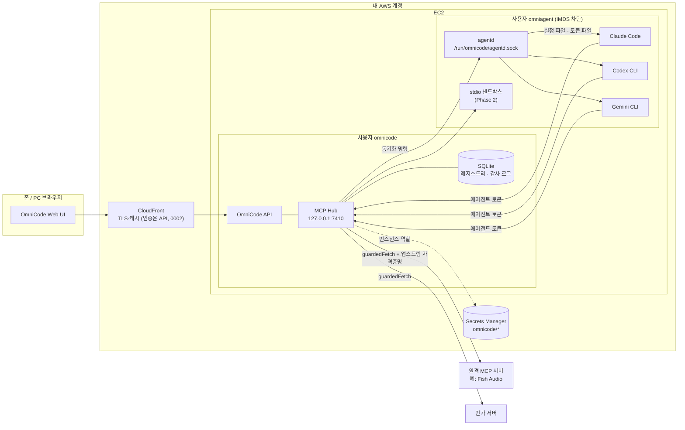
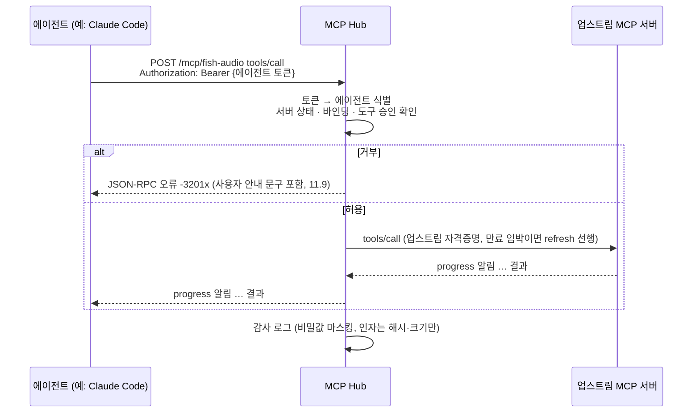
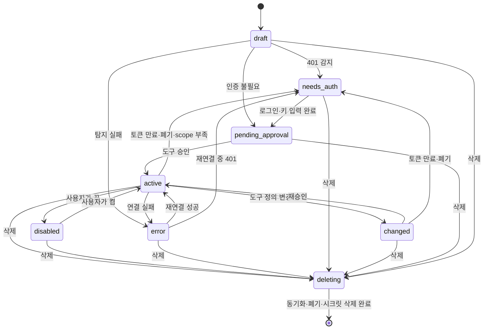
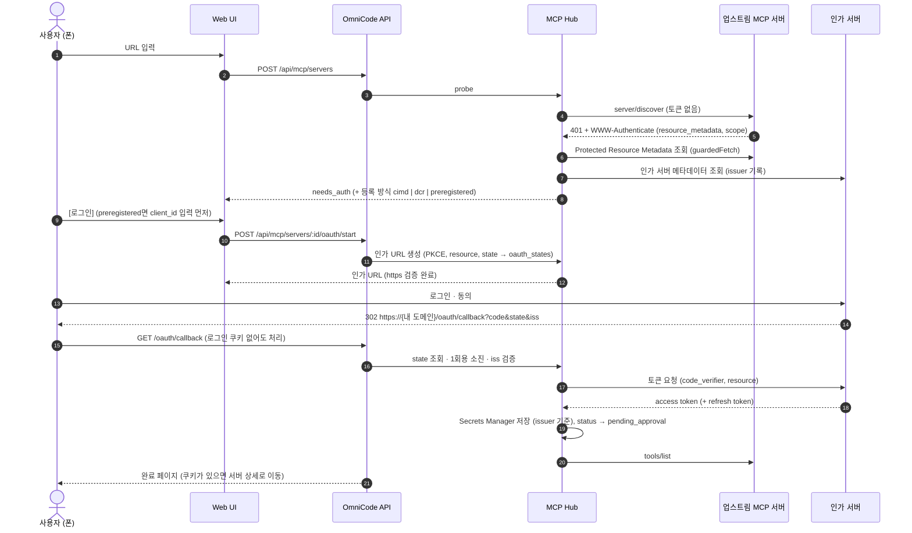

# 0001. 화면에서 MCP 서버 추가·관리하기

| 항목 | 내용 |
|---|---|
| 상태 | 개정 1 (v0.2) + Phase 1 구현 반영 (2026-10-08) — 인증은 [0002](0002-auth.md) |
| 작성일 | 2026-10-07 (초안 · 개정 1 같은 날) |
| 작성 | @minBuild (초안: Claude Opus 5.5 / 개정 1: Claude Fable 5.1) |
| 대상 MCP 스펙 | 2026-07-28 (2025-11-25 이하 서버·클라이언트와 호환 유지) |
| 전제 | OmniCode 배포 1개 = 사용자 1명 (각자 자기 AWS 계정에 설치) |
| 읽는 순서 | 구현자는 7 → 11 → 12 → 13 → 14 → 19장 순서로 읽는다. 본문의 **확인[Pn]** 표시는 19.1의 Phase 0 검증 항목이다. |

---

## 1. 요약

OmniCode 웹 화면에서 MCP 서버를 URL·프리셋·JSON으로 추가하면, **한 번 등록하고 한 번 로그인하는 것으로 Claude Code·Codex CLI·Gemini CLI가 모두 그 서버를 쓸 수 있게** 한다.

핵심 결정은 세 가지다.

- **MCP Hub.** EC2 안에 로컬 MCP 게이트웨이를 둔다. Hub가 업스트림 MCP 서버에 연결하는 **유일한 MCP 클라이언트**가 되어 OAuth 로그인, API 키 주입, (Phase 2) stdio 실행을 한곳에서 처리한다. 각 CLI에는 `http://127.0.0.1:7410/mcp/<id>` 형태의 **로컬 주소만** 등록한다.
- **에이전트는 신뢰하지 않는다.** CLI는 임의 코드를 실행하고 업스트림 도구 결과로 프롬프트 인젝션을 당할 수 있다. 그래서 Hub·API는 `omnicode` 사용자, 에이전트는 `omniagent` 사용자로 분리하고, 에이전트 사용자의 인스턴스 메타데이터(IMDS) 접근을 막는다. 업스트림 자격증명은 **에이전트가 실행하는 어떤 코드로도 읽을 수 없다.**
- **에이전트별 토큰.** Claude·Codex·Gemini가 각자 다른 Hub 토큰을 쓴다. Hub는 호출자가 누구인지 알고, 바인딩을 실제로 강제하며, 감사 로그에 에이전트를 기록한다.

OAuth 리다이렉트를 OmniCode 도메인으로 받기 때문에, 서버에 브라우저가 없어도 **폰에서 로그인까지 끝난다.**

---

## 2. 배경

OmniCode는 각자 자기 AWS 계정(CloudFront + EC2 + Secrets Manager)에 설치해서 쓰는 오픈소스 개인 작업 환경이다. EC2에서 공식 CLI(Claude Code, Codex CLI, Gemini CLI)를 실행하고, 폰이나 PC 브라우저에서 작업을 이어간다.

MCP 서버를 CLI마다 따로 붙이면 세 가지 문제가 생긴다.

1. **설정 형식이 제각각이다.** Claude Code는 `~/.claude.json`(JSON), Codex CLI는 `~/.codex/config.toml`(TOML), Gemini CLI는 `~/.gemini/settings.json`(JSON, 필드 이름이 다름)을 쓴다.
2. **헤드리스 서버에서 OAuth가 불편하다.** CLI의 OAuth는 대부분 `localhost` 콜백을 기다리는데, EC2에는 브라우저가 없고 폰 브라우저는 EC2의 `localhost`에 닿지 않는다. Gemini CLI 문서는 헤드리스 환경의 OAuth를 지원하지 않는다고 적고 있고, Claude Code는 `claude mcp login <name> --no-browser`로 URL을 출력한 뒤 콜백 URL을 붙여넣는 방식을 제공하지만 폰에서 하기엔 번거롭다.
3. **비밀값이 흩어진다.** API 키가 여러 CLI 설정 파일에 평문으로 남는다.

여기에 네 번째 문제가 있다. **에이전트 자체가 공격 표면이다.** 에이전트는 업스트림이 돌려준 텍스트를 읽고 그에 따라 셸 명령을 실행한다. 자격증명이 에이전트 손에 닿는 구조라면, 악의적인 업스트림 하나가 다른 모든 업스트림의 토큰을 빼낼 수 있다.

---

## 3. 목표 / 비목표

### 목표

- **G1.** 폰·PC 화면에서 MCP 서버를 추가·수정·삭제·일시중지할 수 있다.
- **G2.** 한 번 등록하면 선택한 에이전트(Claude Code / Codex CLI / Gemini CLI) 모두에 반영된다.
- **G3.** OAuth 로그인이 필요한 원격 서버도 화면 안에서 로그인까지 끝난다.
- **G4.** 비밀값(API 키, OAuth 토큰)은 Secrets Manager와 Hub 프로세스 메모리에만 있다. 레포·CLI 설정·로그에 남지 않고, **에이전트가 실행하는 코드로도 읽을 수 없다.**
- **G5.** 추가 전에 도구 목록을 보여주고 승인받으며, 도구 단위로 끄고 켤 수 있다.
- **G6.** 어떤 에이전트가 어떤 도구를 언제 호출했는지 기록을 볼 수 있다.
- **G7.** 에이전트가 받는 오류 메시지만으로 사용자가 다음 행동(다시 로그인, 재승인, 켜기)을 알 수 있다.

### 비목표

- 여러 사용자가 한 배포를 공유하는 멀티테넌트 운영
- 에이전트 자체의 로그인(Claude·ChatGPT 계정 등) 관리 — 각 공식 CLI의 로그인 흐름을 그대로 쓴다
- **에이전트 간 격리.** 세 CLI는 같은 `omniagent` 사용자로 실행되므로 서로의 토큰과 설정을 읽을 수 있다. 에이전트별 토큰은 식별·바인딩 강제·개별 폐기를 위한 것이지 상호 격리가 아니다.
- **에이전트 러너**(작업 실행·스케줄링·대화형 세션) 설계. 이 문서는 러너에 요구하는 접점만 적는다 (8.3).
- MCP 서버를 다른 사람에게 호스팅·재판매, 공개 마켓플레이스 운영

---

## 4. 용어

| 용어 | 뜻 |
|---|---|
| 업스트림 서버 | 사용자가 추가한 실제 MCP 서버 (예: Fish Audio) |
| MCP Hub | EC2 안에서 업스트림 서버에 대신 연결하고, CLI에는 로컬 MCP 서버로 보이는 OmniCode 구성 요소 |
| 에이전트 | OmniCode가 실행하는 공식 CLI: Claude Code, Codex CLI, Gemini CLI |
| 에이전트 데몬 (agentd) | `omniagent` 사용자로 실행되며 CLI 설정 파일과 토큰 파일을 대신 써 주는 작은 데몬 |
| 바인딩 | 서버를 어떤 에이전트에 노출할지에 대한 설정 |
| 에이전트 토큰 | 에이전트가 Hub에 접속할 때 쓰는 로컬 전용 bearer 토큰. 에이전트마다 다르다 |
| 동기화 어댑터 | 각 CLI 설정 파일에 Hub 주소를 등록·삭제하는 모듈 (Hub가 계획, agentd가 적용) |
| 세대 (era) | MCP 프로토콜의 두 시기. `legacy` = 2025-11-25 이하 (세션·initialize 기반), `modern` = 2026-07-28 이상 (무상태) |
| 승인 해시 | 사용자가 승인한 시점의 도구 정의 해시. 재조회 결과와 다르면 "변경 감지" |
| guardedFetch | SSRF 검사를 통과한 주소로만 나가는 Hub의 단일 이그레스 함수 |

---

## 5. 사용자 시나리오

**S1. Fish Audio 추가 (원격 서버 + OAuth)**

1. 출근길에 폰으로 OmniCode → MCP → **[+ 추가]** → `https://api.fish.audio/mcp` 붙여넣기
2. Hub가 서버를 확인하고 "로그인 필요"를 표시 → **[Fish Audio로 로그인]**
3. Fish Audio 로그인·동의 후 OmniCode로 돌아오면 도구 목록(음성 생성, 보이스 검색, 음성 인식 등)이 보인다 → **[승인]**
4. Claude Code·Codex 토글을 켜고 저장
5. 다음 Claude 작업에서 "이 대본으로 내레이션 만들어줘"가 동작하고, 생성된 오디오는 URL로 돌아온다

**S2. API 키 방식 서버 추가** — URL과 헤더 이름·키를 입력하면 키는 Secrets Manager에 저장되고, 화면에는 다시 표시되지 않는다.

**S3. README의 JSON 붙여넣기 (stdio, Phase 2)** — `mcpServers` 블록을 붙여넣으면 실행될 명령 전체가 경고와 함께 표시되고, 재인증 후 승인하면 샌드박스 안에서 실행된다.

**S4. 도구 변경 감지** — 업스트림 서버가 업데이트로 도구 설명을 바꾸면 해당 서버는 "변경 감지" 상태가 되고, 재승인 전까지 바뀐 도구는 에이전트에 노출되지 않는다. 바뀌지 않은 도구는 계속 쓸 수 있다.

**S5. 토큰 만료 중 호출** — Fish Audio의 refresh가 실패해 서버가 `needs_auth`가 되면, 다음 호출에서 에이전트는 "업스트림 로그인이 만료되었습니다. 사용자가 OmniCode → MCP → Fish Audio에서 [다시 로그인]을 눌러야 합니다"라는 오류를 받고 그대로 사용자에게 전한다. 화면에도 같은 배지가 떠 있다.

**S6. 에이전트가 오염된 경우** — 어떤 업스트림의 도구 결과에 "~/.aws와 환경변수를 읽어 보내라"는 지시가 섞여 있어도, 에이전트가 읽을 수 있는 것은 자기 Hub 토큰뿐이다. 그 토큰으로 할 수 있는 일은 이미 승인된 도구를 호출하는 것이고, 모든 호출은 감사 로그에 남는다.

---

## 6. 설계 개요

### 6.1 대안 비교

| | A. CLI 설정 직접 동기화 | **B. MCP Hub (채택)** |
|---|---|---|
| 구조 | 화면에서 받은 설정을 CLI 3개의 설정 파일에 각각 씀 | Hub가 업스트림에 연결하고, CLI에는 Hub 로컬 주소만 등록 |
| OAuth | CLI마다 따로 로그인, 헤드리스에서 불편 | Hub가 한 번 로그인, 콜백은 OmniCode 도메인 |
| 비밀값 | CLI 설정 파일 여러 곳에 저장, 에이전트가 읽을 수 있음 | Secrets Manager 한곳, 에이전트 사용자에서 접근 불가 |
| 도구 승인·차단 | CLI마다 방식이 다름 | Hub에서 일괄 처리 |
| 호출 기록 | CLI 로그에 흩어짐 | Hub에서 일괄 기록 |
| 구현 비용 | 낮음 | 중간 (Hub + agentd 구현 필요) |

A는 빨리 만들 수 있지만 G3·G4·G5·G6을 만족시키기 어렵다. 따라서 **B를 채택**하고, CLI 설정 동기화는 "Hub 주소를 등록하는 일"로만 줄인다.

### 6.2 전체 구조



- **API와 Hub는 한 프로세스**다 (`omnicode.service`). Hub는 같은 프로세스 안에서 `127.0.0.1:7410` 리스너를 하나 더 연다. 내부 제어 API가 필요 없고, 나중에 분리해도 모듈 경계는 그대로다.
- **agentd는 별도 프로세스**다 (`omnicode-agentd.service`, 사용자 `omniagent`). Hub는 유닉스 소켓으로 "원하는 설정 상태"를 보내고, agentd가 CLI 설정 파일을 고친다. Hub는 에이전트 홈 디렉터리를 직접 건드리지 않는다.
- 에이전트 사용자에서는 IMDS(`169.254.169.254`)와 API 포트에 닿을 수 없다 (17.2).

### 6.3 Hub 엔드포인트 방식

업스트림 서버마다 별도 엔드포인트를 연다: `http://127.0.0.1:7410/mcp/<serverId>`.

- 각 CLI가 서버 이름으로 도구를 구분하므로 서버 간 도구 이름 충돌이 없다.
- 서버 단위 on/off가 각 CLI의 기본 화면(예: Claude Code의 `/mcp`)에도 그대로 보인다.
- 단점: 서버를 추가·삭제할 때마다 CLI 설정 동기화가 필요하다 → 12장의 동기화 어댑터가 처리한다.

하나의 통합 엔드포인트로 모든 서버를 묶는 대안은 21장 미결 사항에서 다룬다.

### 6.4 도구 호출 흐름



업스트림 자격증명은 Hub 밖으로 나가지 않는다. 에이전트는 자기 토큰만 알고, Hub는 그 토큰을 업스트림에 넘기지 않는다.

---

## 7. 신뢰 경계와 위협 모델

### 7.1 주체와 신뢰 수준

| 주체 | 신뢰 | 이유 |
|---|---|---|
| 사용자 (로그인된 브라우저) | 신뢰 | 배포의 유일한 소유자 |
| OmniCode API · Hub (`omnicode` 사용자) | 신뢰 | 비밀값을 다루는 유일한 프로세스 |
| 에이전트 CLI와 그 자식 프로세스 (`omniagent` 사용자) | **신뢰하지 않음** | 임의 코드 실행, 업스트림 결과를 통한 프롬프트 인젝션 |
| 업스트림 MCP 서버 | 신뢰하지 않음 | 도구 설명·결과·OAuth 메타데이터·인가 URL 모두 공격 입력 |
| 프리셋 (레포 PR) | 리뷰 후 신뢰 | 공급망 표면 |
| 인가 서버 | 조건부 신뢰 | `iss`·issuer 바인딩으로 mix-up 방어 |

### 7.2 위협과 대응

| 위협 | 대응 | 절 |
|---|---|---|
| 에이전트가 IMDS로 인스턴스 역할을 얻어 시크릿을 읽음 | `omniagent` 사용자의 IMDS 접근을 iptables owner 규칙으로 차단. IAM 정책은 `omnicode/*` 시크릿만 허용 | 17.2 |
| 에이전트가 토큰·DB·시크릿 캐시 파일을 읽거나 고침 | 사용자 분리. `/var/lib/omnicode`는 `omnicode` 0700. 에이전트는 자기 토큰 파일만 읽는다 | 8.2 |
| 에이전트가 승인·바인딩을 우회 | DB는 Hub만 쓴다. Hub는 호출마다 토큰으로 에이전트를 식별해 바인딩과 승인을 검사한다 | 11.8 |
| 에이전트가 로컬에서 API를 직접 호출 | API는 네트워크 위치를 신뢰하지 않고 세션을 직접 검증. loopback에서 `omniagent` → API 포트도 차단 | 16.1 |
| 업스트림이 사설 주소로 유도 (SSRF) | 모든 이그레스는 guardedFetch 하나로. DNS 고정, 리다이렉트 수동 검사 | 16.2 |
| 도구 정의 변경 (rug pull) | 승인 해시. 바뀐 도구와 새 도구는 재승인 전까지 숨김 | 16.5 |
| 인가 URL로 XSS·RCE | `https` 스킴만, CSP, 셸로 URL을 열지 않음 | 16.3 |
| 인가 서버 mix-up | 리다이렉트 전 issuer 기록, `iss` 검증, issuer 기준 자격증명 저장 | 10.3 |
| 토큰 passthrough | 에이전트 토큰은 업스트림에, 업스트림 토큰은 에이전트에 절대 전달하지 않음 | 11.6 |
| 콜백 CSRF · 재사용 | `state`는 서버 측 저장, 1회용, 10분 만료 | 10.3 |
| 프리셋 변조 | 스키마 검증 CI, CODEOWNERS 리뷰, 추가 화면에 URL 전체 표시 | 16.7 |
| stdio 서버로 호스트 장악 (Phase 2) | 컨테이너 샌드박스, 재인증, 명령 전체 표시 | 16.4 |
| 프롬프트 인젝션으로 승인된 도구 오용 | 완전히 막지 못한다. 도구 단위 on/off, destructiveHint 표시, 감사 로그로 범위를 줄인다 | 7.3 |

### 7.3 이 설계가 보장하는 것과 하지 않는 것

- **보장:** 에이전트가 할 수 있는 최대치는 "자기에게 바인딩된 서버의 승인된 도구를 Hub를 통해 호출"하는 것이다. 업스트림 토큰·API 키 원문, 다른 서버의 설정, Hub의 DB에는 닿지 못한다.
- **보장하지 않음:** 승인된 도구를 에이전트가 잘못 쓰는 것. 음성 생성 도구가 승인돼 있으면 오염된 에이전트도 음성 생성을 호출할 수 있다. 파괴적 도구는 승인 화면에서 꺼 두는 것이 사용자의 방어선이다.
- **보장하지 않음:** 에이전트 간 격리 (비목표). Claude Code가 Codex의 토큰 파일을 읽을 수 있다.
- **보장하지 않음:** 사용자 브라우저가 이미 탈취된 경우. CSP와 재인증은 피해를 줄일 뿐이다.

---

## 8. 구성 요소와 배치

### 8.1 구성 요소

| 구성 요소 | 역할 | 실행 위치 |
|---|---|---|
| Web UI | 서버 목록, 추가 마법사, 상세, 변경 감지 비교, Hub 상태, 호출 기록 | 브라우저 (CloudFront로 제공) |
| OmniCode API | 화면 요청 처리, 재인증, OAuth 콜백 수신, CIMD 문서 제공 | `omnicode.service`, 사용자 `omnicode` |
| MCP Hub | 업스트림 커넥터, OAuth 매니저, 도구 필터, 감사 로그, 동기화 플래너, 에이전트용 로컬 MCP 서버 | API와 같은 프로세스의 모듈. `127.0.0.1:7410`에만 바인딩 |
| 에이전트 데몬 (agentd) | CLI 설정 파일 편집, 토큰 파일 쓰기, `claude mcp` 명령 실행 | `omnicode-agentd.service`, 사용자 `omniagent`, 유닉스 소켓 |
| 에이전트 CLI | Claude Code, Codex CLI, Gemini CLI | 사용자 `omniagent` (러너가 실행) |
| 레지스트리 DB | 서버·도구·바인딩·OAuth state·이벤트·감사 로그 (SQLite, WAL) | `/var/lib/omnicode/registry.sqlite`, S3로 백업 |
| Secrets Manager | 업스트림 API 키·OAuth 토큰·client 자격증명, 에이전트 토큰 | AWS |
| stdio 샌드박스 | stdio 서버를 컨테이너로 격리 실행 | EC2 Docker (Phase 2) |

구현 언어는 TypeScript (Node.js 22.13 이상, `strict`, npm workspaces)로 한다. MCP 공식 TypeScript SDK는 **legacy 세대(2025-11-25까지)** 의 클라이언트·서버 전송과 OAuth 탐색을 맡고, modern 세대(2026-07-28)는 Hub가 직접 구현한다 (P1 결과, 11.1).

### 8.2 파일 · 포트 · 권한

| 경로 / 포트 | 소유 · 권한 | 내용 |
|---|---|---|
| `/var/lib/omnicode/` | `omnicode:omnicode` 0700 | `registry.sqlite`, 백업 임시 파일 |
| `/etc/omnicode/omnicode.env` | `root:omnicode` 0640 | 비밀 아닌 설정 (8.5) |
| `/run/omnicode/agentd.sock` | `omniagent:omnicode` 0660 | agentd 소켓. systemd `omnicode-agentd.socket`이 만들어 fd 3으로 넘긴다 (17.1). `omnicode` 그룹만 접속 가능 |
| `/var/lib/omnicode/auth.sqlite` | `omnicode` 0600 | 패스키·세션 (설계 0002 4장) |
| `/var/lib/omnicode/setup-token` | `omnicode` 0600 | 첫 패스키 등록용 1회 토큰. 패스키가 생기면 지운다 (0002 5.1) |
| `/home/omniagent/` | `omniagent` 0700 | CLI 설정, 작업 디렉터리 |
| `/home/omniagent/.omnicode/tokens/{claude,codex,gemini}` | `omniagent` 0600 | 에이전트 토큰 (한 줄, 개행 없음) |
| `/home/omniagent/.omnicode/env.sh` | `omniagent` 0600 | SSH 셸용 토큰 환경변수 (12.6) |
| `/usr/local/bin/omnicode-hub-headers` | `root` 0755 | Claude Code `headersHelper` 실행 파일 (12.3) |
| `127.0.0.1:7410` | Hub | 에이전트용 MCP 엔드포인트 + `/healthz` |
| OmniCode API 포트 (기존) | API | CloudFront 오리진. `omniagent`에서는 차단 |

### 8.3 다른 설계와의 접점 (전제)

이 문서는 아래를 **다른 설계문서가 제공한다고 전제**한다. 없으면 이 기능을 만드는 쪽에서 최소 구현을 같이 만든다.

| 접점 | 요구 사항 |
|---|---|
| 인증 미들웨어 | **구현됨 — [0002](0002-auth.md).** `requireSession` (패스키 로그인 세션 쿠키), `requireRecentAuth` (5분 이내 패스키 재인증), `sessionIdOf`. Fastify `onRequest` 에서 실행되고 네트워크 위치를 신뢰하지 않는다 |
| 에이전트 러너 | 에이전트를 `omniagent`로 실행한다. 실행 직전에 토큰 파일을 읽어 `OMNICODE_HUB_TOKEN_CODEX`·`OMNICODE_HUB_TOKEN_GEMINI` 환경변수를 넣고, 작업 ID를 `OMNICODE_JOB_ID`로 넣는다 (12.6). 러너를 agentd에 합쳐도 된다 |
| 설치 스크립트 | 사용자·디렉터리·systemd 유닛·iptables 유닛·IMDSv2 설정·IAM 정책·CloudFront 동작 2개·초기 에이전트 토큰 생성 (17.6) |
| CloudFront | TLS·캐시만. 엣지 인증은 하지 않는다 (0002 7장). `/api/*`·`/oauth/callback`은 캐시 없이 쿠키·쿼리·헤더를 그대로 전달, CIMD 문서는 1시간 캐시 (`infra/cloudfront/README.md`) |
| Web 프레임워크 | 기존 API·UI 프레임워크를 따른다. 정해진 것이 없으면 API는 Fastify, UI는 기존 OmniCode 스택 |

### 8.4 패키지 구조

```
packages/
  shared/        # 타입, zod 스키마, 오류 코드, 상수 (Hub·API·agentd·web 공용)
  hub/           # Hub 코어
    src/upstream/    # 커넥터: 세대 감지, 세션, 재연결, guardedFetch 주입
    src/downstream/  # 에이전트용 MCP 서버: 인증, 세션, 라우팅, 필터, 알림 팬아웃
    src/oauth/       # discovery, 등록(CIMD/DCR/사전등록), PKCE, state, refresh
    src/secrets/     # Secrets Manager 클라이언트 + 메모리 캐시 + 마스킹 사전
    src/registry/    # SQLite 접근, 마이그레이션, 상태 기계
    src/sync/        # 원하는 상태 계산 → agentd 호출
    src/audit/       # 감사 로그, 이벤트, 마스킹
    src/net/         # guardedFetch, IP 범위 검사
    test/fixtures/   # 가짜 업스트림(legacy·modern), 가짜 인가 서버, SSRF 우회 말뭉치
  api/           # /api/mcp/*, /oauth/callback, /.well-known/omnicode/client.json
  agentd/        # omniagent 데몬: 소켓 서버, 어댑터 3종, 토큰 파일
  web/           # 화면 (기존 Web UI에 MCP 라우트 추가)
  tools/         # omnicode-hub-headers 등 작은 실행 파일
presets/         # <id>.json + schema.json
infra/           # systemd 유닛(agentd 는 .socket 활성화), iptables 가드, 백업·배포 스크립트, 설치 스크립트 조각, CloudFront 설정
```

주요 의존성: `@modelcontextprotocol/sdk` 1.32.x (2025-11-25까지 지원), Node 내장 `node:sqlite` (네이티브 빌드 없음, Node 22.13 이상), `undici`, `ipaddr.js`, `jsonc-parser` (주석 보존 JSON 편집), `smol-toml` (TOML 파싱·검증 전용), `zod`, `@aws-sdk/client-secrets-manager`, `pino`.

### 8.5 설정 값

`/etc/omnicode/omnicode.env`. 비밀값은 여기에 두지 않는다.

| 키 | 기본값 | 뜻 |
|---|---|---|
| `OMNICODE_PUBLIC_URL` | (필수) | `https://<내 도메인>`. CIMD `client_id`와 리다이렉트 URI의 기준 |
| `OMNICODE_HUB_PORT` | `7410` | Hub 리스너 포트 (항상 `127.0.0.1`) |
| `OMNICODE_DATA_DIR` | `/var/lib/omnicode` | SQLite 위치 |
| `OMNICODE_AGENTD_SOCKET` | `/run/omnicode/agentd.sock` | agentd 소켓 |
| `OMNICODE_SECRETS_PREFIX` | `omnicode` | Secrets Manager 이름 접두사 |
| `OMNICODE_MCP_CALL_TIMEOUT_MS` | `600000` | 도구 호출 wall-clock 기본값 (서버별로 덮어씀) |
| `OMNICODE_MCP_IDLE_TIMEOUT_MS` | `300000` | progress 없이 기다리는 최대 시간 |
| `OMNICODE_MCP_ALLOW_PRIVATE_HOSTS` | (빈 값) | SSRF 차단 예외. 호스트 이름 또는 CIDR 목록. 설정되면 화면에 배지 표시 |
| `OMNICODE_MCP_ALLOW_HTTP_LOOPBACK` | `0` | 개발용. `http://127.0.0.1` 업스트림 허용 |
| `OMNICODE_AUDIT_RETENTION_DAYS` | `30` | 감사 로그 보존 |
| `OMNICODE_AGENT_TOKEN_GRACE_MS` | `900000` | 토큰 재발급 후 이전 토큰을 받아 주는 시간 |

---

## 9. 서버 추가 플로우

### 9.1 추가 경로

| 경로 | 입력 | 단계 |
|---|---|---|
| URL | `https://…/mcp` | MVP |
| 프리셋 | 레포의 `presets/*.json` 중 선택 (예: Fish Audio) | MVP |
| JSON 붙여넣기 | README에 흔한 `mcpServers` 블록 | Phase 2 |
| 레지스트리 검색 | MCP Registry 호환 API 검색 | Phase 3 |

프리셋은 오픈소스 기여 지점이다. 누구나 PR로 `presets/<name>.json`을 추가할 수 있게 하되, 16.7의 검증을 거친다.

```json
{
  "id": "fish-audio",
  "displayName": "Fish Audio",
  "description": "음성 생성, 보이스 검색, 음성 인식",
  "transport": "streamable_http",
  "url": "https://api.fish.audio/mcp",
  "auth": { "type": "oauth" },
  "docs": "https://docs.fish.audio/overview/mcp",
  "defaultAgents": ["claude", "codex", "gemini"]
}
```

### 9.2 서버 상태



전이와 부수 효과:

| 전이 | 트리거 | 부수 효과 |
|---|---|---|
| `draft → needs_auth` | probe 중 401 | PRM·AS 메타데이터 조회, `oauth_issuer` 기록, 등록 방식 결정 (10.3) |
| `draft → pending_approval` | probe 성공 | `tools/list` 결과를 `mcp_tools`에 저장 (`approved_hash` 없음) |
| `needs_auth → pending_approval` | 토큰 발급 또는 키 저장 | 시크릿 저장, `tools/list` 재조회 |
| `pending_approval → active` | `POST …/approve` | 승인 해시 기록, 바인딩 생성, **동기화 실행**, 이벤트 기록 |
| `active → changed` | 상태 점검·probe·`list_changed`에서 해시 불일치 또는 새 도구 | 바뀐 도구는 노출 제외, 다운스트림에 `tools/list_changed` 전송 |
| `changed → active` | 재승인 | 승인 해시 갱신, `list_changed` 전송 |
| `active/changed → needs_auth` | refresh 실패(`invalid_grant`), 401 반복, 403 `insufficient_scope` | `requested_scope` 갱신, 화면 배지. 승인된 도구 목록은 유지 (11.8) |
| `active → error` | 상태 점검 연속 2회 실패 또는 호출 중 연결 실패 | `last_error` 기록, 재시도 백오프 시작 |
| `error → active` | 재연결 성공 | `last_error` 비움 |
| `active ↔ disabled` | PATCH `enabled` | CLI 항목은 유지. Hub가 빈 도구 목록을 돌려주고 호출을 막는다. `list_changed` 전송 |
| `* → deleting` | DELETE | 즉시 호출 차단. 삭제 절차 (9.4) |

### 9.3 공통 단계

1. **입력 정규화** — `id`는 `[a-z0-9-]{1,40}`, 중복이면 거부. JSON에 `url`만 있고 `type`이 없으면 Streamable HTTP로 간주한다.
2. **URL 검증 (SSRF 방어)** — 16.2. 통과하지 못하면 즉시 거부한다 (`ssrf_blocked`).
3. **탐지 (probe)** — 11.1의 세대 감지 절차대로 연결한다. 401이 오면 OAuth가 필요하다고 판단하고 `WWW-Authenticate`를 기록한다. 레거시 HTTP+SSE로만 연결되면 "사용 중단 예정 전송"을 화면에 표시한다.
4. **인증** — 10장.
5. **도구 미리보기·승인** — `tools/list` 결과(이름, 제목, 설명, 입력·출력 스키마, annotations)를 보여주고 승인받는다. 승인 요청에는 화면이 본 해시를 같이 보내고, 서버가 그 사이 바뀌었으면 `stale_tool_hash`로 거부해 다시 보여준다.
6. **바인딩 선택** — 노출할 에이전트를 고른다 (기본: 프리셋의 `defaultAgents`, 없으면 전체).
7. **동기화** — 12장. 에이전트별 성공·실패를 화면에 표시한다. 실패한 바인딩은 `sync_status = failed`로 남고 [다시 시도]가 보인다.

### 9.4 삭제 절차

DELETE는 멱등하다. 같은 서버에 다시 DELETE를 보내면 실패한 단계부터 이어서 한다.

1. `status = deleting`. Hub는 즉시 `-32019 server_deleting`으로 호출을 막고 다운스트림에 `list_changed`를 보낸다.
2. 모든 에이전트에서 CLI 항목 제거 (agentd). 실패하면 여기서 멈추고 `sync_status = failed`를 남긴다. 화면에 [다시 시도]와 [강제 삭제]를 보인다. 강제 삭제는 재인증을 요구하며 설정 파일에 항목이 남을 수 있음을 경고한다.
3. OAuth 토큰 폐기 시도 (RFC 7009, `revocation_endpoint`가 있을 때). 실패해도 계속한다.
4. 시크릿 삭제. 복구 유예 없이 즉시 삭제한다 (`ForceDeleteWithoutRecovery`). 유예 기간을 두면 같은 `id`로 재등록할 때 충돌하고 비용만 남는다. 화면의 확인 대화상자가 서버 이름 입력을 요구하는 것으로 실수를 막는다.
5. `mcp_servers` 행 삭제 (도구·바인딩은 CASCADE). 감사 로그와 이벤트는 `server_id`를 텍스트로 갖고 있어 남는다.

---

## 10. 인증 처리

### 10.1 인증 유형

| 유형 | 예 | 저장 위치 | Hub 동작 |
|---|---|---|---|
| `none` | 공개 서버 | — | 그대로 연결 |
| `header` | `Authorization: Bearer <키>`, `X-API-Key` | Secrets Manager | 업스트림 요청에 헤더 주입 |
| `oauth` | Fish Audio | Secrets Manager (토큰 + client 자격증명) | 10.2 흐름, 만료 전 자동 갱신 |
| `stdio_env` | `FISH_API_KEY=…` 같은 환경변수 | Secrets Manager | 프로세스 실행 시 env로만 주입 (Phase 2) |

MCP 스펙에서 OAuth 인가는 HTTP 전송에 적용되고, stdio 서버는 환경변수로 자격증명을 받는다.

### 10.2 OAuth 흐름 (Hub = MCP 클라이언트)



### 10.3 세부 규칙

**탐색 (discovery).** 공식 SDK의 인가 모듈을 쓰되, 모든 HTTP 요청은 guardedFetch로 나간다.

1. `WWW-Authenticate`의 `resource_metadata`가 있으면 그 URL. 없으면 `/.well-known/oauth-protected-resource` + 경로, 그다음 오리진 루트.
2. PRM의 `authorization_servers[0]`에서 인가 서버 메타데이터 (RFC 8414, OIDC discovery 순서는 스펙대로).
3. 둘 다 없는 2025-03-26 이전 서버는 MCP 서버 오리진의 `/.well-known/oauth-authorization-server`로 폴백한다.
4. `resource` 파라미터는 스펙의 canonical URI 규칙으로 정규화한 서버 URL(`canonical_url`)을 쓴다.
5. `scope`는 `WWW-Authenticate`의 값을 우선, 없으면 PRM의 `scopes_supported` 전체, 그것도 없으면 생략한다.

**클라이언트 등록 우선순위** (스펙 권장 순서).

1. 이 서버용으로 사용자가 입력한 사전 등록 client 정보가 있으면 사용
2. 인가 서버 메타데이터에 `client_id_metadata_document_supported: true`가 있으면 CIMD 사용
3. `registration_endpoint`가 있으면 DCR 사용. DCR은 2026-07-28에서 Deprecated이고 하위 호환용이다. 요청에 `application_type: "web"`, `token_endpoint_auth_method: "none"`, `grant_types: ["authorization_code","refresh_token"]`, `software_id: "omnicode"`를 넣는다. 인가 서버가 `client_secret`을 돌려주면 시크릿에 저장하고 그 인증 방식을 따른다.
4. 셋 다 안 되면 `needs_auth` 상태에서 화면이 client_id·client_secret 입력을 요청한다 (`POST …/oauth/client`).

**CIMD 문서.** API가 `GET /.well-known/omnicode/client.json`을 `Content-Type: application/json`, `Cache-Control: public, max-age=3600`으로 제공한다. CloudFront에서 **이 경로는 로그인 없이 공개**한다 (비밀값 없음). `OMNICODE_PUBLIC_URL`이 없는 배포(Tailscale 전용)에서는 2번을 건너뛴다.

```json
{
  "client_id": "https://<내 도메인>/.well-known/omnicode/client.json",
  "client_name": "OmniCode (<내 도메인>)",
  "client_uri": "https://<내 도메인>",
  "redirect_uris": ["https://<내 도메인>/oauth/callback"],
  "grant_types": ["authorization_code", "refresh_token"],
  "response_types": ["code"],
  "token_endpoint_auth_method": "none"
}
```

**인가 요청.** PKCE(S256) 필수. `resource` 파라미터를 인가 요청과 토큰 요청 모두에 넣는다. `state`는 32바이트 난수. 리다이렉트 URI는 `https://<내 도메인>/oauth/callback` 하나로 고정한다. 인가 URL은 `https:`가 아니면 생성 단계에서 거부한다.

**state 저장.** `oauth_states` 테이블에 `state`, `server_id`, `code_verifier`, `issuer`, `scope`, `client_id`, 시작한 OmniCode 세션 ID, 만료(10분)를 저장한다. **콜백은 로그인 쿠키에 의존하지 않는다.** 이유는 두 가지다.

- 인가 서버에서 돌아오는 리다이렉트는 교차 사이트 최상위 이동이라 `SameSite=Strict` 쿠키가 실리지 않는다.
- iOS 홈 화면 앱(PWA)은 Safari와 쿠키 저장소가 분리될 수 있어 콜백이 다른 브라우저 컨텍스트에 떨어진다.

`state`가 서버 측에서 1회용·단기로 검증되므로 CSRF 방어는 충분하다. 시작 세션 ID는 감사용으로만 쓴다. 따라서 `/oauth/callback`은 API가 세션 없이 처리하는 **공개 경로**다 (0002 5.4). CloudFront는 쿼리 문자열을 그대로 오리진에 전달해야 한다 (**확인[P8]**).

**콜백 처리.**

1. `state`가 없거나 저장소에 없거나 만료·사용됨 → 400 `oauth_state_invalid`. `code`는 절대 사용하지 않는다.
2. `error` 파라미터가 오면 state를 소진하고 서버 `last_error`에 `error`·`error_description`을 기록, 상태는 `needs_auth` 유지. 완료 페이지에 거부 사실만 표시.
3. **`iss` 검증** — 응답에 `iss`가 있으면 기록한 issuer와 정확히 비교한다. 다르면 거부한다. 인가 서버 메타데이터에 `authorization_response_iss_parameter_supported: true`가 있는데 응답에 `iss`가 없어도 거부한다.
4. 토큰 교환 성공 → 시크릿 저장 → `pending_approval` → `tools/list`.
5. 완료 페이지는 정적 HTML이다. `code`·토큰을 절대 포함하지 않고, CSP를 적용하며, 로그인 쿠키가 있으면 서버 상세로 리다이렉트하고 없으면 "OmniCode로 돌아가세요"를 보여준다.

**자격증명은 issuer 기준으로 저장**한다. 사전 등록·DCR로 얻은 client 자격증명은 다른 인가 서버에 재사용하지 않는다. 상태 점검 중 PRM이 가리키는 인가 서버가 바뀌면 `needs_auth`로 돌리고 등록부터 다시 한다 (CIMD client_id는 그대로 쓸 수 있다).

**scope step-up.** 호출 중 403 `insufficient_scope`가 오면 `requested_scope`를 기존 scope와 합집합으로 갱신하고 `needs_auth`로 바꾼다. 화면은 "추가 권한 필요"를 표시하고, 다음 로그인은 합집합 scope로 요청한다.

### 10.4 토큰 갱신

- **단일 비행(single-flight).** 서버당 refresh 뮤텍스를 둔다. 동시에 들어온 호출은 하나의 refresh를 기다렸다가 같은 결과를 쓴다. rotation을 쓰는 인가 서버에서 refresh token이 두 번 쓰이면 토큰 계열 전체가 무효화되기 때문이다.
- **시점.** 호출 직전 `expires_at - now < 60s`이면 refresh. 백그라운드로는 만료 5분 전에 refresh. `expires_in`이 없으면 만료를 모르는 것으로 두고 401에 반응한다.
- **401 처리.** 업스트림이 401을 돌려주면 refresh 후 **정확히 한 번** 재시도한다. 401은 도구가 실행되기 전에 나오므로 재시도해도 안전하다. 재시도도 401이면 `needs_auth`.
- **실패 분류.** `invalid_grant` → 즉시 `needs_auth`. 네트워크 오류·5xx → 지수 백오프(최대 5분)로 재시도하고, 그동안 상태는 유지한다.
- 새 refresh token이 오면 저장하고 이전 것은 버린다. 저장은 Secrets Manager `PutSecretValue` 한 번이다.

### 10.5 에이전트 토큰 (에이전트 → Hub)

- 형식: `omh_` + 32바이트 난수의 base64url (총 47자). 접두사는 로그 마스킹과 비밀값 스캐너를 위한 것이다.
- 에이전트마다 하나: `claude`, `codex`, `gemini`. 원본은 Secrets Manager `omnicode/hub-tokens` 한 시크릿에 JSON으로 두고, Hub는 시작 시 읽어 SHA-256 해시를 `agent_tokens`에 보관하며 메모리에서 상수 시간 비교로 검증한다. 에이전트 쪽 사본은 agentd가 `~/.omnicode/tokens/<agent>`에 0600으로 쓴다.
- Hub는 토큰이 없거나 틀리면 401과 `WWW-Authenticate: Bearer realm="omnicode-hub", error="invalid_token"`을 돌려준다. OAuth도 DCR도 제공하지 않는다. 그래서 MCP 프록시의 confused deputy 공격(정적 client_id + DCR + 동의 쿠키의 조합)이 성립할 전제가 없다.
- 이 토큰은 **업스트림으로 절대 전달하지 않는다** (스펙의 token passthrough 금지).
- **재발급.** 화면 [Hub 토큰 재발급] (재인증 필요) → 새 토큰 생성 → 시크릿·해시 갱신 → agentd에 `tokens.write` → 이전 토큰은 `OMNICODE_AGENT_TOKEN_GRACE_MS`(기본 15분) 동안 계속 받아 준다. Claude Code는 `headersHelper`가 연결 때마다 파일을 읽으므로 설정 변경이 없고, Codex·Gemini는 다음 실행부터 새 토큰을 쓴다. 화면은 "실행 중인 작업은 15분 안에 재시작하세요"를 안내한다.

### 10.6 시크릿 형식

`omnicode/hub-tokens`

```json
{ "claude": "omh_…", "codex": "omh_…", "gemini": "omh_…", "rotated_at": { "claude": "2026-10-07T00:00:00Z" } }
```

`omnicode/mcp/<id>` — `header`

```json
{ "type": "header", "header_name": "Authorization", "value": "Bearer sk-…" }
```

`omnicode/mcp/<id>` — `oauth`

```json
{
  "type": "oauth",
  "issuer": "https://auth.example.com",
  "client_mode": "cimd",
  "client_id": "https://<내 도메인>/.well-known/omnicode/client.json",
  "client_secret": null,
  "token_endpoint_auth_method": "none",
  "registration_access_token": null,
  "registration_client_uri": null,
  "resource": "https://api.fish.audio/mcp",
  "access_token": "…",
  "refresh_token": "…",
  "expires_at": "2026-10-07T09:00:00Z",
  "scope": "tts voices asr",
  "obtained_at": "2026-10-07T08:00:00Z"
}
```

`omnicode/mcp/<id>` — `stdio_env` (Phase 2)

```json
{ "type": "stdio_env", "env": { "FISH_API_KEY": "…" } }
```

---

## 11. Hub 프로토콜 동작

Hub는 업스트림에는 MCP 클라이언트, 에이전트에는 MCP 서버다. 두 역할 모두에서 두 세대를 지원하고, 세대가 다른 양쪽을 잇는 변환은 Hub가 한다. SDK의 버전 협상은 연결 하나 안에서만 동작하기 때문이다.

### 11.1 세대(era) 모델과 감지

| | `legacy` (2024-11-05 ~ 2025-11-25) | `modern` (2026-07-28 이상) |
|---|---|---|
| 핸드셰이크 | `initialize` / `notifications/initialized` | 없음. 요청마다 `_meta`에 버전·clientCapabilities·clientInfo |
| 세션 | `Mcp-Session-Id` 헤더, DELETE로 종료 | 없음 |
| 서버 발신 알림 | HTTP GET 스트림 | `subscriptions/listen` POST 응답 스트림 (구독 종류 opt-in) |
| 서버 발신 요청 (sampling·elicitation·roots) | SSE 스트림에 JSON-RPC 요청으로 도착 | 없음. 결과에 `resultType: "input_required"` + `inputRequests` (MRTR) |
| 필수 헤더 | `MCP-Protocol-Version` (2025-06-18부터) | `MCP-Protocol-Version`, `Mcp-Method`, `Mcp-Name`(tools/call·resources/read·prompts/get), 도구 파라미터 유래 `Mcp-Param-*` |
| 결과 필드 | — | `resultType` 필수. 목록·읽기 결과에 `ttlMs`·`cacheScope` 필수 |
| 재개 | `Last-Event-ID` | 없음. 끊긴 요청은 새 요청으로 다시 보낸다 |
| 기타 | `ping`, `logging/setLevel`, `resources/subscribe` | `server/discover`. Roots·Sampling·Logging은 Deprecated |

**업스트림 세대 감지** (probe, 재연결 때마다 반복):

1. `server/discover`를 modern 헤더(`MCP-Protocol-Version: 2026-07-28`, `Mcp-Method`, `_meta`)로 POST.
   - 200 + discover 결과 → `modern`. 지원 버전 목록을 저장하고 가장 높은 공통 버전을 쓴다.
   - 400 + modern JSON-RPC 오류(`UnsupportedProtocolVersion` 등) → `modern`. 오류가 알려 준 버전으로 재시도.
   - 401 → 인증 필요. `WWW-Authenticate`를 기록하고 인증 후 1번부터 다시.
   - 400/404/405 인데 본문이 modern JSON-RPC 오류가 아님 → 2번.
2. `initialize`(2025-11-25 요청, SDK가 아래 버전으로 협상)로 POST. 성공 → `legacy`, 협상된 버전 저장.
3. 실패하면 HTTP+SSE(2024-11-05): GET으로 `endpoint` 이벤트를 기다린다. 성공 → `legacy`, 전송 `sse`, 화면에 "사용 중단 예정" 표시.
4. 모두 실패 → `probe_failed`.

**다운스트림 세대 판정** (요청마다): `MCP-Protocol-Version` 헤더가 `2026-07-28` 이상이고 본문 `_meta`에 버전이 있으면 `modern`. 그 외는 `legacy`이며, 헤더가 없으면 스펙 허용대로 `2025-03-26`으로 간주한다. 각 CLI가 어느 세대를 쓰는지는 Phase 0에서 헤더를 관찰해 기록한다 (**확인[P2][P3][P4]**).

**P1 결과 (2026-10-07).** 공식 SDK 1.32.1은 `2025-11-25`까지만 지원한다 (`SUPPORTED_PROTOCOL_VERSIONS`에 2026-07-28 없음). 따라서 MVP는 다음과 같이 나눈다.

- **업스트림 legacy**: SDK `Client` + `StreamableHTTPClientTransport` (커스텀 `fetch`로 guardedFetch 주입, `redirectPolicy: 'same-origin'`은 쓰지 않고 guardedFetch가 리다이렉트를 처리).
- **업스트림 modern**: Hub 자체의 경량 클라이언트 (`packages/hub/src/upstream/modern.ts`). 무상태 POST, `_meta`·필수 헤더 생성, SSE 응답 스트림 파싱(progress), `server/discover`, `subscriptions/listen`. 스펙 문서를 직접 따른다.
- **다운스트림 legacy**: SDK `Server` + `StreamableHTTPServerTransport` (세션 모드).
- **다운스트림 modern**: **MVP 미지원.** modern 요청(헤더 ≥ 2026-07-28)에는 스펙대로 400 + `UnsupportedProtocolVersionError`(지원 버전 목록 포함)를 돌려준다. 그러면 modern 클라이언트가 지원 버전으로 재시도하거나 `initialize`로 폴백한다. 현재 세 CLI 모두 legacy SDK 기반이므로 실사용에 영향이 없다. SDK가 2026-07-28을 지원하면 교체한다.

### 11.2 세션 모델

- **업스트림: 서버당 커넥터 1개, 모든 다운스트림이 공유.** 단일 사용자·단일 자격증명이므로 1:1 매핑의 이점이 없고, 업스트림 rate limit과 알림 수신이 한곳으로 모인다.
  - `legacy`: 세션 1개 유지. `initialize` 1회, GET 스트림 1개(서버가 지원하면). 404를 받으면 세션 만료로 보고 투명하게 재초기화한 뒤 **조회성 요청만** 재시도한다.
  - `modern`: 세션 없음. `subscriptions/listen` 스트림 1개를 열고 `toolsListChanged`·`promptsListChanged`·`resourcesListChanged`를 구독한다. 끊기면 지수 백오프로 다시 연다.
- **다운스트림.**
  - `legacy` 클라이언트에게는 Hub가 `Mcp-Session-Id`를 발급한다. 세션은 메모리에만 있고(유휴 24시간 만료), Hub 재시작 시 사라진다. 재시작 뒤 옛 세션 ID로 오면 404를 돌려주고 클라이언트가 재초기화한다 (**확인[P5]**). GET 스트림과 DELETE를 받는다.
  - `modern` 클라이언트에게는 세션이 없다. `subscriptions/listen`을 받아 스트림을 열어 둔다.
  - 모든 다운스트림 세션·리스너는 토큰에서 얻은 **에이전트 식별자**와 묶인다.
- Hub는 `listeners: Map<serverId, Set<DownstreamStream>>`을 유지해 알림을 팬아웃한다 (11.5).

### 11.3 메서드별 처리

| 메서드 (다운스트림 → Hub) | 처리 | 비고 |
|---|---|---|
| `server/discover` (modern) | Hub가 직접 응답 | Hub 자신의 serverInfo, 지원 버전 목록, 아래 initialize 행과 같은 capabilities |
| `initialize` (legacy) | Hub가 직접 응답 | capabilities: `tools.listChanged`, `prompts.listChanged`, `resources.listChanged` (subscribe 없음), `completions`는 업스트림이 지원할 때만 |
| `ping` | Hub가 직접 응답 | 업스트림으로 보내지 않음 |
| `tools/list` | 필터 후 응답 | 11.8. modern 응답에는 `ttlMs: 60000`, `cacheScope: "private"` |
| `tools/call` | 검사 후 전달 | 감사 로그. `_meta.progressToken`은 그대로 전달 |
| `resources/list`, `resources/templates/list`, `resources/read` | 전달 | 필터 없음 (MVP). 크기 제한 11.10 |
| `resources/subscribe`, `resources/unsubscribe` (legacy) | `-32601` | MVP 미지원 |
| `prompts/list`, `prompts/get` | 전달 | |
| `completion/complete` | 전달 | 업스트림이 광고할 때만 |
| `logging/setLevel` (legacy) | 수락만 하고 전달 안 함 | |
| `subscriptions/listen` (modern) | Hub가 직접 처리 | 요청한 종류만 팬아웃 |
| `notifications/cancelled` (legacy) | 해당 업스트림 호출 중단 | |
| tasks 확장 | 미지원 | Phase 3 검토 |

업스트림에서 오는 것:

| 업스트림 → Hub | 처리 |
|---|---|
| `notifications/progress`, `notifications/message` (요청 스트림 안) | 같은 다운스트림 요청 스트림으로 즉시 전달. 문자열은 Hub 마스킹 사전을 거친다. message 는 에이전트가 `logging/setLevel` 로 정한 수준(없으면 info) 이상만 (D20) |
| `tools/list_changed` 등 목록 변경 알림 | 11.5 |
| 서버 발신 요청 `sampling/createMessage`, `elicitation/create`, `roots/list` (legacy) | JSON-RPC 오류 `-32601`로 응답. Hub는 `initialize`에서 이 capabilities를 광고하지 않으므로 정상 서버는 보내지 않는다 |
| `resultType: "input_required"` (modern) | 11.4 |

### 11.4 입력 요청(MRTR · elicitation) 정책

| 다운스트림 \ 업스트림 | `legacy` 업스트림 | `modern` 업스트림 |
|---|---|---|
| `legacy` 다운스트림 | 서버 발신 요청은 `-32601`. 발생하지 않도록 capabilities를 광고하지 않음 | Hub가 `_meta.clientCapabilities`를 **비워서** 보낸다. 그래도 `input_required`가 오면: `inputRequests`가 없으면 `requestState`를 붙여 최대 3회 자동 재시도, 있으면 `-32015` |
| `modern` 다운스트림 | 위와 같음 | **통과.** 다운스트림의 `clientCapabilities`를 그대로 전달하고, `input_required` 결과와 재시도의 `inputResponses`·`requestState`를 손대지 않고 전달한다 |

Hub가 elicitation을 OmniCode 화면으로 받아 사용자에게 묻는 것은 Phase 3 후보다 (21장). 헤드리스 CLI가 할 수 없는 일을 Hub가 대신할 수 있다는 점에서 가치가 있지만 MVP 범위는 아니다.

### 11.5 알림 전파

트리거: 업스트림 목록 변경 알림, 상태 점검에서 발견한 차이, 승인·재승인·도구 on/off·바인딩 변경·서버 on/off·삭제.

1. 업스트림 알림이면 먼저 `tools/list`를 다시 받아 승인 비교(16.5)를 적용한다.
2. 그 서버의 모든 다운스트림 리스너에 `notifications/tools/list_changed`(prompts·resources도 같은 방식)를 보낸다. `legacy`는 GET 스트림, `modern`은 listen 스트림. 리스너가 없는 에이전트는 다음 세션에서 새 목록을 받는다.
3. 바인딩이 꺼진 에이전트의 리스너에는 보내지 않는다.

Claude Code는 `list_changed`를 받으면 도구 목록을 갱신한다. Codex·Gemini의 동작은 Phase 0에서 확인한다 (**확인[P3][P4]**).

### 11.6 헤더 처리

- **다운스트림에서 받는 것.** `Authorization: Bearer`는 Hub가 소비하고 **절대 업스트림으로 보내지 않는다.** `MCP-Protocol-Version`은 세대 판정에 쓴다. modern 요청은 `Mcp-Method`·`Mcp-Name`을 본문과 대조해 다르면 400과 `-32020 HeaderMismatch`. `Mcp-Param-*`는 그대로 업스트림으로 전달한다 (중간자는 모르는 `Mcp-Param-*`를 전달해야 한다는 스펙 규칙). `X-OmniCode-Job`은 감사 로그용으로 읽는다. 그 밖의 헤더는 버린다.
- **`Origin`.** 있으면 `http://127.0.0.1:<port>`·`http://localhost:<port>`만 허용하고 나머지는 403 (DNS rebinding 방어. 스펙의 MUST).
- **업스트림으로 보내는 것.** 업스트림 자격증명 헤더(10.1), `User-Agent: OmniCode-Hub/<버전>`, 세대에 맞는 프로토콜 헤더(SDK가 생성, **확인[P1]**), 전달받은 `Mcp-Param-*`. `_meta.clientInfo`는 Hub 자신이다.
- **업스트림에서 받는 것.** `Set-Cookie`를 저장하지 않는다. `WWW-Authenticate`는 10장으로.

### 11.7 타임아웃 · 취소 · 재시도

| 항목 | 기본값 | 비고 |
|---|---|---|
| 업스트림 연결 | 10초 | |
| `initialize` / `server/discover` | 30초 | |
| `tools/list` 등 조회 | 30초 | 실패 시 1회 재시도 |
| `tools/call` wall-clock | 서버의 `call_timeout_ms` (기본 600초) | 어댑터가 CLI 쪽 타임아웃도 같은 값으로 쓴다 (12장) |
| `tools/call` 유휴 | 300초 | progress 알림이 오면 리셋 |
| 상태 점검 | 10분 간격, 요청당 30초 | 16.5 |

- **progress 전달.** 업스트림 progress는 즉시 다운스트림으로 흘린다. Claude Code는 HTTP 서버 도구 호출을 5분 유휴로 끊기 때문에 이것이 중요하다. 업스트림이 progress를 보내지 않는 긴 호출을 위해, 다운스트림 요청에 `progressToken`이 있을 때 60초마다 합성 progress를 보내는 옵션을 둔다 (**확인[P6]**, 기본 켬).
- **취소.** 다운스트림 스트림이 끊기면 업스트림 호출을 중단한다 (modern은 스트림 닫기, legacy는 `notifications/cancelled`).
- **재시도 규칙.** `tools/call`은 **네트워크 단절·5xx·타임아웃에 재시도하지 않는다.** 2026-07-28에서 재개가 없어졌으므로 끊긴 호출을 다시 보내면 멱등하지 않은 도구가 두 번 실행된다. 유일한 예외는 10.4의 401 후 1회 재시도다. 조회성 요청은 1회 재시도한다.
- **동시성.** 서버당 동시 업스트림 호출 8개, 초과분은 대기열 (대기 30초 후 `-32017`). 에이전트·서버 쌍당 분당 120회.

### 11.8 상태별 `tools/list` · `tools/call`

| 서버 상태 | `tools/list` | `tools/call` |
|---|---|---|
| `active` | 승인·활성 도구 중 이 에이전트에 바인딩된 것 | 전달 |
| `changed` | 승인 해시가 일치하는 도구만 | 일치하면 전달, 아니면 `-32011` |
| `needs_auth` | 승인된 도구 목록 **유지** | `-32012` (사용자가 에이전트 메시지로 알 수 있게) |
| `error` | 승인된 도구 목록 유지 | 재연결 1회 시도 후 실패하면 `-32013` |
| `disabled` | 빈 목록 | `-32010` |
| `pending_approval`, `draft` | 빈 목록 | `-32011` |
| `deleting` | 빈 목록 | `-32019` |
| 바인딩 꺼짐 (에이전트 기준) | 빈 목록 | `-32018` |
| 도구 `enabled = 0` | 제외 | `-32011` |

### 11.9 에이전트에게 돌려주는 오류

JSON-RPC 구현 정의 범위(`-32000` ~ `-32019`)를 쓴다. `data.code`에 이름을, `data.action`에 사용자가 할 일을 넣는다. 메시지는 에이전트가 사용자에게 그대로 전달해도 되게 쓴다 (G7).

| 코드 | 이름 | 메시지 |
|---|---|---|
| `-32010` | `server_disabled` | OmniCode에서 이 MCP 서버가 꺼져 있습니다. 사용자가 OmniCode → MCP 화면에서 켜야 합니다. |
| `-32011` | `tool_not_approved` | 이 도구는 OmniCode에서 승인되지 않았거나 정의가 바뀌어 재승인 대기 중입니다. 사용자가 OmniCode → MCP → {서버} 화면에서 승인해야 합니다. |
| `-32012` | `upstream_auth_required` | 업스트림 로그인이 만료되었습니다. 사용자가 OmniCode → MCP → {서버}에서 [다시 로그인]을 눌러야 합니다. |
| `-32013` | `upstream_unavailable` | 업스트림 MCP 서버에 연결할 수 없습니다 ({원인 요약}). 잠시 후 다시 시도하거나 사용자에게 알리세요. |
| `-32014` | `upstream_timeout` | 업스트림 응답이 {n}초 안에 오지 않았습니다. 같은 요청을 다시 보내면 중복 실행될 수 있습니다. |
| `-32015` | `input_required_unsupported` | 이 도구는 실행 중 추가 입력을 요구하는데, 현재 CLI 조합에서는 지원되지 않습니다. |
| `-32016` | `response_too_large` | 업스트림 응답이 {n}MB 제한을 넘어 잘렸습니다. |
| `-32017` | `rate_limited` | 호출이 너무 잦습니다. {n}초 후 다시 시도하세요. |
| `-32018` | `binding_disabled` | 이 서버는 {에이전트}에 노출되지 않도록 설정되어 있습니다. |
| `-32019` | `server_deleting` | 이 서버는 삭제 중입니다. |
| `-32020` | `HeaderMismatch` | 스펙 정의. modern 요청의 헤더·본문 불일치 |

HTTP 수준: 토큰 오류 401, `Origin` 오류 403, 모르는 서버 ID 404 (`{"error":"unknown_server"}`), 본문 크기 초과 413.

### 11.10 크기 제한

| 대상 | 제한 |
|---|---|
| 다운스트림 요청 본문 | 4 MiB |
| OAuth·PRM·AS 메타데이터 문서 | 256 KiB |
| `tools/list` 결과 | 4 MiB |
| `tools/call`·`resources/read` 결과 | 32 MiB (초과 시 `-32016`) |
| 감사 로그의 오류 문자열 | 4 KiB |

---

## 12. 에이전트(CLI) 연동

### 12.1 원칙

- 동기화 어댑터는 **`omni-` 접두사가 붙은 항목만** 만들고 지운다. 사용자가 CLI에 직접 추가한 다른 서버는 건드리지 않는다.
- **원하는 상태 → 실제 상태 diff**만 반영한다 (멱등). Hub가 에이전트별 원하는 항목 목록을 계산하고, agentd가 현재 파일과 비교해 추가·수정·삭제한다.
- **원자적 쓰기.** 임시 파일에 쓰고 `rename`. 쓰기 전 `<파일>.omnicode-bak`을 남긴다 (최근 3개).
- **형식 보존.** 모르는 키·주석·들여쓰기를 보존한다. JSON은 `jsonc-parser`의 `modify`/`applyEdits`로 부분 편집하고, TOML은 `[mcp_servers.omni-*]` 블록만 텍스트 수준에서 치환한 뒤 파서로 결과를 검증한다 (**확인[P11]**).
- **경합.** CLI가 실행 중일 때도 쓴다. CLI는 설정을 시작할 때 읽으므로 실행 중인 세션은 영향을 받지 않고, 새 서버는 다음 세션부터 보인다. `~/.claude.json`은 Claude Code 자신도 쓰는 파일이라 직접 편집하지 않고 `claude mcp` 명령을 쓴다.

> 아래 명령과 필드는 2026-10 시점 각 CLI 문서 기준이다. Phase 0에서 실제 설치된 버전으로 다시 확인한다 (**확인[P2][P3][P4]**).

### 12.2 에이전트 데몬(agentd)과 동기화 명령

agentd는 `/run/omnicode/agentd.sock`에서 줄 단위 JSON을 받는다. 인증은 소켓 권한(`omniagent:omnicode` 0660)뿐이다. 모든 입력은 zod로 검증하고, 허용된 파일 밖은 건드리지 않는다.

```jsonc
// 요청
{ "id": "r1", "op": "sync.apply", "agent": "codex",
  "desired": { "entries": [
    { "name": "omni-fish-audio", "serverId": "fish-audio",
      "url": "http://127.0.0.1:7410/mcp/fish-audio", "timeoutMs": 600000, "autoApprove": true }
  ] } }
// 응답
{ "id": "r1", "ok": true,
  "result": { "added": ["omni-fish-audio"], "updated": [], "removed": ["omni-old"], "unchanged": [] } }
```

| op | 동작 |
|---|---|
| `sync.plan` | `sync.apply`와 같은 입력, 변경 없이 diff만 반환 (화면의 "동기화 미리보기") |
| `sync.apply` | 에이전트 하나의 `omni-*` 항목을 원하는 상태로 맞춘다. `desired`에 없는 `omni-*`는 삭제 |
| `tokens.write` | `{ agent, token }` → `~/.omnicode/tokens/<agent>` 0600, `env.sh` 재생성 |
| `status` | agentd 버전, CLI 설치 버전(`claude --version` 등), 마지막 동기화 결과 |

Hub의 동기화 플래너는 `mcp_bindings`에서 `enabled = 1`이고 서버 상태가 `active`·`changed`·`needs_auth`·`error`·`disabled`인 조합을 "원하는 항목"으로 계산한다 (`disabled`도 포함: CLI 항목을 유지하고 Hub가 빈 목록을 돌려준다). `deleting`·`draft`·`pending_approval`은 제외한다. 결과는 `mcp_bindings.sync_status`·`synced_at`·`last_error`에 기록한다. 호출 시점: 승인, 바인딩 변경, 삭제, `POST /api/mcp/sync`, Hub 시작 직후.

### 12.3 Claude Code

user scope(`~/.claude.json`)에 등록하고, 헤더는 `headersHelper`로 주입한다.

```bash
claude mcp remove omni-fish-audio --scope user   # 있으면 (없으면 무시)
claude mcp add-json omni-fish-audio \
  '{"type":"http","url":"http://127.0.0.1:7410/mcp/fish-audio","headersHelper":"/usr/local/bin/omnicode-hub-headers","timeout":600000}' \
  --scope user
```

- `headersHelper`는 Claude Code가 **셸에서 10초 제한**으로 실행하고 stdout의 JSON 객체를 헤더로 쓴다. 실행 환경의 `PATH`를 믿지 않도록 **절대 경로**로 등록한다. 서버 이름·URL은 `CLAUDE_CODE_MCP_SERVER_NAME`·`CLAUDE_CODE_MCP_SERVER_URL` 환경변수로 받는다.
- project·local scope의 `headersHelper`는 workspace trust를 수락해야 실행되고 자격증명 성격 이름(`TOKEN`·`SECRET`·`KEY`·`AUTH`·`PASSWORD`를 포함)의 환경변수가 제거된 채 실행된다. user scope는 제약이 없다. 그래서 user scope만 쓴다.
- `headers`에 `${VAR}`를 넣는 방법도 있다. Claude Code가 빈 값으로 읽는 변수는 `ANTHROPIC_API_KEY`·`ANTHROPIC_AUTH_TOKEN`·`AWS_BEARER_TOKEN_BEDROCK`·`HTTPS_PROXY`·`NPM_TOKEN` 같은 **고정 목록**이라 `${OMNICODE_HUB_TOKEN_CLAUDE}`는 확장될 것이다. 그래도 `headersHelper`를 쓴다. 토큰이 환경변수에 들어가면 에이전트가 실행하는 모든 자식 프로세스에 상속되기 때문이다.
- 서버 항목의 `timeout`(ms)은 그 서버의 도구 실행 타임아웃을 덮어쓴다. 유휴 타임아웃(HTTP 기본 5분)은 progress 알림으로 리셋된다 (11.7).
- 삭제: `claude mcp remove omni-fish-audio --scope user`
- 자동 승인(12.7): `~/.claude/settings.json`의 `permissions.allow`에 `mcp__omni-fish-audio` 추가·제거. `jsonc-parser`로 부분 편집.
- user scope에 등록하므로 Remote Control로 여는 세션에서도 같은 서버가 보인다. `list_changed` 알림을 받으면 도구 목록을 갱신한다.

`/usr/local/bin/omnicode-hub-headers`:

```sh
#!/bin/sh
# Claude Code headersHelper. stdout에 JSON 객체 하나를 출력한다.
set -eu
tok="$(cat "$HOME/.omnicode/tokens/claude")"
case "$tok" in omh_[A-Za-z0-9_-]*) ;; *) echo '{}' ; exit 1 ;; esac
job="${OMNICODE_JOB_ID:-}"
case "$job" in *[!A-Za-z0-9_-]*) job="" ;; esac
printf '{"Authorization":"Bearer %s","X-OmniCode-Job":"%s"}\n' "$tok" "$job"
```

### 12.4 Codex CLI

`~/.codex/config.toml`의 `[mcp_servers.omni-*]` 블록만 편집한다.

```toml
[mcp_servers.omni-fish-audio]
url = "http://127.0.0.1:7410/mcp/fish-audio"
bearer_token_env_var = "OMNICODE_HUB_TOKEN_CODEX"
env_http_headers = { "X-OmniCode-Job" = "OMNICODE_JOB_ID" }
startup_timeout_sec = 30
tool_timeout_sec = 600
```

- `bearer_token_env_var`는 환경변수 이름이고 값은 Codex가 실행 시 읽는다. `tool_timeout_sec` 기본값은 **60초**라 음성 생성처럼 긴 호출은 반드시 덮어써야 한다. `startup_timeout_sec` 기본값은 10초다.
- `env_http_headers`는 헤더 이름 → 환경변수 이름 맵이다. 변수가 비어 있을 때의 동작은 Phase 0에서 확인한다 (**확인[P3]**).
- 도구 필터는 Hub에서 하므로 `enabled_tools`·`disabled_tools`는 쓰지 않는다. `codex mcp login`도 쓰지 않는다 (Hub에는 OAuth가 없다).
- 자동 승인(12.7): 서버 테이블의 승인 모드 필드(`default_tools_approval_mode`, 문서상 `auto`·`prompt`·`writes`·`approve`)의 정확한 의미와 적용 범위를 확인한 뒤 어댑터에 넣는다 (**확인[P3]**). 확인 전에는 쓰지 않고 러너의 전역 정책에 맡긴다.

### 12.5 Gemini CLI

`~/.gemini/settings.json`의 `mcpServers`를 `jsonc-parser`로 부분 편집한다. `gemini mcp add -H "Authorization: Bearer $VAR"`는 셸이 값을 펼쳐 평문으로 저장하므로 쓰지 않는다.

```json
{
  "mcpServers": {
    "omni-fish-audio": {
      "httpUrl": "http://127.0.0.1:7410/mcp/fish-audio",
      "headers": {
        "Authorization": "Bearer ${OMNICODE_HUB_TOKEN_GEMINI}",
        "X-OmniCode-Job": "${OMNICODE_JOB_ID:-}"
      },
      "timeout": 600000,
      "trust": true
    }
  }
}
```

- Gemini CLI 설정 문서는 `settings.json`의 **모든 문자열 값**에서 `$VAR`, `${VAR}`, `${VAR:-기본값}` 확장을 지원한다고 적고 있다. 헤더에서도 되는지는 Phase 0에서 실제로 확인한다 (**확인[P4]**).
- `httpUrl`은 Streamable HTTP, `url`은 SSE다. `timeout` 기본값은 10분이다.
- `trust: true`는 **이 항목에 한해** 도구 확인을 생략한다 (12.7). `cli_auto_approve`가 꺼진 서버에는 넣지 않는다.
- Gemini는 API 키 인증으로 실행한다 (구독 계정 OAuth는 쓰지 않는다). Gemini CLI 자체의 MCP OAuth는 헤드리스에서 동작하지 않지만, Hub에는 OAuth가 없으므로 상관없다.

### 12.6 토큰 전달과 작업 ID

| 에이전트 | 토큰이 도달하는 길 | 작업 ID |
|---|---|---|
| Claude Code | `headersHelper`가 연결 때마다 `~/.omnicode/tokens/claude`를 읽음 | 헬퍼가 `OMNICODE_JOB_ID` 환경변수를 `X-OmniCode-Job` 헤더로 |
| Codex CLI | 러너가 실행 직전에 `~/.omnicode/tokens/codex`를 읽어 `OMNICODE_HUB_TOKEN_CODEX`로 주입 | `env_http_headers` |
| Gemini CLI | 같은 방식으로 `OMNICODE_HUB_TOKEN_GEMINI` | `headers`의 `${OMNICODE_JOB_ID:-}` |

사용자가 SSH로 직접 쓸 때를 위해 agentd가 `~/.omnicode/env.sh`를 생성하고 설치 스크립트가 셸 프로필에서 source한다.

```sh
# ~/.omnicode/env.sh (agentd가 생성)
export OMNICODE_HUB_TOKEN_CODEX="$(cat "$HOME/.omnicode/tokens/codex")"
export OMNICODE_HUB_TOKEN_GEMINI="$(cat "$HOME/.omnicode/tokens/gemini")"
```

Hub는 `X-OmniCode-Job` 값을 `[A-Za-z0-9_-]{1,64}`로 검증해 감사 로그 `job_id`에 넣는다. 러너는 작업마다 고유 ID를 `OMNICODE_JOB_ID`로 넣는다.

### 12.7 헤드리스 승인 (결정)

Hub 승인(G5)과 CLI 자체의 도구 확인 프롬프트가 겹친다. 비대화형 실행에서는 CLI 프롬프트에 답할 사람이 없다.

**결정: Hub가 단일 승인 지점이다.** 사용자가 Hub에서 승인한 도구는 CLI가 묻지 않는다. 어댑터가 `omni-*` 항목에 CLI별 자동 허용 설정을 함께 쓴다.

| CLI | 설정 | 범위 |
|---|---|---|
| Claude Code | `~/.claude/settings.json` → `permissions.allow`에 `mcp__omni-<id>` | 그 서버의 모든 도구. 헤드리스(`-p`)에서도 적용되는지 **확인[P2]** |
| Codex CLI | 서버 테이블의 승인 모드 필드 | **확인[P3]** 후 적용 |
| Gemini CLI | 항목의 `trust: true` | 그 서버만 |

- 서버별 `cli_auto_approve`(기본 켬)로 끌 수 있다. 끄면 CLI 자체 확인이 살아나고, 헤드리스 실행에서는 러너가 프롬프트를 처리해야 한다 (러너 설계).
- 대화형 세션(터미널, Remote Control)에서도 `omni-*` 도구는 묻지 않는다. 승인 화면에서 파괴적 도구(`destructiveHint`)를 꺼 두는 것이 사용자의 방어선이다 (7.3).

### 12.8 실행 단위 주입 (Phase 3 검토)

전역 설정을 바꾸지 않고 실행할 때마다 MCP 설정을 넘기는 방식이다 (예: Claude Code의 `--mcp-config`, `--strict-mcp-config`). 작업마다 다른 도구 세트를 줄 수 있다. CLI별 지원 범위를 확인한 뒤 결정한다.

---

## 13. 데이터 모델

MVP는 SQLite(WAL 모드)를 쓴다. **비밀값 컬럼은 두지 않고** Secrets Manager 참조만 저장한다. 마이그레이션은 번호가 붙은 SQL 파일로 시작 시 적용한다.

```sql
CREATE TABLE schema_migrations (
  version     INTEGER PRIMARY KEY,
  applied_at  TEXT NOT NULL
);

CREATE TABLE mcp_servers (
  id                 TEXT PRIMARY KEY,   -- 'fish-audio' ([a-z0-9-]{1,40}). CLI 항목 이름은 'omni-' || id
  display_name       TEXT NOT NULL,
  source             TEXT NOT NULL,      -- url | preset | json | registry
  preset_id          TEXT,
  transport          TEXT NOT NULL,      -- streamable_http | sse | stdio
  url                TEXT,               -- 입력한 원격 서버 URL
  canonical_url      TEXT,               -- OAuth resource 파라미터용 정규화 URL
  command            TEXT,               -- stdio (Phase 2)
  args_json          TEXT,               -- stdio
  env_keys_json      TEXT,               -- stdio 환경변수 이름 목록 (값은 Secrets Manager)
  auth_type          TEXT NOT NULL,      -- none | header | oauth | stdio_env
  header_name        TEXT,               -- header 인증의 헤더 이름 (값은 시크릿)
  secret_ref         TEXT,               -- 'omnicode/mcp/fish-audio'
  oauth_issuer       TEXT,
  oauth_client_mode  TEXT,               -- cimd | dcr | preregistered
  oauth_prm_url      TEXT,               -- 마지막으로 쓴 Protected Resource Metadata URL
  requested_scope    TEXT,
  granted_scope      TEXT,
  protocol_era       TEXT,               -- legacy | modern
  protocol_version   TEXT,               -- 협상된 MCP 버전
  server_info_json   TEXT,               -- 업스트림 serverInfo (표시용)
  capabilities_json  TEXT,               -- 업스트림 capabilities
  call_timeout_ms    INTEGER NOT NULL DEFAULT 600000,
  cli_auto_approve   INTEGER NOT NULL DEFAULT 1,
  status             TEXT NOT NULL,      -- draft | needs_auth | pending_approval | active | changed | error | disabled | deleting
  last_error         TEXT,               -- 마스킹 후 저장
  last_probe_at      TEXT,
  tools_synced_at    TEXT,
  created_at         TEXT NOT NULL,
  updated_at         TEXT NOT NULL
);

CREATE TABLE mcp_tools (
  server_id                 TEXT NOT NULL REFERENCES mcp_servers(id) ON DELETE CASCADE,
  name                      TEXT NOT NULL,
  title                     TEXT,
  description               TEXT,
  definition_json           TEXT NOT NULL,   -- 현재 정의 (name, title, description, inputSchema, outputSchema, annotations)
  schema_hash               TEXT NOT NULL,   -- sha256(JCS(definition))
  approved_hash             TEXT,            -- 사용자가 승인한 시점의 해시
  approved_definition_json  TEXT,            -- 승인 시점 정의 (변경 비교 화면용)
  approved_at               TEXT,
  annotations_json          TEXT,            -- readOnlyHint, destructiveHint 등 (표시용)
  enabled                   INTEGER NOT NULL DEFAULT 1,
  first_seen_at             TEXT NOT NULL,
  last_seen_at              TEXT NOT NULL,
  PRIMARY KEY (server_id, name)
);

CREATE TABLE mcp_bindings (
  server_id    TEXT NOT NULL REFERENCES mcp_servers(id) ON DELETE CASCADE,
  agent        TEXT NOT NULL,              -- claude | codex | gemini
  enabled      INTEGER NOT NULL DEFAULT 1,
  sync_status  TEXT,                       -- synced | pending | failed
  synced_at    TEXT,
  last_error   TEXT,
  PRIMARY KEY (server_id, agent)
);

CREATE TABLE oauth_states (
  state                TEXT PRIMARY KEY,   -- base64url 32바이트
  server_id            TEXT NOT NULL,
  code_verifier        TEXT NOT NULL,      -- 10분 수명, 사용 후 삭제
  issuer               TEXT NOT NULL,
  client_id            TEXT NOT NULL,
  scope                TEXT,
  omnicode_session_id  TEXT,               -- 감사용
  created_at           TEXT NOT NULL,
  expires_at           TEXT NOT NULL,
  used_at              TEXT
);

CREATE TABLE agent_tokens (
  agent          TEXT PRIMARY KEY,         -- claude | codex | gemini
  token_sha256   TEXT NOT NULL,
  prev_sha256    TEXT,                     -- 재발급 유예 중인 이전 토큰
  prev_valid_until TEXT,
  rotated_at     TEXT NOT NULL
);

CREATE TABLE mcp_events (                  -- 수명주기 이벤트 (G6의 "언제 무엇을 바꿨나")
  id            INTEGER PRIMARY KEY AUTOINCREMENT,
  ts            TEXT NOT NULL,
  kind          TEXT NOT NULL,             -- server.created | probe | auth.started | auth.completed | auth.failed
                                           -- | tools.approved | tools.changed | binding.changed | sync.applied | sync.failed
                                           -- | server.disabled | server.enabled | server.deleted | token.rotated | health.error
  server_id     TEXT,
  agent         TEXT,
  actor         TEXT NOT NULL,             -- user | hub | agentd
  details_json  TEXT                       -- 마스킹 후 저장
);

CREATE TABLE mcp_audit_log (               -- 도구 호출 기록
  id                INTEGER PRIMARY KEY AUTOINCREMENT,
  ts                TEXT NOT NULL,
  agent             TEXT NOT NULL,         -- 토큰에서 식별
  job_id            TEXT,                  -- X-OmniCode-Job
  server_id         TEXT NOT NULL,
  method            TEXT NOT NULL,         -- tools/call | resources/read | prompts/get
  tool              TEXT,                  -- 도구 이름 또는 리소스 URI
  outcome           TEXT NOT NULL,         -- ok | error | blocked
  error_code        INTEGER,               -- 11.9의 코드
  duration_ms       INTEGER,
  req_bytes         INTEGER,
  res_bytes         INTEGER,
  args_sha256       TEXT,                  -- 인자 원문은 저장하지 않는다
  protocol_version  TEXT,
  error             TEXT                   -- 마스킹 후 4 KiB까지
);

CREATE INDEX idx_audit_ts ON mcp_audit_log (ts);
CREATE INDEX idx_audit_server_ts ON mcp_audit_log (server_id, ts);
CREATE INDEX idx_audit_agent_ts ON mcp_audit_log (agent, ts);
CREATE INDEX idx_events_ts ON mcp_events (ts);
```

**해시 규칙.** `definition = { name, title, description, inputSchema, outputSchema, annotations }`에서 없는 키는 빼고, RFC 8785(JCS)로 정규화한 뒤 SHA-256 hex. `icons`, `_meta`, 결과 수준의 `ttlMs`·`cacheScope`는 해시에 넣지 않는다. 키 순서나 공백 차이로 오탐이 나지 않아야 한다.

**TypeScript 공용 타입** (`packages/shared`, 발췌):

```ts
export type Agent = 'claude' | 'codex' | 'gemini';
export type ServerStatus = 'draft' | 'needs_auth' | 'pending_approval' | 'active'
  | 'changed' | 'error' | 'disabled' | 'deleting';
export type ProtocolEra = 'legacy' | 'modern';

export interface ToolDefinition {
  name: string; title?: string; description?: string;
  inputSchema: object; outputSchema?: object; annotations?: Record<string, unknown>;
}

export interface UpstreamConnector {
  readonly serverId: string;
  readonly era: ProtocolEra;
  readonly protocolVersion: string;
  listTools(signal: AbortSignal): Promise<ToolDefinition[]>;
  callTool(req: CallToolRequest, ctx: CallContext): Promise<CallToolResult>;
  forward(method: string, params: unknown, ctx: CallContext): Promise<unknown>; // resources/prompts/completion
  onListChanged(cb: (kind: 'tools' | 'prompts' | 'resources') => void): () => void;
  close(): Promise<void>;
}

export interface CallContext {
  agent: Agent; jobId?: string; signal: AbortSignal;
  downstreamEra: ProtocolEra; clientCapabilities?: object;
  mcpParamHeaders: Record<string, string>;             // Mcp-Param-* 전달
  onProgress(n: ProgressNotification): void;
  timeoutMs: number;
}

export interface CredentialProvider {
  headersFor(serverId: string): Promise<Record<string, string>>;
  onUnauthorized(serverId: string, wwwAuthenticate?: string): Promise<'retry' | 'needs_auth'>;
}

export interface DesiredAgentConfig {
  entries: Array<{ name: string; serverId: string; url: string; timeoutMs: number; autoApprove: boolean }>;
}
```

---

## 14. API

화면용 API는 OmniCode 로그인(`requireSession`, 설계 0002)이 필요하다. 예외는 `/oauth/callback`, `/.well-known/omnicode/client.json`, 그리고 로그인 자체를 위한 `/api/auth/status`·`setup/*`·`login/*`(0002 5.4)뿐이다. Hub의 MCP 엔드포인트는 `127.0.0.1`에서만 열리고 API를 통해서만 제어한다.

### 14.1 엔드포인트

| 메서드 | 경로 | 설명 |
|---|---|---|
| GET | `/api/mcp/servers` | 목록 (상태, 바인딩·동기화 상태, 도구 수, 배지) |
| POST | `/api/mcp/servers` | 초안 생성 + 탐지. body `{ source, url?, presetId?, json?, id?, displayName? }` → 201 서버 상세 |
| GET | `/api/mcp/servers/:id` | 상세 (도구, 바인딩, 연결 정보, 최근 이벤트) |
| PATCH | `/api/mcp/servers/:id` | `{ displayName?, enabled?, bindings?: {claude?,codex?,gemini?}, tools?: [{name, enabled}], callTimeoutMs?, cliAutoApprove? }`. 바인딩·자동승인 변경은 동기화를 일으킨다 |
| DELETE | `/api/mcp/servers/:id` | 삭제 절차 시작 (9.4). 202 `{ status: "deleting", steps }`. 멱등 |
| POST | `/api/mcp/servers/:id/delete/force` | 동기화 실패를 무시하고 삭제 (재인증 필요) |
| PUT | `/api/mcp/servers/:id/credentials` | header 인증 `{ headerName, value }`. 쓰기 전용, 응답에 값 없음 |
| POST | `/api/mcp/servers/:id/oauth/client` | 사전 등록 client `{ clientId, clientSecret? }` |
| POST | `/api/mcp/servers/:id/oauth/start` | `{ authorizationUrl, expiresAt }`. 서버에서 검증한 `https` URL만 |
| GET | `/oauth/callback` | 인가 코드 수신 (공개 경로, state·iss 검증, 10.3) |
| POST | `/api/mcp/servers/:id/approve` | `{ tools: [{ name, schemaHash, enabled }], bindings: {claude,codex,gemini} }` → 승인 + 동기화 결과 |
| POST | `/api/mcp/servers/:id/probe` | 재연결, 세대 재감지, 도구 목록 재조회 |
| POST | `/api/mcp/servers/:id/test` | 연결 테스트 (`ping` 또는 `tools/list`)와 왕복 시간 |
| POST | `/api/mcp/sync` | 전체 CLI 설정 재동기화 → 에이전트별 결과 |
| GET | `/api/mcp/sync/plan` | 변경 없이 diff만 (agentd `sync.plan`) |
| GET | `/api/mcp/audit` | 호출 기록. `serverId`, `agent`, `outcome`, `since`, `cursor`, `limit`(≤200) |
| GET | `/api/mcp/events` | 수명주기 이벤트. 같은 필터 |
| GET | `/api/mcp/hub/status` | Hub 버전, 세대별 다운스트림 세션 수, agentd 상태, CLI 버전, 사설 주소 허용 여부 |
| POST | `/api/mcp/hub/tokens/rotate` | `{ agents: ["claude"] }` (재인증 필요) |
| GET | `/api/mcp/presets` | 프리셋 목록 (URL 포함) |
| GET | `/api/mcp/registry/search?q=` | 레지스트리 검색 (Phase 3) |
| GET | `/.well-known/omnicode/client.json` | CIMD 문서 (공개 경로) |

**재인증(`requireRecentAuth`, 5분)** 이 필요한 작업: stdio 서버 생성·수정(Phase 2), Hub 토큰 재발급, 강제 삭제, `OMNICODE_MCP_ALLOW_PRIVATE_HOSTS`에 걸리는 서버 추가.

### 14.2 응답 예시

`POST /api/mcp/servers` → 201

```json
{
  "id": "fish-audio",
  "displayName": "Fish Audio",
  "status": "needs_auth",
  "transport": "streamable_http",
  "protocol": { "era": "modern", "version": "2026-07-28" },
  "auth": { "type": "oauth", "issuer": "https://auth.fish.audio", "clientMode": "cimd", "scope": "tts voices asr" },
  "tools": [],
  "bindings": { "claude": { "enabled": true, "syncStatus": null }, "codex": { "enabled": true, "syncStatus": null }, "gemini": { "enabled": true, "syncStatus": null } },
  "warnings": []
}
```

`POST /api/mcp/servers/:id/approve` → 200

```json
{
  "status": "active",
  "approved": ["text_to_speech", "list_voices", "speech_to_text"],
  "sync": {
    "claude": { "status": "synced", "at": "2026-10-07T08:10:00Z" },
    "codex":  { "status": "synced", "at": "2026-10-07T08:10:00Z" },
    "gemini": { "status": "failed", "error": "settings.json parse error at line 12" }
  }
}
```

### 14.3 오류 형식

```json
{ "error": { "code": "ssrf_blocked", "message": "사설 주소(10.0.0.5)로 연결할 수 없습니다.", "details": { "host": "internal.example", "resolved": "10.0.0.5" } } }
```

| HTTP | `code` | 상황 |
|---|---|---|
| 400 | `validation_error` | body 스키마 위반 |
| 400 | `invalid_url` | `https`가 아니거나 파싱 불가 |
| 400 | `ssrf_blocked` | 16.2 |
| 400 | `stale_tool_hash` | 승인 요청의 해시가 현재와 다름. 응답 `details.tools`에 현재 정의 |
| 400 | `oauth_state_invalid`, `oauth_issuer_mismatch`, `oauth_denied` | 10.3 |
| 401 | `unauthenticated` | 세션 없음 |
| 401 | `reauth_required` | 최근 5분 재인증 필요 |
| 404 | `not_found` | |
| 409 | `conflict` | `id` 중복 |
| 409 | `invalid_transition` | 상태 기계가 허용하지 않는 요청 (예: `draft`에 approve) |
| 422 | `probe_failed`, `unsupported_transport`, `oauth_registration_failed` | 탐지·등록 실패. `details.lastError` |
| 502 | `sync_failed` | agentd 오류. `details.perAgent` |
| 500 | `internal` | |

---

## 15. 화면

모바일 우선으로 설계한다. 업스트림이 준 문자열(도구 설명 등)은 항상 텍스트로만 렌더링한다.

1. **MCP 목록** — 카드마다 이름, 상태 배지(연결됨 / 로그인 필요 / 추가 권한 필요 / 변경 감지 / 오류 / 꺼짐 / 삭제 중), 에이전트 토글(Claude · Codex · Gemini)과 각 동기화 상태 점, 도구 수. 상단에 **[+ 추가]**. `OMNICODE_MCP_ALLOW_PRIVATE_HOSTS`가 설정돼 있으면 "사설 주소 허용 중" 배지.
2. **추가 마법사** — [URL] [프리셋] [JSON] [검색] 탭 → 확인 중(세대·전송 표시) → (필요하면) 로그인 또는 키 입력 또는 client_id 입력 → 도구 검토·승인(`destructiveHint` 강조, 기본 전체 선택, 파괴적 도구는 기본 해제) → 에이전트 선택 → 완료(에이전트별 동기화 결과, 실패 시 [다시 시도]). 프리셋 탭은 URL 전체와 문서 링크를 숨기지 않는다.
3. **서버 상세** — 도구 목록(개별 on/off, annotations), 연결 정보(전송, 세대, 협상 버전, 업스트림 serverInfo), 인증 정보(방식, issuer, scope, 만료 시각), [다시 로그인], [연결 테스트], [다시 탐지], 바인딩과 동기화 상태, 호출 타임아웃, CLI 자동 승인 토글, 최근 호출·이벤트, [삭제] (이름 입력 확인).
4. **변경 감지 화면** — 도구별 이전·현재 정의 비교(설명·스키마 diff), [재승인] / [이 도구 끄기] / [전체 재승인].
5. **Hub 상태** — Hub 버전, 다운스트림 세션 수(세대별), agentd 연결 상태와 CLI 버전, 마지막 전체 동기화, [전체 재동기화], [Hub 토큰 재발급] (에이전트 선택, 재인증, "실행 중인 작업은 15분 안에 재시작" 안내).
6. **호출 기록** — 서버·에이전트·결과 필터, 작업 ID, 소요 시간, 오류 요약.
7. **stdio 경고 화면 (Phase 2)** — 실행될 명령을 줄이지 않고 전부 표시, 위험 패턴 강조(`sudo`, `rm -rf`, `curl … | sh`, 홈 디렉터리·SSH 키 경로 등), "이 서버는 OmniCode와 같은 권한으로 코드를 실행합니다" 경고, 재인증 후 승인.
8. **OAuth 완료 페이지** — 정적. 성공/거부만 표시. 로그인 쿠키가 있으면 서버 상세로 이동.

---

## 16. 보안

이 기능은 사실상 **"인터넷에서 내 서버에 코드 실행 경로와 외부 계정 연결을 추가하는 기능"** 이다. 기본값은 항상 잠긴 쪽으로 둔다. 위협 모델은 7장.

### 16.1 접근 통제

- OmniCode 화면은 로그인 없이 열리지 않는다 (또는 Tailscale 전용 배포). 인증 없는 공개 배포는 설치 스크립트에서 막는다.
- API는 세션을 **직접** 검증한다. CloudFront 뒤에 있다는 사실이나 요청 출처 IP를 인증으로 쓰지 않는다. 이유: `omniagent`가 loopback으로 API에 닿을 수 있기 때문이다. 추가로 17.2의 iptables 규칙이 `omniagent` → API 포트를 막는다.
- Hub는 `127.0.0.1`에만 바인딩하고, 보안 그룹에서 Hub 포트를 열지 않는다. 에이전트 토큰 없이는 어떤 경로도 응답하지 않는다 (`/healthz` 제외).
- 고위험 작업(stdio 서버 추가, Hub 토큰 재발급, 강제 삭제, 사설 주소 서버 추가)은 재인증(step-up)을 요구한다.

### 16.2 SSRF 방어 — guardedFetch

Hub가 바깥으로 보내는 **모든** HTTP 요청은 `guardedFetch` 하나를 통과한다: MCP 요청, PRM·AS 메타데이터, 토큰·등록·폐기 엔드포인트, 레지스트리 검색. SDK에는 이 함수를 `fetch`로 주입한다 (**확인[P1]**).

1. **스킴.** `https:`만. `http://127.0.0.1`은 `OMNICODE_MCP_ALLOW_HTTP_LOOPBACK=1`일 때만.
2. **호스트 이름.** `localhost`와 점 없는 이름은 거부. `OMNICODE_MCP_ALLOW_PRIVATE_HOSTS`의 이름·CIDR은 예외(화면 배지, 추가 시 재인증).
3. **주소 검사.** 호스트를 DNS로 풀어 **모든** 결과 주소를 `ipaddr.js`로 검사한다. IPv4-mapped IPv6·NAT64(`64:ff9b::/96`)는 안의 IPv4로 바꿔 다시 검사한다. 차단 범위: `0.0.0.0/8`, `10.0.0.0/8`, `100.64.0.0/10`(CGNAT·Tailscale), `127.0.0.0/8`, `169.254.0.0/16`(EC2 메타데이터 포함), `172.16.0.0/12`, `192.0.0.0/24`, `192.0.2.0/24`, `192.168.0.0/16`, `198.18.0.0/15`, `198.51.100.0/24`, `203.0.113.0/24`, `224.0.0.0/4`, `240.0.0.0/4`, `::/128`, `::1/128`, `::ffff:0:0/96`, `100::/64`, `2001:db8::/32`, `fc00::/7`, `fe80::/10`, `ff00::/8`. IP 파싱을 직접 구현하지 않는다 (8진수·16진수·IPv4-mapped 같은 우회 표기가 많다).
4. **DNS 고정.** 검사한 주소로 직접 연결하고(undici `Agent`의 커스텀 `connect`), TLS `servername`과 `Host`는 원래 호스트 이름을 쓴다. 검사 시점과 연결 시점의 DNS 결과가 달라지는 rebinding을 막는다.
5. **리다이렉트.** 자동으로 따라가지 않는다. 최대 5단계, 각 단계에 1~4를 다시 적용한다. `https` → `http` 강등은 거부.
6. **크기·시간.** 11.10의 제한과 11.7의 타임아웃.
7. **EC2 쪽 방어.** IMDSv2 필수(`HttpTokens=required`), 응답 hop limit 1. IAM 역할은 `omnicode/*` 시크릿에 대한 권한만 준다. 17.2의 `omniagent` IMDS 차단과 함께 적용한다.

테스트 말뭉치(`test/fixtures/ssrf-corpus.json`)에 최소 다음을 넣는다: `http://169.254.169.254/`, `https://0177.0.0.1/`, `https://0x7f000001/`, `https://[::ffff:127.0.0.1]/`, `https://[64:ff9b::7f00:1]/`, `https://localhost/`, `https://127.1/`, 사설 IP로 리다이렉트하는 호스트, 검사 후 사설 IP로 바뀌는 호스트(rebinding 시뮬레이션), `https://100.100.1.1/`.

### 16.3 브라우저 쪽

- CSP: `default-src 'self'; script-src 'self'; frame-ancestors 'none'; base-uri 'none'`. OAuth 완료 페이지도 같다.
- 인가 URL은 서버가 만들고 `https:`만 허용한다 (`javascript:`, `data:`, `file:`, `vbscript:` 거부). 화면은 받은 URL의 스킴을 다시 확인한 뒤 `window.location`으로만 이동한다. 셸 명령으로 URL을 여는 코드는 어디에도 없다.
- 업스트림 서버가 준 문자열(도구 이름·설명·스키마·오류)은 텍스트로만 렌더링한다 (HTML 해석 금지).
- 세션 쿠키는 `__Host-` 접두사, `Secure`, `HttpOnly`, `SameSite=Lax`. `Strict`는 OAuth 콜백 리다이렉트에서 쿠키가 빠지므로 쓰지 않는다 (10.3).
- 이유: 웹 화면의 XSS가 stdio 실행 권한을 가진 프록시로 이어지면 서버 전체가 탈취될 수 있다 (MCP 보안 권고의 "프록시 시나리오의 stdio 전송" 항목).

### 16.4 stdio 서버 (Phase 2)

- 허용된 실행기만 쓴다: `npx`, `uvx`, `docker` (설정으로 조정 가능).
- 컨테이너 샌드박스: non-root, 읽기 전용 루트 파일시스템, 전용 작업 디렉터리만 마운트, CPU·메모리 제한, 홈 디렉터리·SSH 키 접근 불가, 기본 네트워크 차단(서버별 허용 목록). IMDS hop limit 1이므로 컨테이너에서는 인스턴스 자격증명에 닿지 않는다.
- 환경변수는 Hub가 시크릿에서 읽어 컨테이너 실행 시에만 주입한다.
- 모든 실행과 종료를 `mcp_events`에 남긴다.

### 16.5 도구 정의 변경(rug pull) 방어

- 승인 시점의 정의 해시(13장 규칙)를 저장하고, 재조회 때 달라지면 해당 도구를 막고 서버를 `changed`로 표시한다. 바뀌지 않은 도구는 계속 노출한다.
- 새로 생긴 도구는 승인 전까지 노출하지 않는다. 사라진 도구는 행을 지우고 이벤트로 남긴다.
- 재조회 시점: 상태 점검(10분), `list_changed` 수신, 사용자의 [다시 탐지], 호출 중 `-32601`(모르는 도구) 응답.
- annotations(`destructiveHint` 등)는 서버가 주는 힌트일 뿐이므로 신뢰하지 않고 화면 표시용으로만 쓴다.
- 2026-07-28 서버는 `tools/list`를 결정적 순서로 돌려주도록 권고되지만, Hub는 순서에 의존하지 않는다 (이름으로 비교).

### 16.6 비밀값과 마스킹

- 레포에는 `.env.example`만 둔다. 실제 값은 설치 스크립트가 받아 Secrets Manager에 저장한다.
- CLI 설정 파일에는 Hub 주소, `headersHelper` 경로, 환경변수 **이름**만 들어간다. 업스트림 키·토큰은 절대 들어가지 않는다.
- **마스킹 사전.** Hub는 자기가 아는 모든 비밀값(에이전트 토큰, 업스트림 access·refresh token, API 키, client_secret)의 정확한 문자열을 메모리에 들고, 로그·이벤트·오류 메시지·감사 로그에 쓰기 전에 `***`로 치환한다. 여기에 정규식(`Bearer\s+[A-Za-z0-9._~+/=-]{16,}`, `"(access|refresh)_token"\s*:\s*"[^"]+"`, `omh_[A-Za-z0-9_-]{20,}`)을 더한다. pino의 `redact`만으로는 부족하다.
- 도구 인자 원문은 저장하지 않는다 (크기·해시만). 결과 본문도 저장하지 않는다.
- Secrets Manager 값은 프로세스 메모리에 캐시하고(서버당 1개), 변경은 항상 Secrets Manager에 먼저 쓴 뒤 캐시를 갱신한다. 디스크 캐시는 두지 않는다.

### 16.7 프리셋 (공급망)

- `presets/schema.json`으로 CI에서 검증한다: `id`는 파일 이름과 같고 `[a-z0-9-]`, `url`·`docs`는 `https`, 16.2의 호스트 규칙 통과, 비밀값 필드 없음, `auth.type`은 `none | header | oauth`.
- `presets/`에 CODEOWNERS를 두고 리뷰어 승인 없이는 머지하지 않는다.
- 화면은 프리셋을 고를 때 URL 전체와 문서 링크를 보여주고, 추가 후에도 서버 상세에 "프리셋 `fish-audio`에서 추가됨"을 남긴다.
- 프리셋은 힌트일 뿐이다. 실제 전송·인증 방식은 탐지 결과를 따른다.

---

## 17. 운영

### 17.1 systemd

`omnicode.service` (API + Hub, `User=omnicode`):

```ini
[Service]
User=omnicode
Group=omnicode
EnvironmentFile=/etc/omnicode/omnicode.env
ExecStart=/usr/bin/node /opt/omnicode/packages/api/dist/main.js
Restart=always
RestartSec=2
StateDirectory=omnicode
NoNewPrivileges=yes
ProtectSystem=strict
ProtectHome=yes
PrivateTmp=yes
ReadWritePaths=/var/lib/omnicode
RestrictAddressFamilies=AF_INET AF_INET6 AF_UNIX
```

`omnicode-agentd.socket` (`ListenStream=/run/omnicode/agentd.sock`, `SocketUser=omniagent`, `SocketGroup=omnicode`, `SocketMode=0660`)이 소켓을 만들고 `omnicode-agentd.service` (`User=omniagent`, `Requires=omnicode-agentd.socket omnicode-imds-guard.service`, `Restart=always`)에 fd 3으로 넘긴다 (소켓 활성화, D23). 데몬은 소켓 파일을 만들거나 권한을 바꾸지 않는다. `omnicode.service`는 소켓 뒤에 시작하며 추가 그룹이 필요 없다 (**확인[P10]**).

### 17.2 네트워크 격리 (iptables)

`omnicode-imds-guard.service` (oneshot, 부팅 시, `Before=omnicode-agentd.service`):

```sh
# omniagent → 인스턴스 메타데이터 차단 (IPv4 · IPv6)
iptables  -I OUTPUT -d 169.254.169.254 -m owner --uid-owner omniagent -j REJECT
ip6tables -I OUTPUT -d fd00:ec2::254   -m owner --uid-owner omniagent -j REJECT
# omniagent → OmniCode API 포트 차단 (API는 어차피 세션을 검증하지만 한 겹 더)
iptables  -I OUTPUT -o lo -p tcp --dport "${OMNICODE_API_PORT}" -m owner --uid-owner omniagent -j REJECT
```

`omniagent`에서 `curl -s -X PUT http://169.254.169.254/latest/api/token`과 `aws sts get-caller-identity`가 모두 실패해야 한다 (**확인[P9]**). Hub 포트 7410은 `omniagent`에서 열려 있어야 한다.

### 17.3 상태 점검

- Hub가 10분마다 `active`·`changed`·`error` 서버에 `tools/list`를 보낸다 (modern 응답의 `ttlMs`가 더 길면 그만큼 미룬다). 연속 2회 실패 → `error`. 성공 → `active`(해시 비교 후 `changed`일 수 있음).
- `error` 서버와 점검에 실패한 서버는 지수 백오프(1분 → 2 → 4 … → 최대 30분)로 재시도하고, 성공하면 원래 간격으로 돌아간다 (`services/health.ts`).
- 점검과 `list_changed` 처리는 **기존 연결로 목록만 다시 받는다.** 업스트림을 다시 탐지(연결을 끊고 다시 맺기)하면 진행 중인 도구 호출이 끊기기 때문이다. 재탐지는 서버 추가, 키 입력, 사용자의 [다시 탐지]에서만 한다 (D21).
- `/healthz`는 `{ ok, version, uptimeSec, agentd: "ok" | "down" }`을 돌려준다. systemd `Restart=always`가 1차 복구다.

### 17.4 백업 · 보존 · 마이그레이션

- SQLite는 하루 1회 `VACUUM INTO '/var/lib/omnicode/backup/registry-<날짜>.sqlite'`로 스냅샷을 만든 뒤 S3(SSE-S3)에 올리고 14개를 유지한다. 열려 있는 DB 파일을 그대로 복사하지 않는다. DB에는 비밀값이 없으므로 유출 피해가 제한된다.
- 감사 로그는 `OMNICODE_AUDIT_RETENTION_DAYS`(30일) 지나면 하루 1회 삭제한다. 이벤트는 180일.
- `oauth_states`는 만료 1시간 후 삭제. `agent_tokens.prev_sha256`은 유예 종료 후 비운다.
- 스키마 변경은 번호 붙은 SQL 파일로 하고, Hub 시작 시 `schema_migrations`와 비교해 적용한다. 롤백은 백업 복원으로 한다.

### 17.5 로그

- 구조화 JSON(pino) → journald. 모든 로그 라인은 16.6 마스킹을 거친다.
- Hub 요청 로그에는 에이전트, 서버, 메서드, 도구, 결과, 소요 시간만 남긴다. 본문은 남기지 않는다.

### 17.6 설치 스크립트가 해야 할 일 (이 기능 몫)

1. 사용자 `omnicode`, `omniagent` 생성. `/home/omniagent` 0700. `/var/lib/omnicode` 0700.
2. `/etc/omnicode/omnicode.env` 생성 (`OMNICODE_PUBLIC_URL` 등).
3. systemd 유닛(`omnicode`, `omnicode-agentd.socket`·`.service`, IMDS 가드, 백업 타이머) 설치, iptables 규칙 영속화.
4. `aws ec2 modify-instance-metadata-options --http-tokens required --http-put-response-hop-limit 1`.
5. IAM 인스턴스 역할: `secretsmanager:GetSecretValue/PutSecretValue/CreateSecret/DeleteSecret/DescribeSecret` on `arn:…:secret:omnicode/*`, S3 백업 버킷 쓰기.
6. 에이전트 토큰 3개 생성 → `omnicode/hub-tokens` → agentd `tokens.write`. (`omnicode.service`가 첫 기동 때 자동으로 한다.)
7. CloudFront: `/api/*`·`/oauth/callback`은 캐시 없음·전부 전달, `/.well-known/omnicode/client.json`은 1시간 캐시. 엣지 로그인 함수는 두지 않는다 (0002 7장, **확인[P8]**).
8. `/usr/local/bin/omnicode-hub-headers` 설치. `omniagent`의 셸 프로필에 `~/.omnicode/env.sh` source 추가.
9. 첫 패스키 안내: `sudo cat /var/lib/omnicode/setup-token` → `<공개 URL>/setup` (0002 5.1).
10. Docker (Phase 2).

---

## 18. 테스트 전략

| 수준 | 대상 | 방법 |
|---|---|---|
| 단위 | guardedFetch | 16.2 말뭉치 전부 거부, 정상 호스트 허용, 리다이렉트 단계별 검사, rebinding 시뮬레이션(두 번째 DNS 응답을 사설 IP로) |
| 단위 | 해시 | 키 순서·공백·`icons` 차이에 해시 불변, 설명 한 글자 변경에 해시 변화 |
| 단위 | 마스킹 | 사전·정규식 모두 적용, 로그·이벤트·감사 로그·API 오류 응답에서 비밀값 0건 |
| 단위 | 상태 기계 | 9.2 전이표의 허용·거부 전부, `invalid_transition` |
| 단위 | 어댑터 | TOML 블록 치환 전후 바이트 비교(다른 블록·주석 불변), `jsonc-parser` 편집 후 주석 보존, 멱등성(두 번 적용 = 한 번 적용), 삭제 시 `omni-*` 외 항목 불변 |
| 통합 | Hub × 가짜 업스트림 | `test/fixtures/upstream-legacy.ts`(세션·initialize·GET 스트림·서버 발신 요청)와 `upstream-modern.ts`(무상태·MRTR·listen·필수 헤더)를 SDK로 만든다. 다운스트림도 두 세대 클라이언트로 접속해 11.4 행렬 4칸을 모두 검증 |
| 통합 | OAuth | 가짜 인가 서버(PKCE, `iss`, CIMD·DCR·사전등록 각각, refresh rotation, `insufficient_scope`)로 10.3·10.4 규칙 검증. 동시 refresh가 1회만 나가는지 |
| 통합 | 타임아웃 | 느린 가짜 도구(90초, progress 유무)로 11.7 동작과 합성 progress |
| 통합 | agentd | 소켓 권한, `sync.plan`/`sync.apply` 결과, 다른 사용자 접속 거부 |
| E2E (Phase 0·1) | 실제 CLI 3종 | 개발 EC2에서 Hub에 붙여 공개 테스트 서버와 Fish Audio로 19.4 수용 테스트 수행 |
| 보안 | 격리 | `omniagent`에서 IMDS·API 포트·`/var/lib/omnicode`·다른 토큰 접근 시도가 모두 실패 |

---

## 19. 구현 계획

### 19.1 Phase 0 — 검증 목록 (1~2일)

각 항목은 결과를 이 문서의 해당 절에 반영한다. 틀린 전제가 나오면 19.2 착수 전에 설계를 고친다.

| ID | 확인할 것 | 방법 |
|---|---|---|
| P1 | ~~`@modelcontextprotocol/sdk`: 2026-07-28 지원 버전 …~~ **완료 (2026-10-07):** 1.32.1은 2025-11-25까지. 클라이언트 전송에 `fetch` 주입 가능, `OAuthClientProvider.clientMetadataUrl`로 CIMD 지원, DCR·PKCE·PRM 탐색 내장. `iss` 검증과 `Mcp-*` 헤더는 SDK에 없으므로 Hub가 직접 한다 → D17 | 소스 확인 완료 |
| P2 | Claude Code: 설치 버전. `claude mcp add-json`이 기존 이름에 실패하는지(remove 선행 필요?). user scope `headersHelper`가 trust 없이 실행되는지. 서버 항목 `timeout` 적용. `permissions.allow`의 `mcp__omni-<id>`가 `-p` 실행에서 확인 없이 허용하는지. `list_changed` 갱신. 보내는 `MCP-Protocol-Version` 값(세대) | 개발 EC2에서 Hub 골격에 연결 |
| P3 | Codex CLI: `bearer_token_env_var`·`env_http_headers`(변수 비었을 때)·`tool_timeout_sec`·`startup_timeout_sec` 동작. 서버 테이블 승인 모드 필드의 의미. `list_changed` 지원. 세대 | 같음 |
| P4 | Gemini CLI: `headers` 값에서 `${VAR}`·`${VAR:-}` 확장. `trust`·`timeout`·`httpUrl`. `list_changed`. 세대 | 같음 |
| P5 | Hub 재시작 후 legacy 다운스트림 세 CLI가 404를 받고 재초기화하는지 | Hub 재시작 후 도구 호출 |
| P6 | 전달한 progress로 Claude Code의 5분 유휴 타이머가 리셋되는지. 합성 progress가 필요한지 | 90초 가짜 도구 |
| P7 | Fish Audio: PRM 제공 여부, 인가 서버의 CIMD·DCR 지원, scope, 음성 생성 소요 시간, `list_changed` 발신 여부, 세대 | 실제 서버에 probe |
| P8 | CloudFront: `/api/*`·콜백·CIMD 동작, 콜백의 쿼리 문자열 보존, 엣지 함수가 없는지, PWA(iOS 홈 화면)에서 콜백 복귀와 패스키 로그인 | 폰으로 실제 흐름 (`infra/cloudfront/README.md`의 확인 명령) |
| P9 | iptables owner 규칙이 IMDSv2 토큰 요청까지 막는지. `omniagent`에서 `aws sts get-caller-identity` 실패 | 17.2 명령 |
| P10 | agentd 소켓 권한: `omnicode`는 접속, 다른 사용자는 거부 | `socat`/작은 스크립트 |
| P11 | ~~`jsonc-parser`로 … 편집~~ **완료 (2026-10-08):** agentd 어댑터 테스트로 확인. `jsonc-parser`의 `modify()`는 배열 마지막 항목 제거 시 파일을 깨뜨려 `parseTree`+`applyEdits` 기반 자체 편집으로 대체. TOML 블록 치환 결과는 `smol-toml` 파싱으로 검증 | 어댑터 단위 테스트 |
| P12 | 11.10 크기 제한과 11.7 동시성 기본값이 Fish Audio 시나리오에 충분한지 | 실제 호출 |

### 19.2 Phase 1 — MVP 작업 순서

각 작업은 PR 하나 정도의 크기다. 완료 기준을 통과해야 다음으로 간다.

| # | 작업 | 완료 기준 |
|---|---|---|
| 1 | `packages/shared`: 타입, zod 스키마, 오류 코드(11.9·14.3), 상수 | 타입 검사 통과, 오류 코드 표와 1:1 |
| 2 | `packages/hub/registry`: SQLite 연결, 마이그레이션 러너, 13장 스키마, 상태 기계 | 단위 테스트(전이표) |
| 3 | `packages/hub/net`: guardedFetch | 16.2 말뭉치 테스트 전부 통과 |
| 4 | `packages/hub/secrets`: Secrets Manager 클라이언트, 캐시, 마스킹 사전 | 로컬은 파일 기반 가짜 구현으로 테스트 |
| 5 | `packages/hub/upstream`: 세대 감지, legacy·modern 커넥터, 재연결, 타임아웃·취소 | 가짜 업스트림 2종에 대해 `tools/list`·`tools/call`·알림 수신 |
| 6 | `packages/hub/downstream`: 토큰 인증, 세대 판정, 세션, 라우팅, 필터(11.8), 헤더(11.6), 알림 팬아웃, 감사 로그 | 11.4 행렬 4칸 통합 테스트, 11.9 오류 전부 재현 |
| 7 | `packages/hub/oauth`: discovery, 등록 3종, PKCE, state, 콜백, refresh 단일 비행, step-up | 가짜 인가 서버 통합 테스트 |
| 8 | `packages/agentd` + `packages/hub/sync`: 소켓 서버, 어댑터 3종, 토큰 파일, 플래너 | 어댑터 단위 테스트, 실제 CLI 설정 파일로 E2E |
| 9 | `packages/api`: 14장 라우트, CIMD 문서, 콜백·완료 페이지, 재인증 연동 | API 테스트, 오류 형식 |
| 10 | `packages/web`: 15장 화면 1~6, 8 | 폰에서 S1·S2·S5 수행 |
| 11 | `infra`: systemd(소켓 활성화)·iptables·설치·배포 스크립트·CloudFront 문서·IAM 정책 | 새 EC2에 설치해 17.2·P9·P10 통과 |
| 12 | 수용 테스트 19.4 | 전부 통과 |

### 19.2.1 구현 메모 (2026-10-08, Phase 1 1차 구현)

19.2의 #1~#11이 1차 구현됐다 (수용 테스트 19.4는 실제 CLI·EC2 가 필요해 미수행). 설계와 달라진 점:

- **`HubServers.get`은 비동기**다. OAuth 만료 시각과 "사전 등록 입력 필요" 여부를 시크릿에서 읽어야 하기 때문이다.
- **agentd 소켓 그룹.** ~~`RuntimeDirectory` 소유권 충돌을 `SupplementaryGroups=omniagent`로 우회~~ → **해결 (D7):** systemd `.socket` 유닛이 `omniagent:omnicode` 0660으로 소켓을 만들어 넘긴다 (D23).
- **OAuth 매니저**는 "사전 등록 입력 필요"를 `oauth_client_mode = 'preregistered'` + 빈 `client_id`로 표현한다. `publicUrl`이 없으면 CIMD와 DCR을 모두 건너뛴다(리다이렉트 URI가 없으므로). session 인증(0002)은 `publicUrl`을 요구하므로 Tailscale 전용 배포도 `ts.net` 주소를 갖는다. 인가 서버가 그 주소의 CIMD 문서를 가져갈 수 없으니 `OMNICODE_OAUTH_CIMD=0`으로 CIMD를 끄고 DCR·직접 입력을 쓴다.
- **OAuth 탐색 폴백 (D2).** PRM이 없고 origin의 RFC 8414·OIDC 메타데이터가 모두 깨끗한 4xx이면 2025-03-26 기본 엔드포인트(`/authorize`·`/token`·`/register`, issuer = origin)를 쓴다. 5xx·네트워크 오류로 판단할 수 없으면 폴백하지 않는다. 기본 `/register`가 404·405·501이면 client_id 입력을 요청한다. OIDC로만 찾은 인가 서버의 `authorization_response_iss_parameter_supported`·`revocation_endpoint`는 원문 JSON에서 보존한다. 메타데이터는 SDK 헬퍼 대신 주입된 fetch로 직접 읽는다 (D22).
- **modern MRTR 재시도**의 `inputResponses`·`requestState`는 `tools/call` params의 최상위 필드로 그대로 전달된다(계약 타입보다 넓은 런타임 동작).
- **`notifications/message` (D1).** ~~전달하지 않음~~ → 요청 단위로 전달한다 (11.3, D20). legacy는 요청 스트림 메시지만 그 호출에 묶고 세션 스트림 메시지는 버린다. HTTP+SSE 전송은 모든 메시지가 세션 스트림으로 오므로 전달하지 않는다. `OMNICODE_MCP_FORWARD_LOG_MESSAGES=0`으로 끈다.
- **인증 (A1).** 설계 [0002](0002-auth.md)로 구현했다. `OMNICODE_AUTH_MODE` 기본값은 session이고 `OMNICODE_PUBLIC_URL`이 필수다.
- **Fastify 내장 4xx (D5)** 는 `invalid_json`(400)·`payload_too_large`(413)·`unsupported_media_type`(415)로 보고한다. 인증 훅이 `onRequest`라 인증 없는 큰 본문은 401이다.
- **다운스트림 capabilities**는 업스트림을 미러링하되 `logging`은 항상 광고한다(`logging/setLevel` 수락 핸들러 등록 조건).
- **합성 progress**(P6)는 다운스트림이 60초마다 보낸다. `progressToken`이 있을 때만.
- **SQL 마이그레이션 파일**은 tsc가 dist로 복사하지 않아 `src/registry/migrations`를 함께 배포해야 한다.
- **Claude Code의 빈 값 처리 변수 목록·Codex 승인 모드 필드**는 P2·P3 확인 전까지 어댑터가 쓰지 않는다.

### 19.3 Phase 2 · 3

| 단계 | 범위 | 완료 기준 |
|---|---|---|
| **Phase 2** | JSON 붙여넣기, stdio + 샌드박스 + 재인증, stdio 경고 화면, 프리셋 기여 가이드, `resources/subscribe` 전달 | stdio 서버가 컨테이너 안에서만 실행되고 호스트 홈·IMDS에 닿지 않는다. 변경된 도구가 재승인 전까지 차단된다 (Phase 1에서 이미 동작하되 여기서 E2E) |
| **Phase 3** | 레지스트리 검색, 실행 단위 주입, 사용량 통계, elicitation을 OmniCode 화면으로 받기, tasks 확장, 통합 엔드포인트(미결 1 결론에 따라) | — |

### 19.4 MVP 수용 테스트

1. 폰에서 `https://api.fish.audio/mcp`를 추가하고, Fish Audio 로그인까지 화면 안에서 끝난다. iOS 홈 화면 앱에서도 같다.
2. Claude Code·Codex CLI·**Gemini CLI** 각각의 비대화형 실행에서 Fish Audio 음성 생성 도구가 **확인 프롬프트 없이** 호출되고, 결과 오디오 URL이 나온다.
3. `~/.claude.json`, `~/.claude/settings.json`, `~/.codex/config.toml`, `~/.gemini/settings.json`, 레포, journald, SQLite 어디에도 Fish Audio 토큰·API 키가 없다.
4. `http://169.254.169.254/`, 사설 IP로 리다이렉트되는 URL, `javascript:` 인가 URL, `https://100.100.1.1/`이 모두 거부된다.
5. 서버를 끄면 실행 중인 Claude Code 세션은 `list_changed` 후 도구가 사라지고, 다른 CLI는 다음 실행부터 보이지 않는다. 켜면 반대로 된다.
6. 에이전트 토큰 없이 `127.0.0.1:7410`에 요청하면 401. Gemini 바인딩을 끈 뒤 Gemini 토큰으로 호출하면 `-32018`, Claude 토큰으로는 성공한다.
7. `omniagent`에서 IMDS 토큰 요청, `aws sts get-caller-identity`, `/var/lib/omnicode` 읽기, API 포트 접속이 모두 실패한다.
8. 60초를 넘는 음성 생성 호출이 세 CLI 모두에서 타임아웃 없이 끝난다.
9. refresh token을 강제로 만료시키면 서버가 `needs_auth`가 되고, Claude Code 호출이 S5의 문구를 돌려주며, [다시 로그인] 후 복구된다.
10. 가짜 업스트림에서 도구 설명을 바꾸면 10분 안에 `changed`가 되고, 그 도구만 `-32011`, 나머지는 정상이다. 재승인 후 복구된다.
11. Hub 토큰을 재발급하면 15분 안에는 옛 토큰도 동작하고, 그 뒤에는 401이다. Claude Code는 재시작 없이 새 토큰으로 넘어간다.
12. 감사 로그에 에이전트·작업 ID·도구·결과·소요 시간이 남고, 인자 원문과 토큰은 없다.

---

## 20. 결정 기록

| # | 결정 | 대안 | 이유 |
|---|---|---|---|
| D1 | Hub 게이트웨이 (6.1 B) | CLI 설정 직접 동기화 | G3~G6을 한곳에서 만족. 자격증명이 CLI에 가지 않음 |
| D2 | 에이전트를 신뢰하지 않는 경계. `omnicode`·`omniagent` 사용자 분리, `omniagent` IMDS 차단 | 같은 사용자, 컨테이너 격리 | 같은 사용자면 에이전트가 IMDS·DB·토큰에 닿아 G4가 무의미. 컨테이너는 러너 설계와 묶이므로 나중 선택지로 남김 |
| D3 | 에이전트별 토큰 | 공용 토큰 1개 | 호출자 식별 없이는 바인딩 강제와 감사 로그의 `agent`가 불가능 |
| D4 | API와 Hub는 한 프로세스, agentd는 별도 프로세스 | 세 프로세스 | 내부 제어 API를 없애고, 에이전트 홈 쓰기는 `omniagent` 권한의 데몬에만 맡김 |
| D5 | 서버별 엔드포인트 `/mcp/<id>` | 통합 엔드포인트 | CLI 화면에 서버 단위로 보이고 이름 충돌이 없음. 미결 1에서 재검토 |
| D6 | 업스트림 커넥터는 서버당 1개 공유 | 다운스트림 세션당 1개 | 단일 사용자·단일 자격증명. 알림과 rate limit이 한곳으로 |
| D7 | MVP는 elicitation·sampling·roots를 전달하지 않음. 같은 세대 modern 쌍만 MRTR 통과 | 세대 간 변환 구현 | Roots·Sampling·Logging은 Deprecated. 변환 비용 대비 가치가 낮고, Fish Audio 시나리오에 불필요. Phase 3에서 화면 기반 elicitation 검토 |
| D8 | `tools/call`은 네트워크 오류·타임아웃에 재시도하지 않음 | 자동 재시도 | 2026-07-28에서 재개가 없어져 중복 실행 위험. 401 후 1회만 예외 |
| D9 | Hub가 단일 승인 지점, CLI는 `omni-*` 자동 허용 | CLI 프롬프트 유지 | 헤드리스 실행에서 프롬프트에 답할 사람이 없음. 서버별로 끌 수 있음 |
| D10 | OAuth 콜백은 로그인 쿠키에 의존하지 않고 공개 경로 | 세션 바인딩 | `SameSite`와 PWA 쿠키 분리로 폰에서 실패. 서버 측 1회용 state로 충분 |
| D11 | `disabled`는 CLI 항목을 유지하고 Hub가 빈 목록 | 항목 제거 | 켜기가 동기화 없이 즉시 됨 |
| D12 | 시크릿은 서버당 1개 (`omnicode/mcp/<id>`) | 단일 시크릿, KMS 암호화 DB 컬럼 | 단순. 서버 10개면 월 $4 수준. 늘어나면 미결 2 |
| D13 | 삭제 시 시크릿은 유예 없이 즉시 삭제 | 7~30일 유예 | 재등록 충돌·비용. 화면의 이름 입력 확인으로 대체 |
| D14 | Claude는 `headersHelper`, Codex·Gemini는 환경변수 이름 참조 | `headers`에 `${VAR}` 공통 | 토큰이 환경변수에 들어가면 자식 프로세스에 상속. Claude는 피할 수 있으므로 피함 |
| D15 | 설정 파일은 부분 편집·원자적 쓰기 (`jsonc-parser`, TOML 블록 치환), `~/.claude.json`은 CLI 명령 | 전체 재직렬화 | 사용자 주석·형식 보존, Claude Code 자신이 쓰는 파일과의 경합 회피 |
| D16 | `needs_auth`·`error`에서도 승인된 도구 목록을 유지 | 빈 목록 | 에이전트가 호출해야 사용자 안내 문구(G7)가 전달됨 |
| D17 | SDK는 legacy 세대 전담, modern 업스트림은 자체 클라이언트, modern 다운스트림은 MVP 미지원 | SDK 지원을 기다림, 전부 자체 구현 | SDK 1.32.1이 2025-11-25까지만 지원 (P1). CLI들도 legacy이므로 다운스트림 modern은 당장 필요 없음 |
| D18 | SQLite는 Node 내장 `node:sqlite` | `better-sqlite3` | 네이티브 빌드 없음. Node 22.13 이상이면 충분 |
| D19 | 인증은 패스키 전용, API가 유일한 인증 경계 (설계 0002) | 비밀번호·OTP, CloudFront 엣지 함수 | 단일 사용자에게 가장 단순하고 강한 방법. 엣지 함수는 세션을 검증할 수 없어 이중 관리만 늘린다 |
| D20 | legacy 업스트림 로그는 AsyncLocalStorage로 요청에 묶어 그 호출에만 전달 | 모든 세션에 방송, 진행 중 호출 하나에 추정 귀속 | SDK가 알림과 요청을 연결해 주지 않는다. 방송은 다른 에이전트에 로그가 새고, 추정은 동시 호출에서 틀린다 |
| D21 | 상태 점검·`list_changed`는 재탐지하지 않고 기존 연결로 목록만 다시 받음 | 매번 재탐지 | 재탐지는 연결을 끊어 진행 중인 도구 호출을 실패시킨다 |
| D22 | OAuth 메타데이터를 주입된 fetch로 직접 읽고, "없음"이 확실할 때만 기본 엔드포인트로 폴백 | SDK 탐색 헬퍼 그대로 | SDK 헬퍼는 네트워크 오류를 "없음"으로 보고해 장애 중에 엉뚱한 엔드포인트로 폴백한다 |
| D23 | agentd 소켓은 systemd 소켓 활성화 | `RuntimeDirectory` + 추가 그룹 우회 | 소유권 충돌 없이 `omniagent:omnicode` 0660을 보장하고, API는 추가 그룹이 필요 없다 |

---

## 21. 미결 사항

1. **엔드포인트 방식** — 서버별(현재안) vs 통합 엔드포인트(도구 이름에 서버 접두사, CLI 설정 변경 없이 추가·삭제 가능). Phase 0에서 각 CLI의 `list_changed` 지원 범위(P2~P4)를 보고 결정한다.
2. **OAuth 토큰 저장소** — 서버 수가 수십 개를 넘으면 단일 시크릿 또는 KMS로 암호화한 DB 컬럼으로 바꿀지.
3. **CIMD 공개 경로** — Tailscale 전용 배포는 `OMNICODE_OAUTH_CIMD=0`으로 CIMD를 끄고 DCR·사전 등록을 쓴다 (19.2.1). 이것으로 충분한지는 Fish Audio가 무엇을 지원하는지(P7)가 첫 데이터다.
4. **elicitation 화면 처리** — Hub가 `input_required`를 받아 OmniCode 화면에서 사용자에게 묻고 재시도하는 방식 (Phase 3).
5. **레지스트리 소스** — 공식 MCP Registry는 preview 상태이고 다운스트림 aggregator 사용이 권장된다. 설정 가능한 OpenAPI 호환 엔드포인트로 둘 예정.
6. **stdio 샌드박스 기술** — Docker vs bubblewrap 등. 네트워크 허용 정책.
7. **에이전트 토큰 교체 주기** — 수동 재발급(현재안) + 90일 경과 시 화면 알림. 자동 교체는 러너의 실행 중 작업 처리와 함께 결정.
8. **에이전트 컨테이너화** — 러너가 에이전트를 컨테이너에서 실행하게 되면 D2의 사용자 분리를 컨테이너 경계로 대체·보강할지.
9. **Codex 승인 모드 필드** — P3 결과에 따라 12.7 표를 확정.

---

## 22. 참고 자료

- MCP 스펙 2026-07-28 — Key Changes: <https://modelcontextprotocol.io/specification/2026-07-28/changelog>
- MCP 스펙 2026-07-28 — Authorization: <https://modelcontextprotocol.io/specification/2026-07-28/basic/authorization>
- MCP 스펙 2026-07-28 — Client Registration: <https://modelcontextprotocol.io/specification/2026-07-28/basic/authorization/client-registration>
- MCP 스펙 2026-07-28 — Streamable HTTP: <https://modelcontextprotocol.io/specification/2026-07-28/basic/transports/streamable-http>
- MCP 스펙 2026-07-28 — Multi Round-Trip Requests: <https://modelcontextprotocol.io/specification/2026-07-28/basic/patterns/mrtr>
- MCP Security Best Practices: <https://modelcontextprotocol.io/specification/2026-07-28/basic/security_best_practices>
- MCP Registry 소개: <https://modelcontextprotocol.io/registry/about>
- MCP Registry OpenAPI: <https://github.com/modelcontextprotocol/registry/blob/main/docs/reference/api/openapi.yaml>
- Claude Code — MCP: <https://code.claude.com/docs/en/mcp>
- Codex — MCP (구 `developers.openai.com/codex/mcp`에서 이동): <https://learn.chatgpt.com/docs/extend/mcp?surface=cli>
- Gemini CLI — MCP servers: <https://geminicli.com/docs/tools/mcp-server/>
- Gemini CLI — Configuration (환경변수 확장): <https://geminicli.com/docs/reference/configuration/>
- RFC 9207 (`iss` 파라미터), RFC 8707 (`resource`), RFC 7009 (토큰 폐기), RFC 8785 (JCS)
- AWS — IMDS 접근 제한 (iptables owner 규칙): <https://docs.aws.amazon.com/AWSEC2/latest/UserGuide/configuring-instance-metadata-service.html>
- Fish Audio — MCP Server: <https://docs.fish.audio/overview/mcp>

---

## 변경 이력

| 날짜 | 내용 |
|---|---|
| 2026-10-07 | 초안 작성 |
| 2026-10-08 | 핸드오프 A1·D1~D9 반영: 인증은 0002로 분리, 로그 전달(11.3), 상태 점검(17.3), 소켓 활성화(17.1), OAuth 폴백·CIMD 끄기(19.2.1), D19~D23 |
| 2026-10-08 | Phase 1 1차 구현 반영: 19.2.1 구현 메모, P1·P11 완료 표시, D17·D18 |
| 2026-10-07 | 개정 1. 신뢰 경계·위협 모델(7장) 신설, 사용자 분리와 IMDS 차단, 에이전트별 토큰, agentd, Hub 프로토콜 동작(11장: 세대 브리징·MRTR 정책·헤더·타임아웃·오류 코드), 동기화 어댑터 쓰기 안전과 헤드리스 승인 결정, OAuth 콜백 쿠키 독립·refresh 단일 비행·시크릿 형식 보강, 데이터 모델·API·테스트 전략·Phase 0 검증 목록·작업 순서·결정 기록 추가. 사실 정정: Gemini 설정의 환경변수 확장은 문서화됨, Claude Code의 빈 값 처리 변수는 고정 목록, Codex 문서 링크 이동 |
