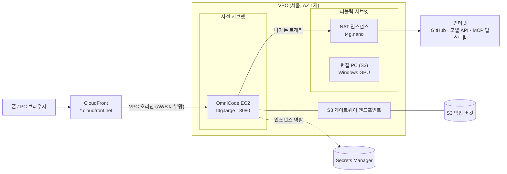
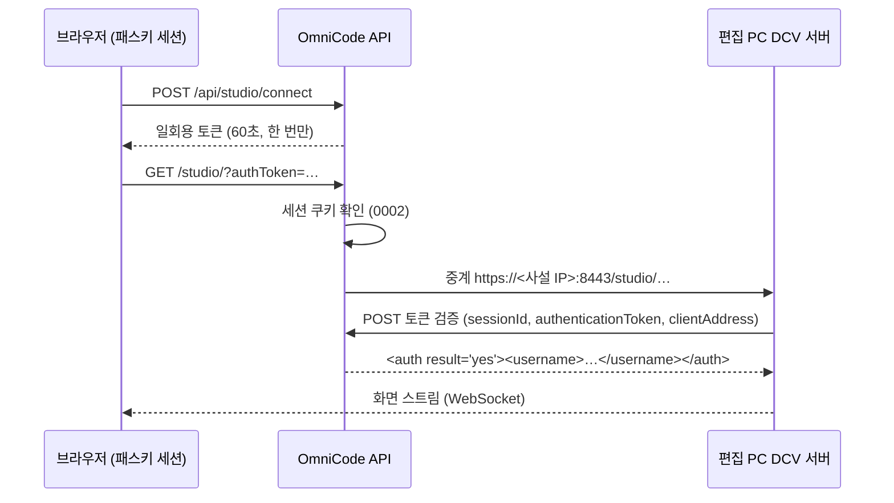

# 0003. AWS 작업 공간 — 본체 배포, 영상 편집 PC, iOS 빌드

| 항목 | 내용 |
|---|---|
| 상태 | 초안 (v0.1) — 구현 전 |
| 작성일 | 2026-10-17 |
| 작성 | @minBuild |
| 관련 | [0001 MCP 화면 관리](0001-mcp-management.md) 8.3·17·19장, [0002 로그인과 재인증](0002-auth.md) 5.1·7장, [핸드오프 0001](../handoff/0001-mcp-remaining-work.md) A2·A4 |
| 전제 | 배포 1개 = 사용자 1명, 각자 자기 개인 AWS 계정. 리전은 서울(`ap-northeast-2`). 에이전트 구독, Adobe Creative Cloud, Apple Developer Program은 사용자가 이미 가지고 있다 |
| 읽는 순서 | 1 → 4 → 5장, 그다음 진행할 단계의 장 (6~10) |

---

## 1. 요약

- **OS 하나에 모든 작업을 담지 않는다.** 에이전트 CLI와 Hub는 Linux, Premiere Pro는 Windows나 macOS, Xcode는 macOS에서만 돈다. OmniCode 화면은 이 컴퓨터들을 켜고 끄고 화면을 띄워 주는 **시작 화면 겸 원격 화면**이 된다.
- **본체(S1)는 항상 켜 둔다.** 서울 리전 Linux EC2 한 대(`t4g.large`)를 사설 서브넷에 두고 CloudFront VPC 오리진으로만 들어오게 한다. Terraform으로 만들고 지운다. 월 약 $75.
- **iOS 빌드(S2)는 Mac을 빌리지 않는다.** 에이전트가 GitHub에 올리면 Xcode Cloud가 빌드·서명해 TestFlight로 보낸다. 서명 자격 증명은 에이전트에 닿지 않는다. Apple Developer Program 멤버십에 월 25시간이 포함된다.
- **영상 편집 PC(S3)는 쓸 때만 켠다.** 서울 Windows GPU EC2에서 Premiere Pro를 돌리고, Amazon DCV 화면을 OmniCode와 같은 출처(`/studio/`)로 중계해 화면 안에 띄운다. 들어가는 문은 패스키 세션 하나다. Windows Server는 Premiere의 공식 지원 OS가 아니므로 수동 시험(8.6)을 통과해야 착수한다.
- **화면에서 개발 명령을 내리는 기능(러너, S4)은 아직 없다.** 별도 설계(0004)로 다룬다.
- 비용 때문에 S1 → S2 → S3 → S4 순서로 하나씩 한다.

---

## 2. 배경

이 설계가 겨냥하는 사용자의 하루 작업은 세 갈래다.

1. 코딩 에이전트(Claude Code 등)로 개발하고 GitHub에 올린다.
2. Premiere Pro로 영상을 편집한다.
3. Xcode로 iOS 앱을 빌드해 TestFlight로 보내고 폰에서 확인한다.

이 모두를 폰이나 아무 PC의 브라우저에서 OmniCode 화면 하나로 이어 가고 싶다.

현재 OmniCode는 MCP Hub와 패스키 로그인까지 구현됐고(0001, 0002), 실제 AWS 배포와 실환경 검증이 남아 있다(핸드오프 A2·A4). 저장소에는 설치·배포 스크립트, systemd 유닛, IAM 정책, CloudFront 문서가 있지만 **AWS 자원을 만드는 코드(IaC)는 없다.** 에이전트 러너는 0001에서 비목표로 남겨 두었다.

---

## 3. 목표 / 비목표

### 목표

- **W1.** 개인 AWS 계정에 본체를 코드로 만들고 지울 수 있다. 실제 값(계정, 메일 주소, 도메인)은 `infra/local/`에만 둔다.
- **W2.** 상시 비용은 본체만 낸다 (월 $100 이하). GPU와 Mac은 쓴 시간만큼만 낸다. 예산 알림을 가장 먼저 만든다.
- **W3.** 인터넷에 직접 열린 포트가 없다. 들어오는 길은 CloudFront 하나, 관리는 SSM으로 한다.
- **W4.** 편집 PC 화면도 OmniCode 패스키 세션으로만 열린다. 비밀번호를 따로 쓰거나 포트를 열지 않는다.
- **W5.** iOS 서명 인증서와 App Store Connect 키는 에이전트(`omniagent`)에 닿지 않는다 (0001 G4와 같은 원칙).
- **W6.** 단계마다 따로 켜고 끈다. 편집 PC나 Mac이 없어도 본체는 그대로 동작한다.

### 비목표

- 여러 사용자, 공유 배포
- 에이전트 러너 설계 — 0004에서 다룬다. 이 문서는 접점만 적는다 (10장)
- 원격 데스크톱 프로토콜 직접 구현 — Amazon DCV를 쓴다
- 미디어 자산 관리, 공동 편집, 렌더 팜

---

## 4. 작업별 실행 위치

| 작업 | 필요한 OS | 선택 | 버린 대안 |
|---|---|---|---|
| 에이전트 CLI, Hub, 화면 | Linux | 서울 EC2 `t4g.large` (Graviton, Ubuntu 24.04) | — |
| iOS 빌드 → TestFlight | macOS (Apple silicon) | **Xcode Cloud** | EC2 Mac (아래), GitHub Actions macOS 러너 (분당 과금이고 서명 비밀값을 저장소 쪽 CI에 둬야 한다) |
| Premiere Pro 편집 | Windows 10/11, macOS | 서울 **Windows Server GPU EC2 + Amazon DCV**, 쓸 때만 켬 | Amazon WorkSpaces (디렉터리 서비스가 필요하고 OmniCode 화면에 붙이기 어렵다), EC2 Mac (24시간 최소 과금, 서울에 Apple silicon이 없다) |
| Xcode 화면 작업 (시뮬레이터, 프리뷰, 디버거) | macOS | 필요한 날만 EC2 Mac — 나중에 결정 (9장) | — |

**EC2 Mac을 기본으로 두지 않는 이유.**

- Mac 인스턴스는 Dedicated Host에서만 돌고, 호스트를 할당하면 **최소 24시간** 요금이 나온다.
- 서울 리전의 Mac은 2018년 Intel Mac mini(`mac1`)뿐이다. Xcode 27(2026-09-14)은 macOS Tahoe 26.6 이상을 요구하는데, 2018년 Mac mini는 Tahoe를 지원하지 않는다. App Store Connect는 2026-04-28부터 Xcode 26 이상으로 만든 빌드만 받고, 이 요구 버전은 해마다 오른다. `mac1`은 곧 TestFlight에 올릴 수 없게 된다.
- 가장 가까운 Apple silicon은 싱가포르(`mac2`, M1)와 시드니(`mac2-m2`, `mac2-m2pro`, `mac-m4`)다. us-east-1 기준 M1이 시간당 $0.65, M4가 $1.23이라 한 번 할당하면 하루 $16~30이 나가고, 서울보다 지연도 크다.

---

## 5. 단계

| 단계 | 범위 | 완료 기준 | 비용 |
|---|---|---|---|
| **S1 본체** | Terraform(6.2), 설치·배포 스크립트, 첫 패스키, Phase 0 검증(0001 19.1 P2~P10·P12), 수용 테스트(0001 19.4) | 폰에서 로그인하고 세 CLI가 Hub 도구를 호출한다. 핸드오프 A2·A3·A4 완료 | 월 약 $75 (6.5) |
| **S2 iOS** | Xcode Cloud 워크플로, GitHub 연결, TestFlight 내부 테스트 | 에이전트가 push한 커밋이 TestFlight에 빌드로 도착한다 | $0 (월 25시간 안) |
| **S3 편집 PC** | 수동 시험(8.6) → Terraform 모듈 → OmniCode 켜기·끄기·열기 | 폰·PC에서 [열기] 한 번으로 Premiere 화면이 뜨고, GPU 가속과 하드웨어 인코딩이 동작한다 | 쓴 시간 × $0.95~1.57 + 디스크 (8.7) |
| **S4 러너** | 화면에서 개발 명령 (0004) | — | — |

요금은 모두 AWS 공개 가격표의 서울 온디맨드 가격(2026-10-15 게시)이다. EC2 Mac만 us-east-1 기준이다.

---

## 6. S1 — 본체

### 6.1 사람이 하는 일 (한 번)

본인 확인과 결제가 걸린 일이라 자동화하지 않는다.

1. **개인 AWS 계정 가입.** 요금제는 **Paid plan**을 고른다. 2025-07-15 이후 만든 계정의 Free plan은 6개월 뒤 만료되고 EC2를 작은 유형으로만 쓸 수 있어 `t4g.large`나 GPU 인스턴스를 띄울 수 없다. 두 플랜 모두 가입 크레딧을 준다.
2. **루트 계정 MFA.** 루트는 이후 쓰지 않는다.
3. **관리자 IAM 사용자.** 콘솔 로그인 + MFA, `AdministratorAccess` + `SignInLocalDevelopmentAccess`.
4. **로컬 로그인.** `aws login --profile omnicode` (AWS CLI 2.32 이상). 최대 12시간짜리 임시 자격 증명이라 장기 액세스 키를 만들지 않는다. Terraform은 `aws configure export-credentials --profile omnicode --format env`로 받은 환경변수로 실행한다.

S1이 끝날 때까지 사람이 할 일이 셋 더 있다: 폰에서 첫 패스키 등록(0002 5.1), 서버에서 세 CLI 로그인 승인(각자의 구독 계정), 에이전트용 GitHub 토큰 발급(6.4).

### 6.2 자원 (Terraform)

`infra/terraform/core/`에 둔다. 상태는 S3 백엔드(버전 관리를 켠 버킷, `use_lockfile = true`)에 두고, 그 버킷만 처음에 CLI로 만든다. 변수 값은 `infra/local/core.tfvars`(커밋되지 않음)에 둔다.



| 자원 | 설정 | 이유 |
|---|---|---|
| VPC | 서브넷 2개(사설·퍼블릭), AZ 1개, 인터넷 게이트웨이 | 단일 사용자라 다중 AZ가 필요 없다. VPC 오리진은 인터넷 게이트웨이가 붙은 VPC를 요구한다 |
| OmniCode EC2 | `t4g.large`(2 vCPU, 8 GiB), Ubuntu 24.04 arm64, gp3 50 GiB 암호화, **공인 IP 없음**, IMDSv2 필수·hop limit 1 | 0001 17.6의 4단계(IMDSv2)를 시작 시점에 적용한다 |
| 보안 그룹 | 인바운드는 8080/TCP 하나, 출처는 `com.amazonaws.global.cloudfront.origin-facing` 프리픽스 목록. SSH 없음 | CloudFront 말고는 들어올 길이 없다 |
| CloudFront | VPC 오리진(인스턴스의 사설 DNS 이름, HTTP 8080). 동작은 [`infra/cloudfront/README.md`](../../infra/cloudfront/README.md) 그대로, 엣지 함수 없음 | 오리진 구간이 공용 인터넷을 지나지 않아 오리진에 TLS 인증서가 필요 없다 |
| NAT 인스턴스 | `t4g.nano`, 퍼블릭 서브넷, 소스/대상 확인 끔, nftables 마스커레이드 | NAT 게이트웨이는 시간 요금만 월 $30을 넘는다 |
| S3 게이트웨이 엔드포인트 | 두 라우팅 테이블에 연결 | 무료. 백업과 (S3) 미디어 전송이 NAT를 거치지 않는다 |
| S3 백업 버킷 | SSE-S3, 퍼블릭 접근 차단, 버전 관리, 수명 주기 | [`infra/aws/iam-policy.json`](../../infra/aws/iam-policy.json)의 백업 버킷 |
| IAM 인스턴스 역할 | `infra/aws/iam-policy.json` (시크릿 ARN을 이 계정·리전으로 좁힘) + `AmazonSSMManagedInstanceCore` | SSH 대신 SSM으로 접속한다 |
| AWS Budgets | 월 예산(변수). 실제 50·80·100%, 예측 100%에서 메일 | 비용 사고를 먼저 막는다 |

**공개 주소.** 처음에는 CloudFront 기본 주소(`https://dxxxx.cloudfront.net`)를 `OMNICODE_PUBLIC_URL`로 쓴다. 패스키는 이 호스트에 묶이므로(0002 7장) 나중에 도메인을 붙이면 `auth reset`으로 패스키를 다시 등록하고, OAuth로 붙인 MCP 서버는 다시 로그인한다 (리다이렉트 URI와 CIMD 주소가 바뀐다). 배포를 지웠다 다시 만들면 주소가 바뀌므로 배포 자원에 `prevent_destroy`를 건다.

### 6.3 설치 순서

`terraform apply` 뒤 SSM Run Command로 실행한다.

1. 패키지: git, Node.js (CI와 같은 26), AWS CLI v2 (`omnicode-backup`이 쓴다), build-essential.
2. `git clone https://github.com/minBuild/omnicode.git /opt/omnicode`
3. `bash infra/install/mcp-feature.sh --public-url https://<배포 주소> --backup-bucket <버킷> --skip-aws`
   - IMDS 설정은 Terraform이 이미 했다. 인스턴스 역할에는 `ec2:ModifyInstanceMetadataOptions` 권한이 없으므로 `--skip-aws`로 그 단계를 건너뛴다.
4. `/etc/omnicode/omnicode.env`의 `OMNICODE_API_HOST`를 `0.0.0.0`으로 바꾼다. VPC 오리진이 사설 IP로 들어오기 때문이다.
   - `omniagent`의 API 포트 차단(0001 17.2)은 그대로 유효하다. 자기 사설 IP로 가는 패킷도 `lo`로 나간다.
   - 설치 스크립트에 `--api-host` 플래그를 추가해 이 단계를 없앤다.
5. `infra/bin/omnicode-deploy --no-restart`로 빌드 → `mcp-feature.sh … --start`로 agentd 소켓과 서비스를 시작한다.
6. 확인: `curl -s http://127.0.0.1:7410/healthz`, `infra/cloudfront/README.md`의 P8 명령 5개.
7. 첫 패스키: `sudo cat /var/lib/omnicode/setup-token` → 폰에서 `<배포 주소>/setup`.
8. `omniagent`로 세 CLI를 설치하고 로그인한다 (사람이 승인). 이어서 0001 19.1 P2~P4부터 검증한다.

### 6.4 GitHub 자격 증명

에이전트는 신뢰하지 않으므로(0001 7장) 에이전트가 쓰는 GitHub 자격 증명은 새어 나갈 수 있다고 본다.

- 저장소를 골라 준 **fine-grained 토큰**을 만료일과 함께 발급한다. 권한은 Contents(읽기·쓰기)와 Pull requests만 준다.
- **Workflows 권한은 주지 않는다.** CI 정의를 고쳐 다른 비밀값을 빼 가는 길을 막는다.
- 중요한 저장소는 `main`을 보호하고 PR로 받는다.

### 6.5 비용 (월 730시간)

| 항목 | 산정 | 월 |
|---|---|---|
| OmniCode EC2 `t4g.large` | $0.0832 × 730 | $60.7 |
| NAT 인스턴스 `t4g.nano` + 공인 IPv4 | ($0.0052 + $0.005) × 730 | $7.5 |
| EBS gp3 약 60 GiB | GiB당 약 $0.09 | $5.5 |
| Secrets Manager, S3, CloudFront | 시크릿 몇 개. 개인 사용량은 CloudFront 무료 한도 안 | $1~3 |
| **합계** | | **약 $75** |

`t4g`는 버스트형이다. 빌드가 길게 이어져 CPU 크레딧이 바닥나면 추가 요금이 붙는다. 그런 일이 잦으면 `m7g.large`(시간당 $0.1003)로 바꾼다.

---

## 7. S2 — iOS 빌드 (Xcode Cloud)

### 7.1 흐름

```
에이전트(Linux)가 Swift 코드를 고치고 GitHub에 push
  → Xcode Cloud: 아카이브, Apple이 관리하는 인증서로 서명
  → TestFlight 내부 테스트 그룹 → 폰에서 확인
```

### 7.2 설정 (한 번, Mac에서)

1. Xcode에서 Product → Xcode Cloud → Create Workflow. Xcode Cloud의 GitHub 앱에는 해당 저장소만 허용한다.
2. 시작 조건은 `main` 변경(또는 태그). 동작은 Archive(iOS), 후속 동작은 TestFlight 내부 테스트.
3. **워크플로 환경변수에 비밀값을 두지 않는다.** 저장소의 `ci_scripts/`는 에이전트가 고칠 수 있고, 그 스크립트는 빌드 안에서 환경변수를 읽을 수 있다.

### 7.3 한계와 보완

- Linux에서는 iOS 타깃을 컴파일할 수 없다. 에이전트는 컴파일 오류를 Xcode Cloud 결과에서야 안다.
- 플랫폼에 묶이지 않는 로직은 Swift 패키지로 떼어 내 본체에서 `swift build`·`swift test`로 돌린다 (Swift는 Ubuntu arm64를 지원한다).
- 빌드 결과를 에이전트가 직접 읽으려면 App Store Connect API 키가 필요하다. 키를 에이전트에 주지 않고 **Hub가 키를 들고 읽기 도구(빌드 상태, 이슈)만 노출**하는 방식을 검토한다 (미결 5).
- 월 25시간을 넘으면 Apple의 유료 구간을 쓰거나 9.3의 Mac 빌드 노드로 간다.

---

## 8. S3 — 영상 편집 PC

### 8.1 구성

| 항목 | 설정 |
|---|---|
| 인스턴스 | 기본 `g6.2xlarge` (8 vCPU, 32 GiB, NVIDIA L4 24 GB). 변수로 `g4dn.2xlarge`(T4 16 GB), `g6f.2xlarge`(L4의 1/4, 6 GB) |
| OS | Windows Server 2022 또는 2025 (라이선스 포함). 수동 시험(8.6)으로 정한다 |
| 드라이버 | AWS가 EC2용으로 제공하는 NVIDIA GRID 드라이버. 데이터센터용 드라이버는 쓰지 않는다 (8.5) |
| 디스크 | C: gp3 100 GiB, D: gp3 300 GiB (프로젝트·미디어·캐시). 인스턴스를 꺼도 남는다 |
| 위치 | 퍼블릭 서브넷. 켜져 있을 때만 공인 IP가 붙고 나가는 트래픽에만 쓴다. 인바운드는 OmniCode EC2에서 오는 8443/TCP 하나 |
| 원격 화면 | Amazon DCV 서버 (EC2에서는 추가 요금 없음). `web-url-path=/studio`, `web-x-frame-options=SAMEORIGIN`, `auth-token-verifier`는 OmniCode |
| 기본 상태 | 꺼짐 (Terraform `aws_ec2_instance_state`) |
| 관리 접속 | SSM. RDP 포트를 열지 않는다 |

### 8.2 화면 띄우기 — 같은 출처 중계 + DCV 외부 인증



- **같은 출처.** 브라우저는 OmniCode 주소만 본다. 편집 PC에는 공개 주소도 공인 인증서도 필요 없고, CloudFront는 WebSocket을 그대로 넘긴다. DCV 화면은 `SAMEORIGIN` iframe으로 OmniCode 화면 안에 띄운다.
- **문은 하나.** `/studio/*` 중계는 API가 세션 쿠키를 확인한 뒤에만 연다 (0002의 "API가 유일한 인증 경계"). DCV 자체 인증은 API가 발급한 일회용 토큰으로 한다. 검증 엔드포인트는 사설 인터페이스에서만 듣고, 편집 PC의 사설 IP에서 온 요청만 받는다. 보안 그룹도 그 포트를 편집 PC에만 연다.
- **에이전트 차단.** `omniagent`에서 편집 PC 8443과 검증 포트로 가는 연결을 iptables owner 규칙으로 막는다 (`omnicode-imds-guard` 확장).
- **중계 구간 인증서.** 설치할 때 DCV용 자체 인증서를 만들어 두고, API가 그 지문을 고정해 검증한다.
- **QUIC은 쓰지 않는다.** CloudFront를 지나므로 WebSocket(TCP)만 쓴다. 손실이 많은 망에서 끊김이 보이면 다시 판단한다 (미결 3).

### 8.3 켜기·끄기와 자동 종료

- API: `GET /api/studio` (상태, 이번 달 사용 시간, 예상 비용), `POST /api/studio/start`, `POST /api/studio/stop`, `POST /api/studio/connect`.
- 인스턴스 역할에 이 인스턴스 하나에 대한 `ec2:StartInstances`·`ec2:StopInstances`와 `ec2:DescribeInstances`를 더한다. `omniagent`는 IMDS가 막혀 있어(0001 17.2) 이 권한을 쓸 수 없다.
- **유휴 자동 종료.** DCV `idle-timeout`으로 유휴 연결을 끊는다. 편집 PC의 예약 작업이 DCV 연결 없는 상태가 30분 이어지면 인스턴스를 끈다 (종료 동작 = 중지). API는 하루 최대 사용 시간을 따로 강제한다.
- 화면: `/studio` 페이지에 상태, [켜기]·[열기]·[끄기], 이번 달 사용 시간과 비용, 자동 종료 설정을 둔다.

### 8.4 라이선스

- **Windows.** EC2의 Windows Server 라이선스는 시간당 요금에 포함된다. 공유 테넌시에서는 Windows 11을 쓸 수 없다 (BYOL과 전용 하드웨어가 필요하다).
- **Adobe.** 개인 플랜은 여러 대에 설치할 수 있지만 동시에 로그인할 수 있는 건 두 대까지다. 편집 PC가 한 자리를 쓴다. Adobe의 지원 문서는 AWS 같은 가상 환경에서 Creative Cloud 앱을 쓰는 것을 허용하되 지원은 최선 노력 수준이고 환경 검증은 사용자 몫이라고 적는다. 이 문서는 기업용이라 개인 플랜에 그대로 적용되는지는 명시돼 있지 않다.

### 8.5 위험

- **Premiere의 공식 지원 OS는 Windows 10/11이다.** Windows Server는 목록에 없다. Windows Server 2019 + T4 + 데이터센터용 드라이버 조합에서 하드웨어 인코딩이 안 되고 "지원하지 않는 시스템"으로 표시된 사례가 있다 (2023, Adobe 커뮤니티). GRID 드라이버와 최신 Windows Server로 시험하기 전에는 S3 구현을 시작하지 않는다.
- **원본 영상을 클라우드로 옮겨야 한다.** AWS로 올리는 트래픽은 무료다. 인터넷으로 내려받는 트래픽은 무료 한도(EC2·S3 합산 월 100 GB, CloudFront 월 1 TB)를 넘으면 GB당 요금이 붙는다. 전송 방법은 미결 4.
- **GPU 한도.** 새 계정은 "Running On-Demand G and VT instances" 한도가 0일 수 있다. 8 vCPU 이상으로 미리 요청한다.

### 8.6 수동 시험 (S3 착수 조건)

1. G·VT 한도 증가를 요청한다.
2. `g6.2xlarge` Windows Server를 띄우고 GRID 드라이버와 DCV를 설치한다. 시험하는 동안만 보안 그룹을 내 IP에 연다.
3. Creative Cloud와 Premiere Pro를 설치하고 로그인한다.
4. 확인: 실행할 때 차단이 없는지, 렌더러가 GPU 가속(CUDA)인지, H.264 하드웨어 인코딩으로 내보내지는지, 4K 타임라인이 1/2 해상도로 끊김 없이 재생되는지, DCV 반응 속도.
5. 같은 절차를 `g6f.2xlarge`로 반복해 비용 대비 성능을 본다.
6. 결과를 이 절에 적고 인스턴스 유형과 Windows Server 버전을 정한다. 시험 비용은 약 $3~5.

### 8.7 비용

| 인스턴스 (Windows) | 사양 | 시간당 | 월 40시간 |
|---|---|---|---|
| `g6f.2xlarge` | 8 vCPU, 32 GiB, L4 1/4 (6 GB) | $0.952 | $38 |
| `g4dn.2xlarge` | 8 vCPU, 32 GiB, T4 16 GB | $1.293 | $52 |
| `g6.2xlarge` | 8 vCPU, 32 GiB, L4 24 GB | $1.570 | $63 |

디스크 400 GiB는 꺼져 있어도 월 약 $36이 나간다. 켜져 있는 동안은 공인 IPv4 요금(시간당 $0.005)이 붙는다.

---

## 9. Mac (선택, 나중에)

### 9.1 언제 필요한가

Xcode Cloud로 부족할 때다. 시뮬레이터·SwiftUI 프리뷰·디버거 같은 화면 작업이 필요하거나, 에이전트가 `xcodebuild`로 직접 빠르게 확인해야 할 때.

### 9.2 제약

- Apple silicon만 쓴다 (4장). 서울 `mac1`은 쓰지 않는다.
- DCV는 2025-11부터 Apple silicon EC2 Mac을 지원하므로 8.2와 같은 방식으로 띄울 수 있다. 다만 다른 리전이라 중계 경로(VPC 피어링 등)를 따로 설계해야 한다.
- 최소 24시간 과금이므로 "Mac 쓰는 날" 단위로 할당하고 반납한다.

### 9.3 빌드 노드로 쓸 때

에이전트가 SSH로 Mac에서 빌드하게 하면 Mac에 둔 자격 증명이 에이전트 쪽에 노출된다. 빌드 노드에는 서명 자격 증명을 두지 않고 컴파일과 테스트만 맡긴다. 배포용 서명은 Xcode Cloud에 남긴다.

---

## 10. S4 — 러너와의 접점

- 화면에서 개발 명령을 내리는 기능은 0004에서 설계한다. 요구 사항: `omniagent`로 실행, `OMNICODE_JOB_ID`와 Hub 토큰 환경변수 주입(0001 8.3·12.6), 출력 스트리밍(WebSocket — CloudFront가 그대로 넘긴다), GitHub push는 6.4의 토큰으로.
- 그 전에는 SSM 세션으로 본체에 들어가 CLI를 직접 쓴다.

---

## 11. 결정 기록

| # | 결정 | 대안 | 이유 |
|---|---|---|---|
| D1 | AWS 자원은 Terraform으로 만든다 (`infra/terraform/`) | 콘솔, CloudFormation, CDK | 다시 만들고 지우기 쉽다. `.gitignore`가 이미 Terraform 상태·변수 파일을 막고 있다 |
| D2 | 서울 리전, AZ 1개 | 다중 AZ | 사용자가 한국에 있다. 단일 사용자라 가용성보다 비용이 중요하다 |
| D3 | 본체는 `t4g.large` + Ubuntu 24.04 arm64 | `m7g.large`, Amazon Linux 2023 | 8 GiB 중 가장 싸다. 세 CLI 모두 arm64를 지원한다. Ubuntu는 NodeSource로 systemd 유닛이 기대하는 `/usr/bin/node`를 맞추기 쉽다 |
| D4 | 본체는 사설 서브넷 + CloudFront VPC 오리진 | 공인 IP + CloudFront 프리픽스 목록, Tailscale 전용 | 오리진 구간이 공용 인터넷을 지나지 않아 오리진 TLS가 필요 없고, 인터넷에서 직접 닿을 수 없다. Tailscale 전용은 모든 기기에 앱이 필요하고 CIMD를 꺼야 한다 (0001 19.2.1) |
| D5 | 나가는 트래픽은 NAT 인스턴스 (`t4g.nano`) | NAT 게이트웨이 | NAT 게이트웨이는 본체 요금의 절반을 넘는다. 단일 사용자에게 NAT 장애는 감수할 만하다 |
| D6 | 관리 접속은 SSM | SSH | 열린 포트가 없다 |
| D7 | 처음엔 CloudFront 기본 주소 | 처음부터 도메인 구입 | 비용. 바꿀 때 패스키 재등록과 MCP OAuth 재로그인이 필요하다는 점은 감수한다 |
| D8 | 로컬 자격 증명은 `aws login` 임시 자격 증명 | IAM 액세스 키 | 장기 키가 남지 않는다 |
| D9 | iOS 빌드·배포는 Xcode Cloud | EC2 Mac, GitHub Actions macOS | 멤버십에 포함되고 서명이 Apple 쪽에 남는다. EC2 Mac은 4장의 이유로 기본값에서 뺀다 |
| D10 | Xcode Cloud 워크플로에 비밀값 환경변수를 두지 않는다 | 필요한 키를 환경변수로 | `ci_scripts/`를 에이전트가 고칠 수 있다 |
| D11 | 편집 PC는 Windows Server GPU EC2 + DCV, 쓸 때만 켬 | WorkSpaces, EC2 Mac, 집 PC 원격 | 시간 단위 과금, 서울 리전, OmniCode에서 켜고 끄기 쉽다 |
| D12 | DCV는 OmniCode 같은 출처 중계 + 외부 인증 토큰 | DCV를 공개 주소로 열기 | 문이 패스키 세션 하나로 남고, 편집 PC에 공인 인증서와 인바운드 포트가 필요 없다 |
| D13 | 에이전트용 GitHub 자격 증명은 저장소 범위 fine-grained 토큰, Workflows 권한 없음 | 계정 전체 토큰, SSH 키 | 새어 나가도 피해가 고른 저장소에 머물고, CI 비밀값으로 번지지 않는다 |

---

## 12. 미결 사항

1. **도메인** — 언제, 어떤 이름으로 바꿀지. 바꾸는 절차(패스키 재등록, OAuth 재로그인)를 스크립트로 둘지.
2. **Windows Server 위의 Premiere** — 8.6 결과. 안 되면 대안은 EC2 Mac(Apple silicon, 9장) 위의 Premiere 또는 WorkSpaces.
3. **DCV 중계 품질** — CloudFront와 API 중계를 지나는 WebSocket만으로 편집에 충분한지. 부족하면 DCV Connection Gateway를 검토한다.
4. **미디어 전송** — S3 (화면에서 미리 서명한 업로드 URL 발급) vs DCV 파일 전송 vs 클라우드 드라이브 동기화.
5. **빌드 결과 읽기 도구** — App Store Connect API 키를 Hub에만 두고 읽기 전용 MCP 도구로 노출할지 (7.3).
6. **러너** — 0004.
7. **본체 크기** — `t4g.large`의 CPU 크레딧이 버티는지 S1 뒤 한 달 지켜본다.

---

## 13. 참고 자료

- AWS — EC2 리전별 인스턴스 유형: <https://docs.aws.amazon.com/ec2/latest/instancetypes/ec2-instance-regions.html>
- AWS — CloudFront VPC 오리진: <https://docs.aws.amazon.com/AmazonCloudFront/latest/DeveloperGuide/private-content-vpc-origins.html>
- AWS — 콘솔 자격 증명으로 CLI 로그인 (`aws login`): <https://docs.aws.amazon.com/cli/latest/userguide/cli-configure-sign-in.html>
- AWS — Amazon DCV 외부 인증: <https://docs.aws.amazon.com/dcv/latest/adminguide/external-authentication.html>
- AWS — Amazon DCV 서버 설정 값: <https://docs.aws.amazon.com/dcv/latest/adminguide/config-param-ref.html>
- AWS — Windows DCV 서버의 EC2 요구 사항: <https://docs.aws.amazon.com/dcv/latest/adminguide/setting-up-installing-winprereq.html>
- AWS — DCV의 EC2 Mac 지원 (2025-11): <https://aws.amazon.com/about-aws/whats-new/2025/11/amazon-dcv-ed2-mac-instances>
- AWS — Dedicated Host 요금 (Mac 24시간 최소): <https://aws.amazon.com/ec2/dedicated-hosts/pricing/>
- Adobe — 가상·서버 환경 지원 범위: <https://helpx.adobe.com/enterprise/kb/technical-support-boundaries-virtualized-server-based.html>
- Adobe — 이용약관: <https://www.adobe.com/legal/terms.html>
- Apple — Xcode Cloud: <https://developer.apple.com/xcode-cloud/>
- Xcode 27 시스템 요구 사항 (릴리스 노트 인용): <https://mjtsai.com/blog/2026/09/15/xcode-27/>
- 2025-07 AWS 무료 플랜 변경: <https://dev.classmethod.jp/en/articles/try-new-aws-free-tier-2025/>
- EC2 Mac 요금 (us-east-1, 2026-07): <https://dev.classmethod.jp/en/articles/ec2-mac-m3ultra-metal-pricing-api/>
- 그 밖의 요금: AWS 공개 가격표, 서울 온디맨드 (2026-10-15 게시)

---

## 변경 이력

| 날짜 | 내용 |
|---|---|
| 2026-10-17 | 초안 |
